# Module 01 — Concepts: Introduction to Microsoft Copilot Studio

> [!NOTE]
> **Product snapshot: November 2026.** Copilot Studio changes every month. This lesson reflects Microsoft Learn as of 18 November 2026. Before you rely on a detail in production, check [What's new in Copilot Studio](https://learn.microsoft.com/en-us/microsoft-copilot-studio/whats-new).

## How every lesson is structured

Each lesson follows the same 11-part teaching sequence. This makes it easy to revise and to find things later.

| # | Part | What you get |
|---|---|---|
| 1 | What is it? | A plain-language definition, then a professional one |
| 2 | Why is it needed? | The business or technical problem it solves |
| 3 | How does it work? | The mechanics, usually with a Mermaid diagram |
| 4 | When should it be used? | Good fits, poor fits, and alternatives |
| 5 | Step-by-step | Where to see or configure it in Copilot Studio |
| 6 | Practical example | A small, concrete example |
| 7 | Real-world enterprise scenario | How an organization applies it at scale |
| 8 | Common mistakes | What beginners (and professionals) get wrong |
| 9 | Troubleshooting | Symptom → cause → fix |
| 10 | Interview questions | Typical questions with model answers |
| 11 | Assessment | A quick knowledge check (answers are hidden) |

**Feature status legend** used throughout the course: 🟢 **GA** (generally available) · 🧪 **Preview** (includes Microsoft's "production-ready preview") · ⚠️ **Deprecated** · ⛔ **Retired** · 💳 **Licensing/Region** (subject to licensing, billing, cloud, or regional limits).

## Lessons in this module

1. [What is Microsoft Copilot Studio?](#lesson-1-what-is-microsoft-copilot-studio)
2. [Harnesses and the new vs. classic experience](#lesson-2-harnesses-and-the-new-vs-classic-experience)
3. [Evolution from Power Virtual Agents](#lesson-3-evolution-from-power-virtual-agents)
4. [Copilot Studio vs. Microsoft Copilot](#lesson-4-copilot-studio-vs-microsoft-copilot)
5. [Copilot Studio vs. Microsoft 365 Copilot](#lesson-5-copilot-studio-vs-microsoft-365-copilot)
6. [Copilot Studio vs. traditional chatbots](#lesson-6-copilot-studio-vs-traditional-chatbots)
7. [AI agents and autonomous agents](#lesson-7-ai-agents-and-autonomous-agents)
8. [Generative AI fundamentals](#lesson-8-generative-ai-fundamentals)
9. [Large language models (LLMs)](#lesson-9-large-language-models-llms)
10. [Natural language processing (NLP)](#lesson-10-natural-language-processing-nlp)
11. [Agent architecture](#lesson-11-agent-architecture)
12. [Enterprise use cases](#lesson-12-enterprise-use-cases)
13. [Licensing fundamentals](#lesson-13-licensing-fundamentals)

---

## Lesson 1: What is Microsoft Copilot Studio?

### What is it?

**Beginner view:** Copilot Studio is a website where you build your own AI assistants, called **agents**. You tell an agent what its job is, connect it to the information it needs, and give it tools to take actions. Then you test it and make it available where people already work, such as Microsoft Teams, Microsoft Copilot, or a website.

**Professional view:** Microsoft describes Copilot Studio as *"a graphical, low-code studio for building and managing AI-powered agents and workflows."* It brings agent creation, workflow automation, testing, publishing, analytics, evaluation, and administration into one studio. That studio runs on top of the Microsoft Power Platform (environments, Dataverse, connectors, and solutions).

The overview page lists three **building blocks** under *What you can build*:

| Building block | What it is | Notes |
|---|---|---|
| **Agents** | An AI assistant that handles conversations and completes tasks. It follows your instructions, draws on the knowledge you connect, and uses tools to act. | Available on all three harnesses (see [Lesson 2](#lesson-2-harnesses-and-the-new-vs-classic-experience)). |
| **Workflows** | Automations built in a drag-and-drop designer, where each step can reason and act. They include built-in testing and human-in-the-loop controls. | Part of the new experience (Microsoft Copilot harness). |
| **Agent flows** | The established flow format in Copilot Studio. It feels similar to Power Automate but is native to Copilot Studio, and runs standalone or as a tool for an agent. | Used with the standard harness. Agent flows can run prompts, call agents, and include human review steps. |

Two related experiences are called out separately on the same page:

| Experience | What it is | Notes |
|---|---|---|
| **App creation (Apps)** | An app creation experience inside Copilot Studio | 🧪 **Preview**, mentioned in a separate note rather than as a building block |
| **Build with natural language** | Describe a business goal, and Copilot Studio proposes and builds the right mix of agents and workflows | 🧪 **Preview** |

### Why is it needed?

Organizations want AI that answers questions *from their own content* and *takes action in their own systems*, and they want it safely. Doing that from scratch takes developers, infrastructure, security reviews, and ongoing operations. Copilot Studio tackles this in four ways:

- **Speed:** you can create an agent by describing it in plain language, then refine it.
- **Reach:** subject-matter experts (HR, IT, customer service) can build without deep coding skills, while professional makers still get depth. Microsoft's Application Card describes the aim as making *"advanced artificial intelligence accessible to a wide range of users, from business analysts and IT professionals to developers."*
- **Integration:** it connects to data and systems through prebuilt or custom connectors, plus other tool types.
- **Governance:** it inherits Power Platform administration, such as environments, data policies, and security roles, and adds agent inventory, analytics, and evaluations.

### How does it work?

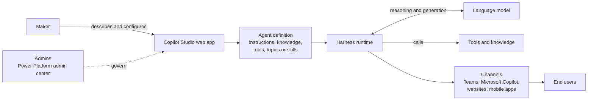

1. A **maker** signs in at `https://copilotstudio.microsoft.com` and creates an agent, either by describing it or from a blank start.
2. The agent's **definition** (instructions, knowledge, tools, conversation logic) is stored in a Power Platform **environment**. Agents are solution-aware: you can choose the solution and schema name when you create one.
3. At runtime, a **harness** (the engine behind the agent) decides when to call the **language model**, what context to send it, and which tools to call.
4. The agent is **published** to one or more **channels**, where users talk to it. Some agents are also triggered by events (see [Lesson 7](#lesson-7-ai-agents-and-autonomous-agents)).
5. Makers and admins **monitor** usage and quality, **evaluate** with test sets, and **govern** the agent in the Power Platform admin center.

### When should it be used?

| Use Copilot Studio when… | Consider something else when… |
|---|---|
| You need an agent grounded in organizational knowledge, with actions in business systems | A single user just needs a quick personal or team helper over Microsoft 365 content. Agent Builder in Microsoft 365 Copilot may be enough (see [Lesson 5](#lesson-5-copilot-studio-vs-microsoft-365-copilot)). |
| You need multiple channels, including external customers | You need full source-code control of every layer. That is a pro-code route, out of scope for this course. |
| You need environment-based governance, ALM, analytics, and evaluations | The scenario is medical diagnosis, treatment, or emergencies. Microsoft states Copilot Studio isn't intended for these uses. |

### Step-by-step: open Copilot Studio and orient yourself

1. Use a supported, up-to-date browser: Microsoft Edge or Chrome 122+, Firefox 127+, or Safari 17+.
2. Go to `https://copilotstudio.microsoft.com` and sign in with a **work or school** account.
3. If you don't have access yet, sign up for the trial. See [Lesson 13](#lesson-13-licensing-fundamentals) and [Module 03](../03-Environment-and-Setup/README.md).
4. You land on the **Home** page. Notice that you can describe what you want to build, or start an **Agent** directly.
5. Notice the side pane entries such as **Agents** and **Workflows**. These are the lists of things you have built.
6. Don't build anything yet. The guided exploration is in the [lab](STEP-BY-STEP-LAB.md).

> [!TIP]
> The current Home page has screenshots in [Overview – Microsoft Copilot Studio](https://learn.microsoft.com/en-us/microsoft-copilot-studio/fundamentals-what-is-copilot-studio). This course deliberately includes no screenshots, because the UI changes frequently.

### Practical example

*"Employees keep asking IT how to reset passwords and request software."* Here is how that maps to Copilot Studio building blocks:

| Need | Building block |
|---|---|
| Answer "How do I reset my password?" from the IT knowledge base | Agent + **knowledge** (for example, a SharePoint site) |
| Request software | Agent **tool** that creates a ticket (for example, a connector or an agent flow) |
| Available in Teams | Publish to the **Microsoft Teams** channel |
| Prove value | **Monitor** page metrics plus **evaluations** before go-live |

### Real-world enterprise scenario

A global manufacturer with 40,000 employees launches an **HR self-service agent** in Microsoft Teams.

- The HR team writes the instructions and connects the HR policy SharePoint site as knowledge.
- IT adds a tool that opens an HR case when the agent can't help.
- The Power Platform admin applies data policies and restricts sharing to the HR security group.
- After launch, HR reviews the **Monitor** page weekly and adds missing content.

The result is fewer repetitive tickets, and HR specialists can spend their time on complex cases.

### Common mistakes

- Treating Copilot Studio as "just a chatbot builder" and ignoring tools, autonomy, workflows, and governance.
- Assuming it is the same product as Microsoft 365 Copilot (see Lessons [4](#lesson-4-copilot-studio-vs-microsoft-copilot) and [5](#lesson-5-copilot-studio-vs-microsoft-365-copilot)).
- Starting to build before defining the agent's purpose, users, knowledge, and success metrics.
- Ignoring the environment and licensing until publishing day.

### Troubleshooting

| Symptom | Likely cause | Fix |
|---|---|---|
| Sign-up rejects your email | You used a personal email address | Use a work or school account |
| "Sign-up couldn't be completed" | Your admin disabled self-service sign-up | Ask the admin to enable sign-up or assign a license |
| The UI doesn't match a tutorial | New vs. classic experience, or a staged rollout. Releases roll out over several days. | Check which experience you're in ([Lesson 2](#lesson-2-harnesses-and-the-new-vs-classic-experience)) and compare with the current Microsoft Learn article |
| Pages render incorrectly | Unsupported or outdated browser | Update to a supported browser version |

### Interview questions

1. **Explain Copilot Studio to a business stakeholder in 60 seconds.**
   *Model answer:* It's Microsoft's low-code studio for building AI agents and workflows. You describe what the agent should do, connect it to company knowledge and systems, test it, and publish it to Teams, Microsoft Copilot, or websites. IT can govern it with Power Platform controls and monitor it with built-in analytics.
2. **Name the main building blocks in Copilot Studio today.**
   *Model answer:* The overview page lists three: agents, workflows, and agent flows. It also mentions an app creation experience (preview) and building with natural language (preview). They can work together; for example, a workflow can call an agent.

### Assessment (knowledge check)

1. Which phrase best matches Microsoft's definition of Copilot Studio? (a) A Teams-only chatbot designer (b) A graphical, low-code studio for building and managing AI-powered agents and workflows (c) A large language model (d) A replacement for Microsoft 365
2. True or false: you sign in to Copilot Studio with a personal Microsoft account to start a trial.
3. Name the three building blocks listed under *What you can build* on the Copilot Studio overview page.

Show answers

1. **(b)**. Copilot Studio is a studio, not a model, and it isn't limited to Teams.
2. **False.** Use a work or school account; personal email addresses can be rejected.
3. Agents, workflows, and agent flows. The app creation experience (preview) is mentioned separately.

---

## Lesson 2: Harnesses and the new vs. classic experience

### What is it?

**Beginner view:** A **harness** is the "engine" that runs your agent behind the scenes. Copilot Studio has three engines, and each is good at different jobs.

**Professional view:** Microsoft Learn defines the harness as *"a runtime that exists between"* your design and the model. *"It determines when to call the model, what components to send it, interprets what comes back, and calls the right tools."* Your choice of harness affects how the agent reasons, which features you get, which channels you can publish to, and how usage is billed.

| Harness | Best for | How it works | Billing | Status |
|---|---|---|---|---|
| **Microsoft Copilot harness** | Complex, multistep business processes | Reasons through a goal step by step and recovers from failures. Natively creates and edits Word, Excel, PowerPoint, and PDF files. Supports skills and memory, and runs each task in a secure sandbox. | Usage-based Copilot Credits, **from the moment you start building** | 🧪 **Preview** ("production-ready preview" since June 2026). This is the default **new experience**. |
| **Customer Conversation harness** | Customer-facing voice and chat, contact centers | A primary agent works with specialized sub-agents, each with an escalation path to a human representative | Copilot Credits (usage-based) | 🧪 **Preview** (October 2026) |
| **Standard harness** | Rule-based agents, structured and repeatable conversations | Follows the topics, prompts, and paths you define. Can use generative orchestration and generative answers. | Standard licensing model. Billing starts after you publish. | 🟢 **GA**. Fully supported, no forced switch. Opened through the **classic experience**. |

### Why is it needed?

Different business problems need different trade-offs between **predictability** and **autonomy**:

- A benefits-policy agent should answer the same way every time. The **standard harness** gives you that control through topics.
- An accounts-payable process must read invoices, match purchase orders, and route exceptions. That needs multistep reasoning with tools and files, which is what the **Microsoft Copilot harness** offers.
- A contact center needs voice and chat with reliable escalation to people. The **Customer Conversation harness** is designed for that.

### How does it work?

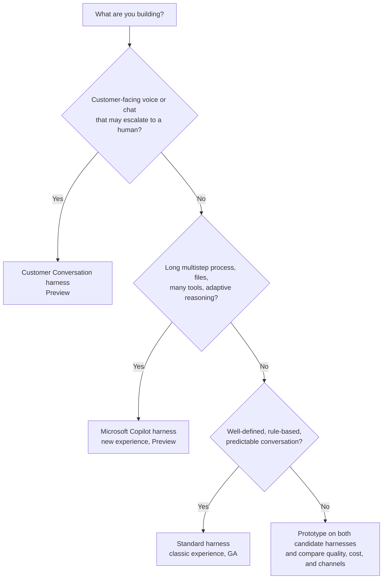

Key facts about how the experiences relate (verified November 2026):

- The **new experience** is the default Copilot Studio UI and creates Microsoft Copilot harness agents. You configure knowledge, tools, channels, and connected agents as components on the **Build** tab. Agent-level options are in the **Agent settings** dialog, which has the tabs **Agent details**, **AI & behavior**, **Safety & access**, and **Greeting & prompts**.
- The **classic experience** is where you build **standard harness** agents and **agent flows**. You can reach it in three ways: select the **…** menu at the bottom of the Home page side bar and choose **Open classic experience**, select **Other ways to build** on the Home page, or open an existing standard agent from the **Agents** list. Some older articles describe turning off a **New experience** toggle instead.
- Choosing the classic experience lasts for **your current session only**. There's no tenant-wide setting to make it the default.
- The Microsoft Copilot harness has **no topics**, no separate **prompts** feature, and no **child agents**. Instead it uses **skills**, **workflows**, and **connected agents**.
- Standard harness agents and Microsoft Copilot harness agents **cannot invoke each other directly** today.
- You can ask Copilot Studio to **upgrade** a standard agent to the Microsoft Copilot harness (🧪 **Preview**). The upgrade creates a copy and carries over instructions, tools, and suggested prompts. It doesn't migrate knowledge sources, Power Fx, or child agents, and it consumes credits.

> [!NOTE]
> Some Microsoft Learn pages and URLs still contain the string "GitHub Copilot harness", for example in page anchors and admin article URLs. Treat it as the same harness that the current [harness overview](https://learn.microsoft.com/en-us/microsoft-copilot-studio/harnesses-overview) calls the **Microsoft Copilot harness**. A few pages (for example, *Access standard harness agents and agent flows*) also mention a "Copilot chat" harness and "four harnesses", which have their own creation paths. This course follows the harness overview (updated 13 November 2026), which describes three harnesses for building in Copilot Studio.

### When should it be used?

| Scenario | Recommended harness | Why |
|---|---|---|
| Internal IT help desk answering common questions and routing simple requests | Standard | Predictable, topic-based, mature (GA) |
| Accounts payable: read invoices, match POs, route exceptions | Microsoft Copilot | Multistep reasoning, files, tool orchestration |
| Customer support line with phone number and website chat, escalation to representatives | Customer Conversation | Built for voice and chat with human escalation |
| Regulated disclosure wording that must never vary | Standard (topics with message nodes) | Deterministic responses |
| Learning the classic conversation-design skills taught in Modules 07–08 | Standard | Topics, nodes, variables, and entities exist only on the standard harness |

### Step-by-step: identify the experience you are in

1. Sign in to Copilot Studio.
2. On **Home**, look for the **Agent** tile and the **Build** tab when you open an agent. These belong to the new experience (Microsoft Copilot harness).
3. To reach the classic experience, select **…** at the bottom of the side bar, then **Open classic experience**. Your tenant may show a **New experience** toggle instead.
4. In the classic experience, open or create an agent. You'll see pages such as **Overview**, **Knowledge**, **Tools**, **Topics**, and **Settings**. These belong to the standard harness.
5. Write down which experience each of your agents uses. Mixing them up is the most common beginner confusion in 2026.

### Practical example

Your manager asks for "an agent that answers questions about our travel policy and never improvises."

- **Choose:** standard harness.
- **Why:** You can use generative answers grounded in the policy document, and for the few legally sensitive questions you can author topics with exact message text.
- **Avoid:** building on the Microsoft Copilot harness just because it's the default. It isn't the best fit for strictly scripted answers, and building and testing there already consumes credits.

### Real-world enterprise scenario

A bank runs three agent programs:

- **Employee policy assistant:** standard harness, GA, deterministic, published in Teams.
- **Loan-document processing:** Microsoft Copilot harness, piloted in a sandbox environment while it is in preview, with credit limits set per agent.
- **Card-services contact center:** Customer Conversation harness, evaluated in preview with a human-escalation path.

The architecture board records **why** each harness was chosen, along with its preview risks and its cost model.

### Common mistakes

- Assuming every Copilot Studio tutorial applies to every agent. Topics, for example, don't exist on the Microsoft Copilot harness.
- Not realizing that Microsoft Copilot harness **building and testing consume Copilot Credits**.
- Putting a preview harness into business-critical production without accepting preview terms and risks.
- Expecting a standard agent and a Microsoft Copilot harness agent to call each other.

### Troubleshooting

| Symptom | Likely cause | Fix |
|---|---|---|
| "I can't find **Topics**." | You're in the new experience (Microsoft Copilot harness) | Open the classic experience, or use skills and workflows instead |
| The classic experience "resets" next day | The choice applies to the current session only | Reopen it from **…** > **Open classic experience** each session |
| Credits are consumed during testing | Microsoft Copilot harness bills from build time | Test with a credit budget, or prototype on the standard harness |
| A connected agent can't be added | Cross-harness connection isn't supported | Keep both agents on the same harness |

### Interview questions

1. **What is a harness in Copilot Studio, and why does it matter?**
   *Model answer:* The harness is the runtime between your agent design and the model. It decides when to call the model, what to send, how to interpret the output, and which tools to call. It determines capabilities, channels, and billing. For example, the Microsoft Copilot harness bills from build time, while the standard harness bills after publish.
2. **When would you deliberately choose the standard harness in 2026?**
   *Model answer:* When I need predictable, rule-based conversations, topic-level control, or GA-only components, or a channel the newer harness doesn't support yet, and when I want to avoid build-time credit consumption.

### Assessment (knowledge check)

1. Which harness is designed for contact-center voice and chat with escalation to human representatives?
2. True or false: you can set the classic experience as the tenant-wide default.
3. Name two things that are *not* migrated when you upgrade a standard agent to the Microsoft Copilot harness.

Show answers

1. The **Customer Conversation harness** (🧪 Preview).
2. **False.** The choice applies to the current session only.
3. Any two of: knowledge sources, Power Fx expressions, child agents.

---

## Lesson 3: Evolution from Power Virtual Agents

### What is it?

**Beginner view:** Copilot Studio didn't appear from nowhere. It grew out of **Power Virtual Agents (PVA)**, Microsoft's no-code chatbot builder.

**Professional view:** PVA provided the conversational foundation (topics, trigger phrases, entities, and Power Automate integration). At Microsoft Ignite in November 2023, those capabilities became part of the new **Microsoft Copilot Studio**, which added generative AI. Since then the product has moved from scripted chatbots to AI **agents**, then to autonomy, and in 2026 to a multi-harness platform.

### Why is it needed?

Knowing the history helps you:

- Read older blogs, community posts, and videos correctly. "Bot", "copilot", "messages", and "PVA" are older terms.
- Understand why **topics, trigger phrases, and entities** still exist (on the standard harness).
- Plan migrations of **classic chatbots** that organizations still run.

### How does it work?

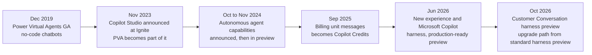

| Date | Milestone | Source |
|---|---|---|
| 2 Dec 2019 | Microsoft announces **general availability of Power Virtual Agents**, which lets anyone *"create powerful chatbots using a guided, no-code graphical interface."* | [Microsoft blog](https://www.microsoft.com/en-us/copilot/blog/copilot-studio/microsoft-power-virtual-agents-is-now-generally-available/) |
| 15 Nov 2023 | **Microsoft Copilot Studio** announced at Ignite. *"Power Virtual Agents has provided the foundations for and will become part of Copilot Studio."* Existing bots kept working. | [Microsoft blog](https://www.microsoft.com/en-us/copilot/blog/copilot-studio/microsoft-power-virtual-agents-now-part-of-microsoft-copilot-studio/) |
| 21 Oct 2024 | **Autonomous agent** capabilities announced. The 2023 launch spoke of building "copilots"; by now Microsoft speaks of building **agents**. | [Microsoft blog](https://www.microsoft.com/en-us/copilot/blog/copilot-studio/unlocking-autonomous-agent-capabilities-with-microsoft-copilot-studio/) |
| 19 Nov 2024 | Copilot Studio autonomous agents **in preview** (Ignite 2024) | [Power Platform blog](https://www.microsoft.com/en-us/power-platform/blog/2024/11/19/redefine-development-ai-first-innovation-with-agents-and-microsoft-copilot-in-power-platform/) |
| 1 Sep 2025 | The common currency changes from **messages** to **Copilot Credits**, with no change to pack quantities or the pay-as-you-go rate | [Standard harness licensing](https://learn.microsoft.com/en-us/microsoft-copilot-studio/billing-licensing) |
| Jun 2026 | **New experience** and **Microsoft Copilot harness** in production-ready preview | [What's new](https://learn.microsoft.com/en-us/microsoft-copilot-studio/whats-new) |
| Oct 2026 | **Customer Conversation harness** (preview). **Upgrade** from standard to Microsoft Copilot harness (preview). | [What's new](https://learn.microsoft.com/en-us/microsoft-copilot-studio/whats-new) |

**Classic chatbots** are bots created in PVA, or in an early version of the Copilot Studio app for Teams. They are a legacy item. You can **clone** a classic chatbot into a new standard harness agent; cloning creates a new agent and doesn't modify the original. Classic chatbots that use languages other than English, handoff to Omnichannel for Customer Service, or Knowledge Management extensions aren't eligible for cloning.

### When should it be used?

Use this history when you:

- Inherit an older PVA bot and must decide whether to clone it to a standard agent or redesign it.
- Read pre-2024 material. Translate "bot" → agent, "messages" → Copilot Credits, and "PVA" → Copilot Studio.
- Explain to stakeholders why some features (topics, entities) look "classic" while others (skills, memory) look new.

### Step-by-step: recognize legacy items

1. If you open a classic bot built in PVA or the early Teams app, Copilot Studio shows a **Copy this chatbot** option.
2. Before cloning, check eligibility: English only, no Omnichannel handoff, no Knowledge Management extensions.
3. After cloning, reconfigure **authorization, channels, and security settings**. Reconnect any Bot Framework skills, and retest any Power Automate flow connections.
4. Update deployment pipelines and reports that referenced the old bot ID.
5. Full guidance: [Upgrade classic chatbots to Copilot Studio](https://learn.microsoft.com/en-us/microsoft-copilot-studio/unified-authoring-conversion).

### Practical example

A 2021 PVA FAQ bot answers 40 questions through topics. When it is cloned to a standard harness agent, it gains generative answers from knowledge, Power Fx variables, code view (YAML), and new system topics such as **Conversation Start** and **Multiple Topics Matched**.

### Real-world enterprise scenario

A retailer still runs 12 classic bots. The Center of Excellence classifies them:

- 7 eligible English-only bots are cloned and tested.
- 3 bots that use Omnichannel handoff are redesigned.
- 2 low-usage bots are retired.

Each cloned agent goes through regression testing before the old bot is switched off.

### Common mistakes

- Searching docs for "Power Virtual Agents" and following outdated steps.
- Assuming cloning moves channels and authentication automatically. They must be reconfigured.
- Calling Copilot Studio "PVA 2.0". It is a much broader agent platform.

### Troubleshooting

| Symptom | Likely cause | Fix |
|---|---|---|
| No clone option on an old bot | Bot uses a non-English language, Omnichannel handoff, or KM extensions | Redesign the bot as a new agent |
| Cloned agent works in test but not in Teams | Channels and auth aren't cloned | Reconfigure channels, auth, and security, then republish |
| Reports stop updating after cutover | Reports referenced the classic bot ID | Point reports and pipelines to the new agent |

### Interview questions

1. **How is Copilot Studio related to Power Virtual Agents?**
   *Model answer:* PVA (GA in December 2019) was Microsoft's no-code chatbot builder. At Ignite in November 2023 its capabilities became part of Copilot Studio, which added generative AI and later autonomy and multiple harnesses. Older PVA bots are now "classic chatbots" and can be cloned into standard harness agents if they're eligible.
2. **What would you check before cloning a classic chatbot?**
   *Model answer:* Eligibility (English, no Omnichannel handoff, no KM extensions), the custom components and canvas, Bot Framework skills, flows, channels, auth, and any pipelines or reports that use the old bot ID. Then I plan regression tests.

### Assessment (knowledge check)

1. In which month and year was Copilot Studio announced?
2. True or false: cloning a classic chatbot modifies the original bot.
3. Since 1 September 2025, what is the billing unit called?

Show answers

1. November 2023 (Microsoft Ignite).
2. **False.** Cloning creates a new standard harness agent.
3. **Copilot Credits** (formerly "messages").

---

## Lesson 4: Copilot Studio vs. Microsoft Copilot

### What is it?

**Beginner view:** **Microsoft Copilot** is an AI assistant you *use*: you chat with it. **Copilot Studio** is a tool you use to *build* your own assistants (agents). Agents you build in Copilot Studio can appear *inside* Microsoft Copilot.

**Professional view (November 2026 naming):**

- **Microsoft Copilot Chat:** Microsoft notes that *"The Microsoft 365 Copilot Chat app is now called Microsoft Copilot Chat."* **Copilot Chat (Basic)** is the baseline secure AI chat included with eligible Microsoft 365 licenses. It mainly uses web data, and uses organizational content only when you explicitly provide it (paste, upload, or open content in Teams or Outlook). You reach it at `copilot.cloud.microsoft`, in the Microsoft Copilot app (web, desktop, mobile), in Edge, and in Outlook and Teams.
- **Agents in Copilot Chat:** Declarative agents grounded in instructions and public websites are included with Copilot Chat. Access to custom or other agents is **pay-as-you-go**.
- **Personal accounts:** Microsoft also offers Copilot to people with personal Microsoft accounts. Organizations control personal-account sign-in with tenant restrictions, not by blocking the work URL. That consumer experience is a separate product and isn't something you build in Copilot Studio.
- **Microsoft Copilot as a channel:** Copilot Studio agents can be published to **Microsoft Copilot**, alongside Teams, websites, and mobile apps.

### Why is it needed?

Stakeholders often ask, "We already have Copilot, so why do we need Copilot Studio?" The answer is **customization and control**:

- Copilot Chat is a general assistant. A Copilot Studio agent is purpose-built, with *your* instructions, *your* knowledge, *your* tools, and *your* governance.
- Copilot Studio agents can serve **external customers** on websites, which a workforce chat assistant doesn't do.

### How does it work?

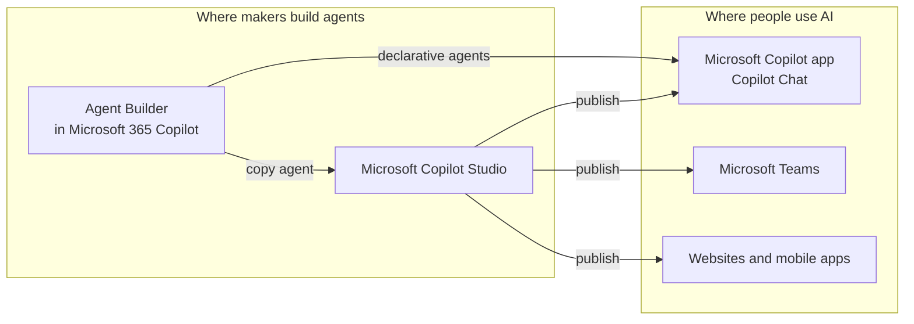

### When should it be used?

| Need | Use |
|---|---|
| Ask general questions, summarize a web page, draft text | Microsoft Copilot Chat (no building required) |
| A reusable agent with your instructions over Microsoft 365 content, for you or your team | Agent Builder (see [Lesson 5](#lesson-5-copilot-studio-vs-microsoft-365-copilot)) |
| A governed agent with tools, workflows, external channels, ALM, analytics | Copilot Studio |

### Step-by-step: see the relationship yourself

1. Open Microsoft Copilot (`copilot.cloud.microsoft`) with your work account and notice the agents available to you.
2. In Copilot Studio, open a standard harness agent and look at its **Channels** page. Microsoft Teams and Microsoft Copilot are listed there as publishing targets.
3. In [Module 14](../14-Publishing-and-Channels/README.md) you'll publish an agent and then find it in Microsoft Copilot or Teams.

### Practical example

- **Ana** asks Copilot Chat to summarize a public article. No agent or Copilot Studio is needed.
- **Ben** needs answers from the company's procurement policy and wants to raise a purchase request. A Copilot Studio agent, published to Microsoft Copilot and Teams, uses the policy as knowledge and a tool to create the request.

### Real-world enterprise scenario

An insurer rolls out Copilot Chat to all staff. The service desk then builds a Copilot Studio **claims-status agent** and publishes it to Microsoft Copilot and Teams for adjusters. It is grounded in the claims procedures site and has a tool that looks up claim status. Adjusters stay in one familiar interface while getting a specialized, governed agent.

### Common mistakes

- Using "Copilot" to mean every product. Always say *which* Copilot.
- Promising that Copilot Chat users automatically get free access to every custom agent. Custom agents in Copilot Chat are pay-as-you-go unless the user has a Microsoft 365 Copilot license or the scenario is otherwise included.
- Blocking `copilot.cloud.microsoft` to stop personal-account use. Microsoft recommends tenant restrictions instead.

### Troubleshooting

| Symptom | Likely cause | Fix |
|---|---|---|
| Users can't find a published agent in Microsoft Copilot | The agent wasn't made available to them, or an admin approval step is pending | Check the agent's channel and sharing settings ([Module 14](../14-Publishing-and-Channels/README.md)) |
| Copilot Chat can't answer from company files | Copilot Chat (Basic) doesn't use broad organizational grounding | Provide the content explicitly, use a licensed experience, or use an agent with that knowledge |

### Interview questions

1. **What's the difference between Microsoft Copilot and Copilot Studio?**
   *Model answer:* Microsoft Copilot (for example, Copilot Chat) is an AI assistant that people use. Copilot Studio is a low-code studio for building custom agents. You can publish those agents to Microsoft Copilot, Teams, websites, and other channels, so they complement each other.
2. **A user says "Copilot can't read our policy SharePoint." What do you check?**
   *Model answer:* Which Copilot experience and license they have. Copilot Chat (Basic) uses organizational content only when it's provided explicitly. Then I'd consider an agent grounded in that site, with appropriate permissions and licensing.

### Assessment (knowledge check)

1. True or false: a Copilot Studio agent can be published to Microsoft Copilot.
2. What does Copilot Chat (Basic) mainly use to ground its answers?
3. Which tool would you use to build an agent that calls a ticketing system and serves external customers on a website?

Show answers

1. **True.** Microsoft Copilot is one of the documented channels.
2. Web data. Organizational content is used only when explicitly provided.
3. **Copilot Studio.**

---

## Lesson 5: Copilot Studio vs. Microsoft 365 Copilot

### What is it?

**Beginner view:** **Microsoft 365 Copilot** is the AI built into Word, Excel, PowerPoint, Outlook, Teams, and the Copilot app. With the paid add-on license it can use your *work* data. Copilot Studio is where you *extend* it with your own agents, or build agents that live outside Microsoft 365.

**Professional view:**

- **Microsoft 365 Copilot (Premium)** is the add-on licensed experience. It grounds responses in organizational data through Microsoft Graph, Work IQ, Copilot Search, and semantic indexing, and it is deeply integrated into Microsoft 365 apps. **Microsoft 365 Copilot (Basic)** users have in-app Copilot capabilities but no add-on license.
- **Agent Builder** in Microsoft 365 Copilot offers *"guided configuration of declarative agents."* It supports Microsoft 365 knowledge sources and built-in capabilities, organizational sharing, and submission to your org catalog. It **doesn't** support authoring actions that integrate external services.
- **Copilot Studio** adds workflows, tools and connectors, external channels, environment-based ALM, analytics, and Power Platform governance. Capabilities vary by harness.
- You can **copy** an Agent Builder agent to Copilot Studio. The copy is a snapshot, not a synchronized upgrade, and some knowledge sources and capabilities need reconfiguration.

### Why is it needed?

Microsoft's guidance is to choose *"based on the required capabilities and operating model, not audience size alone."* Picking the wrong tool wastes effort. You either over-engineer a simple team helper in Copilot Studio, or hit Agent Builder's limits when you need external actions.

### How does it work?

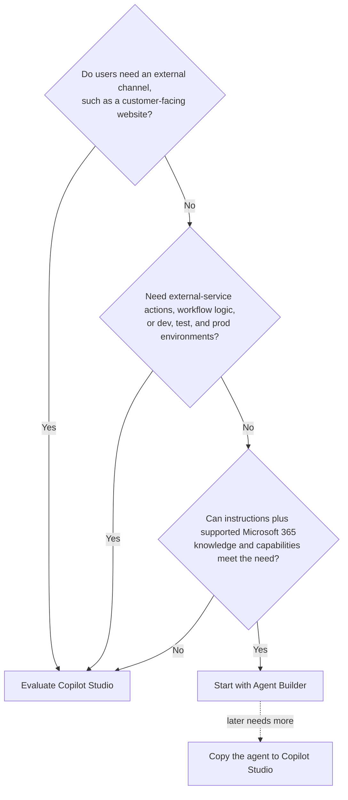

The decision flow above follows Microsoft's guide [Choose between Agent Builder and Copilot Studio](https://learn.microsoft.com/en-us/microsoft-365/copilot/extensibility/copilot-studio-experience).

**How licensing connects them (summary; details in [Lesson 13](#lesson-13-licensing-fundamentals)):**

- A Microsoft 365 Copilot license lets users **build** agents for the Microsoft Copilot harness in Copilot Studio. However, building, testing, evaluating, and running Microsoft Copilot harness agents consume Copilot Credits, and Microsoft states that *"this usage isn't included with a user's Microsoft 365 Copilot license."*
- When Microsoft 365 Copilot-licensed users use agents in Copilot Chat, Teams, or SharePoint, *classic answers, generative answers, and Microsoft Graph tenant grounding* aren't charged when the agent runs with the user's authenticated identity. Fair use applies, and there are exceptions such as computer use.

### When should it be used?

| Requirement | Agent Builder | Copilot Studio |
|---|---|---|
| Guided natural-language configuration, no project | ✅ | ✅ (also supports far deeper configuration) |
| External-service actions and workflows | ❌ (copy to Copilot Studio) | ✅ |
| External customers (public website) | ❌ | ✅ (channel support varies by harness) |
| Environments, ALM, deployment pipelines | ❌ | ✅ |
| Governance | Microsoft 365 agent controls | Power Platform environment and connector controls, plus Microsoft 365 controls when published there |

### Step-by-step: decide in five questions

1. Who are the users: internal only, or external too?
2. Does the agent need to **act** in other systems, such as creating tickets or updating records?
3. Do you need dev, test, and prod environments and controlled releases?
4. Is Microsoft 365 content plus instructions enough?
5. What licenses do the users hold? (Microsoft 365 Copilot users change the cost picture.)

If questions 1–3 are all "internal only / no / no", start with Agent Builder. Otherwise, use Copilot Studio.

### Practical example

- **Project-information agent** for a 15-person team, grounded in the project SharePoint site: **Agent Builder**.
- **IT request agent** with approvals and a ServiceNow ticket integration: **Copilot Studio**.

These two examples mirror Microsoft's own "Example fit" guidance.

### Real-world enterprise scenario

A consulting firm lets employees build personal agents in Agent Builder, governed by Microsoft 365 agent controls and org-catalog approval. When the Knowledge Management team's research agent needs a connector to the CRM, it is **copied to Copilot Studio**. There it is reconfigured, tested in a dev environment, and published through the firm's ALM pipeline.

### Common mistakes

- Choosing Copilot Studio only because "many departments will use it". Agent Builder supports organizational distribution too.
- Expecting a copied agent to stay in sync with the original Agent Builder agent.
- Forgetting that publishing a Copilot Studio agent to Microsoft 365 **doesn't remove** Microsoft 365 controls. Both control planes apply.

### Troubleshooting

| Symptom | Likely cause | Fix |
|---|---|---|
| Agent Builder can't call your API | External actions aren't supported in Agent Builder | Copy to Copilot Studio, or use a pro-code route |
| A copied agent misses some knowledge | Some sources and capabilities aren't copied or need reconfiguration | Reconfigure them in Copilot Studio and test |
| Unexpected Copilot Credit charges for internal users | Users lack Microsoft 365 Copilot licenses, or the feature isn't included (for example, computer use) | Review licensing (Lesson 13) and the billing rates table |

### Interview questions

1. **When do you recommend Agent Builder over Copilot Studio?**
   *Model answer:* When instructions plus supported Microsoft 365 knowledge and capabilities meet the need, there are no external actions or external channels, and Microsoft 365 sharing and org-catalog publishing are enough. Audience size alone isn't the deciding factor.
2. **How do Microsoft 365 Copilot licenses affect Copilot Studio costs?**
   *Model answer:* For employee-facing use of standard harness agents by Microsoft 365 Copilot-licensed users with their authenticated identity, classic answers, generative answers, and tenant graph grounding in Copilot Chat, Teams, or SharePoint aren't charged, subject to fair use and exceptions. The license also lets those users build Microsoft Copilot harness agents, but that harness's usage is billed in Copilot Credits and isn't included in the license.

### Assessment (knowledge check)

1. True or false: Agent Builder supports authoring actions that call external services.
2. What happens when you copy an Agent Builder agent to Copilot Studio?
3. Which product grounds answers in Microsoft Graph and Work IQ when the user has the add-on license?

Show answers

1. **False.**
2. A separate snapshot is created in Copilot Studio. It isn't synchronized, and some sources and capabilities need reconfiguration.
3. **Microsoft 365 Copilot (Premium)**.

---

## Lesson 6: Copilot Studio vs. traditional chatbots

### What is it?

**Beginner view:** Older chatbots work like phone menus. They recognize a fixed list of questions, follow a script, and say "Sorry, I didn't understand" when you go off-script. Copilot Studio agents can *understand* free-form language, *search* your knowledge, *combine* several steps, and *act*. When you need it, you can still script the parts that must be exact.

**Professional view:** Traditional bots rely on **intent classification** plus **scripted dialog trees**. Copilot Studio's standard harness offers two orchestration modes:

- **Classic orchestration:** trigger-phrase matching to a single topic, with knowledge as a fallback.
- **Generative orchestration (default for new standard agents):** an LLM-based planner selects topics, tools, other agents, and knowledge using their **descriptions**. It can handle multi-intent requests, generate questions for missing inputs, and compose the final answer.

The Microsoft Copilot harness goes further, with goal-driven multistep reasoning.

### Why is it needed?

Microsoft's documentation describes the traditional pattern this way. When a chatbot *"can't determine a user's intent, it asks the user to rephrase their question. If after two prompts, the chatbot still can't determine the user's intent, it escalates to a live agent."* Every unanticipated question becomes a dead end or a handoff. Generative capabilities reduce that by answering from knowledge and planning across capabilities.

### How does it work?

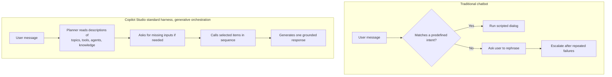

| Behavior | Traditional chatbot | Classic orchestration | Generative orchestration |
|---|---|---|---|
| Selects what to run | Intent classifier | Trigger phrases → one topic | Descriptions → topics, tools, agents, knowledge |
| Multi-intent ("reset my password and check my ticket") | Usually no | One topic | Yes, can combine several |
| Missing information | Scripted questions | Question nodes you author | Questions generated automatically |
| Unknown question | Rephrase, then escalate | Knowledge fallback, if configured | Proactively searches knowledge |
| Response text | Fully scripted | Message nodes you author | Generated from results |

### When should it be used?

- **Scripted (topics with message nodes):** legal or regulated wording, deterministic step-by-step procedures, and channels or tenants where generative orchestration is turned off. Note that if an admin turns off generative orchestration in an environment, agents there can use only classic orchestration.
- **Generative orchestration:** broad question sets, multi-step requests, many tools.
- **Hybrid (most real agents):** generative orchestration plus a few carefully authored topics for the critical paths.

### Step-by-step: see both modes (standard harness)

1. In the classic experience, open your agent and go to **Settings**.
2. In the **Generative AI** section, under **Orchestration**, find **Use generative AI orchestration for your agent's responses?**.
3. **Yes** means generative orchestration (the default for new agents). **No** means classic orchestration.
4. Ask the same multi-part question in both modes in the test panel and compare. You'll do this in the [lab](STEP-BY-STEP-LAB.md).

### Practical example

User: *"I need to change my delivery address and also want to know your return policy."*

- **Traditional bot:** matches one intent (or none) and asks the user to rephrase.
- **Classic orchestration:** may trigger the "Change address" topic only.
- **Generative orchestration:** may run the "Change address" topic, then search knowledge for the return policy, and answer both parts in one response.

### Real-world enterprise scenario

A telecom provider replaces a 300-intent legacy bot. It keeps 15 authored topics for regulated processes (contract cancellation, identity verification) and lets generative orchestration and knowledge handle the long tail of questions. Fewer escalations are caused by "didn't understand" failures, and the regulated wording stays exactly as legal approved it.

### Common mistakes

- Rebuilding hundreds of intents as topics instead of letting knowledge and generative answers cover the long tail.
- Removing **all** topics and losing control of critical flows.
- Writing vague topic and tool **descriptions**. In generative orchestration, the description is the most important selection factor.

### Troubleshooting

| Symptom | Likely cause | Fix |
|---|---|---|
| Only one part of a multi-part question is answered | Classic orchestration is on | Turn on generative orchestration, if allowed |
| The generative orchestration option is unavailable | An admin turned it off in the environment | Ask the admin, or design for classic orchestration |
| The wrong topic or tool is chosen | Weak or overlapping descriptions | Rewrite descriptions to be specific and distinct ([Module 09](../09-Generative-AI-and-Orchestration/README.md)) |

### Interview questions

1. **How does generative orchestration differ from classic orchestration?**
   *Model answer:* Classic orchestration triggers the single topic whose trigger phrases best match the query, uses knowledge as a fallback, and calls tools only from topics. Generative orchestration selects topics, tools, other agents, and knowledge by their descriptions. It can combine several, ask for missing inputs automatically, and generate the response.
2. **Why keep authored topics in a generative agent?**
   *Model answer:* For deterministic, regulated, or high-risk paths, such as identity verification or legal wording, where every response must be controlled.

### Assessment (knowledge check)

1. In generative orchestration, what is the most important factor for selecting a topic or tool?
2. True or false: with classic orchestration, the agent can call tools directly without a topic.
3. Which orchestration mode is the default for new standard harness agents?

Show answers

1. Its **description** (along with names and input and output parameters).
2. **False.** Tools can only be called from within a topic in classic orchestration.
3. **Generative orchestration**, unless the agent was created from a prebuilt agent with a different configuration, or an admin disabled it in the environment.

---

## Lesson 7: AI agents and autonomous agents

### What is it?

**Beginner view:** An **AI agent** is software that can understand a goal, decide what to do, and use tools to get it done. Most agents wait for someone to chat with them. An **autonomous agent** can also start working by itself when something happens, for example when a new email arrives or a record is created.

**Professional view:** Microsoft's Application Card defines an agent as *"an AI‑powered conversational or autonomous component … that can answer questions, take actions, or automate business processes using configured instructions, tools, and data sources."* Autonomy in Copilot Studio comes from:

- **Event triggers (standard harness):** let an agent *"act autonomously in response to the specified event."* They require **generative orchestration** to be turned on.
- **Triggers for Microsoft Copilot harness agents:** 🧪 **Preview** (October 2026). They run the agent when an event happens in a connected service, such as a new SharePoint item, an incoming email, or a scheduled time.
- **An agent's own account:** 🧪 **Preview**, part of Microsoft's **Frontier** preview program (October 2026). A Microsoft Copilot harness agent can get its own Microsoft Entra ID, mailbox, and presence in Teams, so it can take part in business processes under its own identity. 💳 **Licensing/Region:** prerequisites include an early-release-cycle environment, admin enablement, enrollment in the Frontier program, and a maker license of Microsoft 365 E5 with the Microsoft Agent 365 add-on, or Microsoft 365 E7. See [Give your agent an account](https://learn.microsoft.com/en-us/microsoft-copilot-studio/agents-experience/authoring-agent-account).

### Why is it needed?

Many business processes don't start with a chat. Examples include a new hire added to HR, an invoice arriving, a ticket breaching its SLA, or stock falling below a threshold. Autonomous agents react to these **events** without waiting for a person, which saves time and catches issues earlier.

### How does it work?

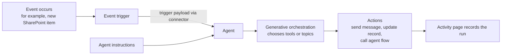

1. An **event** occurs in a connected service.
2. The **trigger** sends a **payload** (JSON or plain text, with event data and optional instructions) to the agent through a connector.
3. The agent combines its **general instructions** with any **payload instructions**, then uses generative orchestration to choose tools or topics.
4. It acts. Each payload is processed like a user message for billing purposes.

Important constraints (standard harness):

- Event triggers are available **only with generative orchestration**.
- Which triggers are available depends on your organization's **data policies**.
- Event trigger activity **consumes Copilot Credits**. For example, a Recurrence trigger every 10 minutes sends a payload every 10 minutes. Agent flows called while responding to a trigger consume credits at the standard rate, even for Microsoft 365 Copilot-licensed users.

### When should it be used?

| Good fit | Poor fit |
|---|---|
| Repetitive event-driven work with clear rules (welcome new hires, triage incoming requests, summarize changes) | High-stakes decisions without human review |
| Monitoring and alerting (inventory threshold, SLA breach) | Very frequent triggers with little value per run (cost) |
| Processes where an approval step can be inserted | Processes needing actions your data policies block |

**Autonomy is a spectrum:** an assistive agent answers questions, a task agent completes requested actions, and an autonomous agent starts work itself. Add human-in-the-loop steps as risk increases. Workflows and agent flows support human review.

### Step-by-step: where autonomy lives in Copilot Studio

1. **Standard harness:** make sure generative orchestration is on (**Settings** > **Generative AI**). Then add a trigger from the agent's **Overview** page. When you create an agent from a description, Copilot Studio can also *suggest* triggers.
2. Pick a trigger from the triggers library (for example, *When an item is created in SharePoint* or *Recurrence*).
3. Keep or edit the default **payload** and add trigger-specific instructions. Avoid conflicts with the agent's general instructions.
4. Test the trigger and review runs on the **Activity** page.
5. Full how-to: [Add an event trigger](https://learn.microsoft.com/en-us/microsoft-copilot-studio/authoring-trigger-event). Autonomous design is covered in depth in [Module 18](../18-Advanced-Agent-Development/README.md).

### Practical example

- **Trigger:** *When a row is added* to a Dataverse "New hires" table.
- **Payload instruction:** "Send the new employee a welcome message with onboarding resources."
- **Agent behavior:** reads the new row, finds the onboarding checklist in knowledge, and sends the message through a tool.

### Real-world enterprise scenario

A distributor's **inventory agent** runs on a schedule. When stock for a SKU falls below its threshold, it drafts a restock request and posts it to the purchasing channel for **human approval**. Credit consumption is estimated up front (runs × actions) and capped by an admin with an agent spending limit. Every run is reviewed on the Activity page during the pilot.

### Common mistakes

- Setting a high-frequency Recurrence trigger without estimating credits.
- Writing payload instructions that conflict with the agent's instructions, which causes errors or unexpected results.
- Giving an autonomous agent broad permissions with no approval step.
- Forgetting that event triggers need generative orchestration.

### Troubleshooting

| Symptom | Likely cause | Fix |
|---|---|---|
| No triggers can be added | Generative orchestration is off | Turn it on (**Settings** > **Generative AI**) |
| An expected trigger isn't in the library | It is blocked by data policies | Ask the admin to review data policies ([Module 17](../17-Agent-Management-and-Governance/README.md)) |
| Unexpectedly high credit usage | A frequent trigger, or agent flows billed at the standard rate | Reduce frequency, add conditions, set agent limits |
| The agent behaves inconsistently on trigger | Payload and agent instructions conflict | Align the instructions and retest |

### Interview questions

1. **What makes a Copilot Studio agent "autonomous"?**
   *Model answer:* It can start work in response to events through event triggers (standard harness, requires generative orchestration) or triggers (preview) on the Microsoft Copilot harness, rather than waiting for a user message. The trigger sends a payload, and the agent uses its instructions to choose and run actions.
2. **How do you keep autonomous agents safe and affordable?**
   *Model answer:* Least-privilege connections, human approval for high-impact actions, clear non-conflicting instructions, trigger conditions to avoid noise, credit estimation and agent spending limits, and monitoring through the Activity and Monitor pages.

### Assessment (knowledge check)

1. Which orchestration mode is required for event triggers on the standard harness?
2. True or false: trigger payloads are free and never consume Copilot Credits.
3. What decides which triggers you can use in your tenant?

Show answers

1. **Generative orchestration.**
2. **False.** Each payload is processed like a user message and billed.
3. Your organization's **data policies**, configured by an administrator.

---

## Lesson 8: Generative AI fundamentals

### What is it?

**Beginner view:** Generative AI is AI that *creates* new content, such as text, summaries, or answers, instead of only picking from a fixed list. When an agent writes a fresh answer from your policy document, that's generative AI.

**Professional view:** Microsoft Learn describes generative AI as *"an artificial intelligence technology that uses language models to generate original content and provide natural language understanding and responses."* In Copilot Studio it powers:

- **Generative answers:** answers built from your knowledge sources.
- **Generative orchestration:** planning which topics, tools, agents, and knowledge to use.
- **Natural-language authoring:** creating agents, topics, and prompts by describing them.
- **AI general knowledge:** answering general questions when **Allow ungrounded responses** is on.

Key vocabulary:

| Term | Meaning |
|---|---|
| **Prompt** | The input sent to the model: instructions, conversation, retrieved content, and the user's message |
| **Grounding** | *"Providing relevant enterprise or external data to a model so agent responses are contextually accurate"* (Application Card) |
| **RAG** (retrieval-augmented generation) | Retrieve relevant content first, then generate an answer from it. Copilot Studio uses RAG, for example, for tenant graph grounding. |
| **Ungrounded content / hallucination** | A fluent answer that isn't supported by the provided data. Microsoft lists *"bias, stereotyping, and ungrounded content"* as limitations. |
| **Non-determinism** | The same question can produce different wording, because generation uses context and probabilities |
| **Content safety** | Classifiers that detect harmful content and can block or redirect responses |

### Why is it needed?

Scripted bots need someone to write every answer in advance. Generative AI lets an agent answer the *long tail* of questions directly from documents and websites, summarize, and adapt to how people actually ask. That cuts authoring time and improves coverage.

### How does it work?

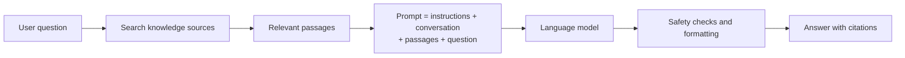

1. The agent searches its knowledge sources for passages relevant to the question.
2. It builds a prompt that combines the instructions, the conversation so far, the retrieved passages, and the question.
3. The model generates an answer. Responsible AI checks (classifiers and metaprompting) apply.
4. The user sees an answer that cites its sources.

**Responsible AI.** Microsoft's six AI principles are *fairness, reliability and safety, privacy and security, inclusiveness, transparency, and accountability.* Copilot Studio implements safeguards such as grounding in data the user has permission to access, content safety filters, and prompt guardrails. The maker still owns the agent's design and the disclaimers it gives users.

### When should it be used?

| Use generative answers when… | Prefer authored (classic) answers when… |
|---|---|
| Questions are many and varied, and answers live in documents or sites | Exact, approved wording is mandatory (legal, regulatory) |
| Summaries or explanations help users | A deterministic, auditable step-by-step process is required |
| Content changes often (the agent reads the latest version) | The answer must never vary between users |

### Step-by-step: observe generative AI in Copilot Studio

1. Create a standard harness agent from a description. The AI generates the name, description, and instructions. This is generative AI helping *you*.
2. Add a public website as knowledge (the lab uses Microsoft Learn's Copilot Studio docs).
3. Ask a question in the test panel. The answer is generated and cites sources.
4. Ask the same question again in a new test session and compare the wording. It is non-deterministic.
5. Review your agent's knowledge settings for **Allow ungrounded responses** (see [Allow ungrounded responses](https://learn.microsoft.com/en-us/microsoft-copilot-studio/knowledge-copilot-studio#allow-ungrounded-responses)). Decide deliberately whether general knowledge is acceptable for your scenario.

### Practical example

An employee asks, *"How many days of parental leave do I get?"* The agent searches the HR policy PDF and finds the parental-leave section. It answers in two sentences and cites the policy. It doesn't make up a number when the policy is silent; it should say it can't find the answer and offer escalation.

### Real-world enterprise scenario

A bank uses **generative answers** grounded in internal procedures for staff questions. It turns **off** ungrounded responses so the agent can't drift into general internet knowledge. For mandated disclosures it uses **authored topics** with fixed message text. Answers are monitored, and test sets in **evaluations** check groundedness before each release.

### Common mistakes

- Expecting identical answers every time. Generative answers aren't deterministic.
- Leaving **Allow ungrounded responses** on for a regulated agent.
- Treating citations as optional. Users and auditors need them.
- Assuming the model "knows" your company. It only knows what you ground it in.

### Troubleshooting

| Symptom | Likely cause | Fix |
|---|---|---|
| Answer includes facts not in your documents | Ungrounded responses allowed, or weak knowledge | Turn off ungrounded responses where appropriate, improve sources ([Module 10](../10-Knowledge-Sources-and-Grounding/README.md)) |
| Same question, different answer | Expected non-determinism plus conversation context | Start a new test session to compare. Use authored topics for fixed wording. |
| "I couldn't find that" for content you know exists | Source not indexed yet, user lacks permission, or the content isn't searchable | Check indexing status, permissions, and file type and size limits |

### Interview questions

1. **What is grounding, and why does it matter?**
   *Model answer:* Grounding supplies relevant enterprise or external data to the model so responses are accurate and aligned with organizational information. It reduces ungrounded or fabricated content, and with citations it makes answers verifiable.
2. **How do you reduce hallucinations in a Copilot Studio agent?**
   *Model answer:* Ground it in high-quality, permission-appropriate knowledge, turn off ungrounded responses when general knowledge isn't acceptable, write clear instructions about what to do when the answer isn't found, use authored topics for critical answers, and evaluate groundedness with test sets.

### Assessment (knowledge check)

1. What does RAG stand for, and what are its two main steps?
2. True or false: asking the same question twice always produces the same generative answer.
3. Name three of Microsoft's six responsible AI principles.

Show answers

1. Retrieval-augmented generation: **retrieve** relevant content, then **generate** an answer from it.
2. **False.**
3. Any three of: fairness, reliability and safety, privacy and security, inclusiveness, transparency, accountability.

---

## Lesson 9: Large language models (LLMs)

### What is it?

**Beginner view:** An LLM is the "brain" that reads text and writes text. It was trained on a huge amount of text, so it learned how language works and can predict good next words.

**Professional view:** Microsoft defines an LLM as *"a machine‑learning model trained on large datasets that enables natural language understanding and generation within Copilot Studio agents."* LLMs process text as **tokens** (pieces of words). They work within a **context window** (how much text they can consider at once) and generate output token by token. Copilot Studio uses several model families. Microsoft lists examples such as OpenAI's GPT‑5 series (through Azure OpenAI), Anthropic's Claude models, and xAI's Grok 4.1 Fast. Microsoft states it *"does not train foundation models using customer data."*

### Why is it needed?

The LLM is what lets an agent understand messy, real-world phrasing, plan across tools, and write natural answers. Choosing and managing the model affects **quality, latency, cost, and compliance**.

### How does it work?

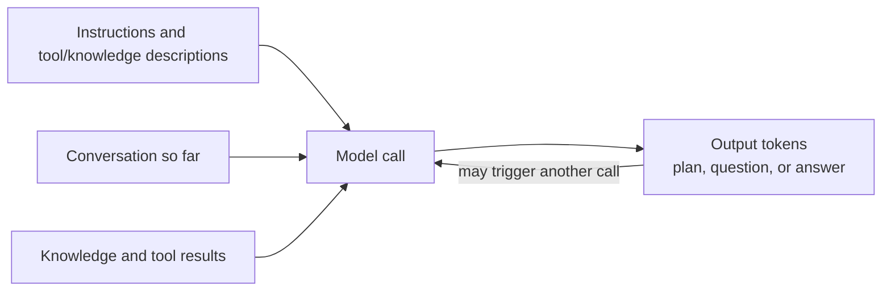

To answer one message, the agent may call the model **several times**: to plan, to search knowledge or call tools, and to write the response. Microsoft documents that each model call includes the agent's instructions and the descriptions of its tools and knowledge, the conversation so far, and the knowledge and tool results retrieved during the turn. This is why long instructions and long conversations increase token usage.

**Models in Copilot Studio (standard harness, November 2026):**

- Each agent starts with a **default** model, which Microsoft upgrades periodically. In October 2026, **GPT‑5.5 Chat** became the default for standard harness agents.
- You change the primary model on the agent's **Overview** page, in the **Model** section.
- Models are tagged by release type (**Experimental**, **Preview**, **GA**) and availability. **Cross-geo** means data might be processed outside your region. Use GA models for production.
- Some external models (for example, Anthropic models) aren't available in GCC and might process data outside your geography. 💳 **Licensing/Region**
- When Microsoft upgrades a default model, you can keep your agent on its current model for up to **30 days** to test and migrate.
- **Reasoning models** cost more. On the standard harness they add a premium per-token charge on top of the feature rate (see [Lesson 13](#lesson-13-licensing-fundamentals)).
- On the Microsoft Copilot harness you choose a model from a dropdown, including experimental models for early evaluation.

### When should it be used?

| Choose… | When… |
|---|---|
| The default GA model | Most scenarios. Start here. |
| A reasoning model | Complex analysis or multistep planning where quality matters more than cost and latency |
| A cross-geo or external model | Only after a compliance review of data-residency requirements |
| Experimental or preview models | Exploration and testing, not production |

### Step-by-step: view and change an agent's model (standard harness)

1. Open your agent in the classic experience. The **Overview** page appears.
2. Find the **Model** section and open the list of models.
3. Read each model's tags (Default, GA, Preview, Experimental, cross-geo).
4. For this module, **keep the default** model. Changing models is covered in [Module 09](../09-Generative-AI-and-Orchestration/README.md).

### Practical example

A support agent answers FAQs well on the default chat model. The team tries a reasoning model for a complex troubleshooting topic. Quality improves slightly, but latency and credit consumption rise noticeably. They keep the default model and improve the knowledge instead.

### Real-world enterprise scenario

A European insurer's architecture board approves only **GA, in-region** models for production agents. They don't approve cross-geo or experimental ones. When Microsoft upgrades the default model, the team uses the 30-day window to rerun its **evaluation test sets** before accepting the change.

### Common mistakes

- Picking the most powerful reasoning model "just in case", which multiplies cost and latency.
- Ignoring the **cross-geo** tag in regulated industries.
- Not retesting after a model upgrade. Behavior can change with the model.
- Believing the model learns from your conversations or trains on your data.

### Troubleshooting

| Symptom | Likely cause | Fix |
|---|---|---|
| Credit consumption spiked | A reasoning model was selected, or instructions and conversations are long | Use a standard model, shorten instructions, start new conversations for new topics |
| Responses changed overnight | The default model was upgraded | Use the 30-day option to stay on the current model while you retest |
| A model is missing from the list | Region, cloud (for example, GCC), or admin controls | Check model availability and admin settings |

### Interview questions

1. **Why can one user message consume many tokens?**
   *Model answer:* The agent may call the model several times per turn (plan, search, call tools, respond). Each call includes the instructions, tool and knowledge descriptions, conversation history, and retrieved results.
2. **How do you choose a model for a production agent?**
   *Model answer:* Start with the default GA model. Consider reasoning models only where quality needs justify the cost and latency. Check region and cross-geo tags against compliance requirements. Validate any change with evaluation test sets.

### Assessment (knowledge check)

1. Where do you change a standard harness agent's primary model?
2. True or false: Microsoft trains its foundation models on your agent's conversations.
3. What does the **cross-geo** tag indicate?

Show answers

1. On the agent's **Overview** page, in the **Model** section.
2. **False.**
3. Data might be processed outside your region.

---

## Lesson 10: Natural language processing (NLP)

### What is it?

**Beginner view:** NLP is how computers work with human language: reading it, understanding what you mean, and writing back.

**Professional view:** NLP covers two parts:

- **Natural language understanding (NLU):** working out *intent* (what the user wants) and *entities* (key details such as dates, numbers, and places).
- **Natural language generation (NLG):** producing text.

In Copilot Studio, NLP shows up in several places:

- **Classic orchestration:** NLU matches a user's message to the topic whose **trigger phrases** best fit.
- **Entities and slot filling:** values are extracted from user messages ([Module 08](../08-Variables-and-Entities/README.md)).
- **Generative orchestration:** an LLM interprets the request against **descriptions**.
- **Generative answers:** NLP is used to *"parse what a user types… find, collate, and parse relevant information… [and] summarize search results into plain language."*

### Why is it needed?

People ask for the same thing in many ways: "reset my password", "I'm locked out", "can't log in". NLP lets the agent understand these variations without you listing every phrasing. It also lets the agent capture details, such as "3 tickets for next Friday", without a rigid form.

### How does it work?

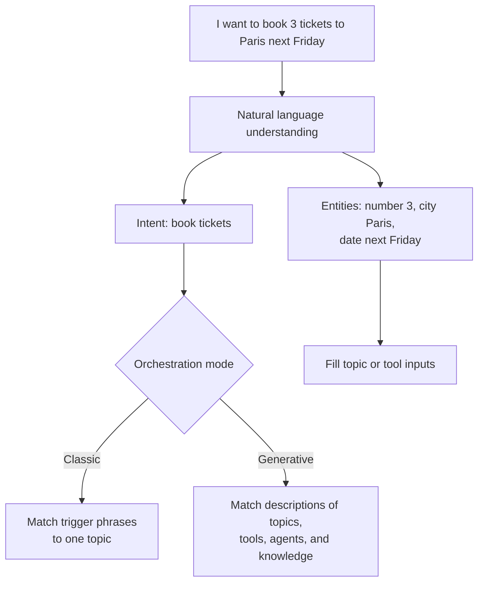

- When more than one topic matches with high confidence, the **Multiple Topics Matched** system topic asks *"Did you mean X or Y?"* (standard harness).
- Language matters. Microsoft states Copilot Studio was *"developed and tested primarily in English,"* and conversational accuracy is highest in English. Copilot Studio supports many languages, in stages. Check the [language support](https://learn.microsoft.com/en-us/microsoft-copilot-studio/authoring-language-support) list for your language's status. 💳 **Licensing/Region**

### When should it be used?

NLP is always in use. Your design choices decide *how* it's used:

- Rely on **descriptions and generative orchestration** for broad, varied requests.
- Use **trigger phrases** (classic orchestration) when you need tight, predictable topic matching.
- Use **entities** when you must capture structured values reliably, such as order numbers, dates, or email addresses.

### Step-by-step: see NLP at work (standard harness)

1. Go to the **Topics** page of your agent and open a system topic such as **Multiple Topics Matched** to see the disambiguation logic.
2. In the test panel, type the same request three different ways and check which topic or knowledge source responds.
3. Open the activity map to see what the agent selected (generative orchestration).
4. Defer building custom entities until [Module 08](../08-Variables-and-Entities/README.md).

### Practical example

*"Where's my order 45821?"* NLU identifies the intent (order status) and the entity (order number = 45821). The agent fills the order-number input of an order-status tool, so it doesn't ask the user again.

### Real-world enterprise scenario

A multinational builds an HR agent with English as the primary language and adds other languages for regional offices. The team tests each language separately with representative phrasing, because accuracy differs by language. They also note that if an agent's primary language isn't English, suggested prompts don't appear in the Microsoft Copilot channel (they still work in Teams and Web Chat).

### Common mistakes

- Using too few or near-identical trigger phrases (classic), or vague descriptions (generative).
- Assuming every language performs as well as English.
- Creating many topics that overlap, which triggers constant "Did you mean…?" prompts.

### Troubleshooting

| Symptom | Likely cause | Fix |
|---|---|---|
| The wrong topic triggers | Overlapping trigger phrases or descriptions | Make phrases and descriptions distinct; merge duplicate topics |
| Frequent "Did you mean…?" | Several topics match with high confidence | Reduce overlap; refine the topics |
| Poor understanding in a non-English language | Language support stage, or limited testing | Check the language support status; test and tune per language |

### Interview questions

1. **What's the difference between NLU and NLG?**
   *Model answer:* NLU interprets input, working out intent and extracting entities. NLG produces natural-language output. Copilot Studio uses NLU for topic and entity recognition and LLM-based generation for answers.
2. **How does Copilot Studio handle ambiguous requests?**
   *Model answer:* In the standard harness, the **Multiple Topics Matched** system topic offers a disambiguation choice. With generative orchestration, the planner uses context and descriptions and can ask clarifying questions.

### Assessment (knowledge check)

1. In "Book 2 rooms in Oslo on 3 May", which parts are entities?
2. Which system topic handles "Did you mean…?" disambiguation?
3. True or false: Copilot Studio conversational accuracy is highest in English.

Show answers

1. "2" (number), "Oslo" (city), "3 May" (date).
2. **Multiple Topics Matched.**
3. **True**, according to Microsoft's Application Card.

---

## Lesson 11: Agent architecture

### What is it?

**Beginner view:** An agent is made of parts: a **job description** (instructions), **things it knows** (knowledge), **things it can do** (tools), **conversation recipes** (topics or skills), **ways it's started** (users or triggers), and **places it lives** (channels).

**Professional view:** Agent architecture is how these components are arranged and governed. The arrangement differs by harness:

| Component | Purpose | Standard harness (classic experience) | Microsoft Copilot harness (new experience) |
|---|---|---|---|
| **Instructions** | Role, scope, tone, rules | Overview page; up to 8,000 characters | **Instructions** section on the **Build** tab |
| **Knowledge** | Grounding content | Knowledge sources (websites, files, SharePoint, Dataverse, and more) | Knowledge components; **Work IQ** added by default (🟢 GA, October 2026) |
| **Tools** | Actions in other systems | Connectors, agent flows, prompts, REST APIs, MCP, computer use (🟢 GA, May 2026) | Tools such as connectors and REST APIs; **workflows** and **MCP servers** as tools (🧪 Preview, July 2026) |
| **Conversation logic** | Structured paths | **Topics** (system and custom) with nodes | **Skills** (no topics) |
| **Other agents** | Delegation | **Child agents** and **connected agents** | **Connected agents** (🧪 Preview, June 2026); task agents where available |
| **Triggers** | Autonomous starts | Event triggers (need generative orchestration) | Triggers (🧪 Preview, October 2026) |
| **State** | Remember information | **Variables** (topic, global, system) | **Memory** (per user, across interactions) |
| **Model** | Reasoning and generation | Overview page > **Model** | Model dropdown |
| **Channels** | Where users interact | Channels page (widest set) | Smaller set (for example, Microsoft Copilot, Teams, demo website, web app embedding) |
| **Settings** | Behavior, security | **Settings** page (for example, **Generative AI**) | **Agent settings** dialog: Agent details, AI & behavior, Safety & access, Greeting & prompts |

**Platform layer (all harnesses):**

- Agents are created in a Power Platform **environment** and are **solution-aware** (solution and schema name).
- Copilot Studio automatically configures new agents for **Microsoft Entra ID authentication** (standard harness).
- Since July 2026, a **Microsoft Entra Agent ID** is created automatically for every new agent. The timing depends on the harness. On the standard harness it is provisioned when you **create** the agent. On the Microsoft Copilot harness it is provisioned when you **first publish** the agent, not when you save a draft. Agents created before Entra Agent ID was introduced (May 2026) keep using traditional app registrations.

### Why is it needed?

Good architecture makes agents **accurate** (the right knowledge), **capable** (the right tools), **safe** (least privilege and authentication), **maintainable** (clear components and descriptions), and **operable** (monitored and governed). Poor architecture produces agents that guess, overreach, or can't be supported.

### How does it work?

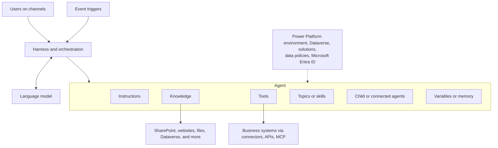

**Request lifecycle with generative orchestration (standard harness).** The steps below follow Microsoft's documented behavior:

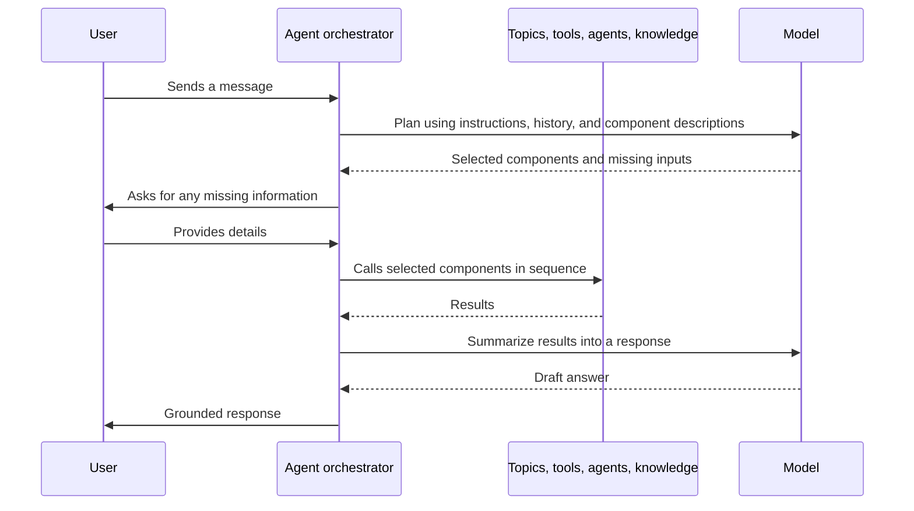

### When should it be used?

Sketch the architecture **before** you build anything beyond a prototype, and revisit it when:

- You add a new channel, especially an external one.
- You add tools that change data. Review authentication and least privilege.
- The agent grows beyond one clear responsibility. Consider child or connected agents.
- You move between harnesses.

### Step-by-step: draw your first agent architecture

1. Write the **one-sentence purpose** (for example, "Answer employee IT questions and open tickets").
2. List the **users and channel**, such as employees in Teams.
3. List the **knowledge** and who may see it, such as the IT KB SharePoint site for all employees.
4. List the **tools** and the credentials each uses (maker vs. end-user).
5. Decide which **logic** is deterministic (topics) and which is generative.
6. Choose the **harness** ([Lesson 2](#lesson-2-harnesses-and-the-new-vs-classic-experience)).
7. Note **governance**: environment, data policies, monitoring, and owners.
8. Draw it as a Mermaid diagram, like the one above.

### Practical example

**IT Help agent (standard harness):**

| Part | Choice |
|---|---|
| Instructions | IT support role, polite tone, never asks for passwords |
| Knowledge | IT KB SharePoint site |
| Tools | "Create ticket" agent flow; "Check ticket status" connector |
| Topics | Escalate to human (system), Password reset (custom, scripted) |
| Channel | Teams and Microsoft Copilot |
| Authentication | Microsoft Entra ID |

### Real-world enterprise scenario

A university designs a **front-door student agent** that routes requests to specialist agents: admissions, finance, and IT. Each specialist has its own knowledge, tools, owners, and release cycle. The front door uses generative orchestration and clear agent descriptions. Each specialist can be updated independently. Multi-agent design is covered in [Module 18](../18-Advanced-Agent-Development/README.md).

### Common mistakes

- A "god agent" with dozens of tools and topics and no clear scope.
- Tools that run with the maker's broad credentials where end-user credentials are required.
- Undocumented components, so nobody knows why a tool exists.
- Ignoring channel differences between harnesses.

### Troubleshooting

| Symptom | Likely cause | Fix |
|---|---|---|
| The agent calls the wrong tool | Overlapping tool descriptions; too many tools | Narrow the scope, sharpen descriptions, split into specialist agents |
| Users see data they shouldn't | Over-privileged connections or knowledge | Re-architect authentication and knowledge permissions ([Module 13](../13-Authentication-and-Security/README.md)) |
| The agent can't be published to a needed channel | The harness doesn't support that channel | Revisit the harness choice |

### Interview questions

1. **Walk me through the components of a Copilot Studio agent.**
   *Model answer:* Instructions; knowledge; tools; conversation logic (topics on the standard harness, skills on the Microsoft Copilot harness); other agents; triggers; state (variables or memory); the model; channels; and settings. All of these sit inside a Power Platform environment governed by data policies and Entra ID.
2. **How does generative orchestration process a message?**
   *Model answer:* It plans using the instructions, history, and component descriptions. It asks for missing inputs, calls the selected topics, tools, agents, and knowledge in sequence, then generates a response from the results.

### Assessment (knowledge check)

1. What replaces topics on the Microsoft Copilot harness?
2. What is the maximum length of standard harness agent instructions?
3. True or false: since July 2026, a Microsoft Entra Agent ID is created automatically for every new agent.

Show answers

1. **Skills** (and workflows for process automation).
2. **8,000 characters.**
3. **True.** On the standard harness it's provisioned at creation; on the Microsoft Copilot harness, at first publish.

---

## Lesson 12: Enterprise use cases

### What is it?

**Beginner view:** A use case is a specific job you want an agent to do for specific people, such as "answer employee leave questions in Teams".

**Professional view:** An enterprise use case defines the **users, problem, data, actions, channel, risk level, harness, and success metrics** of an agent. Microsoft's Application Card notes that agents are generally *"purpose-built for defined tasks"* and *"operate within boundaries set by the organization."*

### Why is it needed?

Most failed agent projects fail on scope, not technology. A clear use case keeps the agent focused, measurable, and safe, and it makes licensing and cost predictable.

### How does it work?

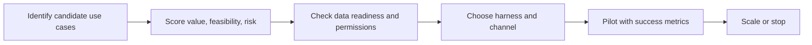

**Common categories** (examples drawn from Microsoft documentation):

| Category | Example | Typical harness |
|---|---|---|
| Customer support automation (B2C) | Answer common questions, track orders, process returns on a website | Standard; Customer Conversation for voice and contact-center scenarios (Preview) |
| Employee self-service (B2E) | HR policies, leave requests, compliance guidelines | Standard |
| Internal help desk | Answer common IT questions and route simple requests | Standard |
| Financial workflow automation | Monitor queries and applications; accounts payable (read invoices, match POs, route exceptions) | Microsoft Copilot (Preview) |
| Education | Course registration help, deadlines, resources | Standard |
| Content operations | Pull metadata, organize assets, suggest tags | Microsoft Copilot (Preview) |
| Autonomous monitoring | Inventory thresholds that trigger restocking | Standard with event triggers, or Microsoft Copilot with triggers (Preview) |

### When should it be used?

Prioritize use cases that combine:

- **High volume and repetition**, such as frequent questions or repeatable processes.
- **Available, well-owned data** with clear permissions.
- **Tolerable risk**, with human review where errors are costly.
- **Measurable outcomes**, such as resolution rate, escalation rate, satisfaction (CSAT), time saved, and credits per resolved session.

Avoid uses that Microsoft excludes, such as medical diagnosis or treatment, and emergency use.

### Step-by-step: write a use-case canvas

1. **Problem:** what pain exists today, with numbers?
2. **Users:** who uses the agent, and on which channel?
3. **Jobs:** the top 10 questions or tasks.
4. **Knowledge:** sources, owners, and permissions.
5. **Actions:** systems the agent must touch, plus read/write needs.
6. **Risk:** what goes wrong if the agent is wrong? Where are approvals needed?
7. **Harness and licensing:** which harness, which users' licenses, and the credit estimate.
8. **Metrics:** baseline and target values.
9. **Owner:** the business owner and the technical owner.

### Practical example

**Use case:** *Employee Policy Assistant*

- **Problem:** 1,200 policy questions to HR per month.
- **Users:** all employees in Teams.
- **Knowledge:** the HR policy SharePoint site.
- **Actions:** none in phase 1; open an HR case in phase 2.
- **Risk:** medium. Answers must cite the policy and can escalate to HR.
- **Harness:** standard.
- **Metrics:** a 40% reduction in HR policy tickets and CSAT ≥ 4/5.

### Real-world enterprise scenario

A Center of Excellence runs a quarterly **agent intake**. Business teams submit use-case canvases, which are scored on value, feasibility, and risk. The top three get a 6-week pilot in a dedicated environment with evaluation test sets and a credit budget. Only pilots that meet their metrics move to production.

### Common mistakes

- "Let's build one agent that does everything."
- No baseline metrics, so success can't be proven.
- Choosing a use case whose data is outdated or has unclear ownership.
- Ignoring licensing. Employee-facing use by Microsoft 365 Copilot-licensed users can be much cheaper than the same usage by unlicensed users.

### Troubleshooting

| Symptom | Likely cause | Fix |
|---|---|---|
| Pilot has low usage | Wrong channel, or a low-value use case | Move to the channel users already use (for example, Teams), and re-score the use case |
| Answers are often wrong | Poor or outdated source content | Fix the content first, then the agent |
| Costs exceed budget | Volume or feature mix (for example, tenant graph grounding or reasoning models) | Re-estimate with the official estimator and adjust the design |

### Interview questions

1. **How do you prioritize agent use cases?**
   *Model answer:* Score value (volume, time saved), feasibility (data readiness, integrations, harness and channel support), and risk (impact of wrong answers, need for approvals). Start with high-value, low-risk, data-ready cases and define baseline and target metrics.
2. **Give an example where Copilot Studio is *not* appropriate.**
   *Model answer:* Medical diagnosis or treatment decisions, or emergency use. Microsoft states Copilot Studio isn't intended for these. Also high-stakes decisions without human review.

### Assessment (knowledge check)

1. List four elements of a use-case canvas.
2. Which harness fits an accounts-payable process that reads invoices and routes exceptions?
3. Name two metrics that prove an agent's value.

Show answers

1. Any four of: problem, users/channel, jobs, knowledge, actions, risk, harness and licensing, metrics, owner.
2. **Microsoft Copilot harness** (🧪 Preview).
3. Any two of: resolution rate, escalation rate, CSAT, time saved, ticket deflection, credits per resolved session.

---

## Lesson 13: Licensing fundamentals

> [!IMPORTANT]
> Licensing changes often. Always confirm details in the official [Microsoft Copilot Studio Licensing Guide](https://go.microsoft.com/fwlink/?linkid=2320995) and the [billing rates](https://learn.microsoft.com/en-us/microsoft-copilot-studio/requirements-messages-management) page. This course never quotes prices.

### What is it?

**Beginner view:** You need a license to *build* agents. Your organization also pays for how much the agents are *used*, measured in **Copilot Credits**.

**Professional view:** Since **1 September 2025**, **Copilot Credits** have been the common currency across Copilot Studio capabilities. They replaced "messages", with no change to pack quantities or the pay-as-you-go rate. Billing differs by harness:

- **Standard harness:** features consume credits at published rates. Billing starts **after publish**.
- **Microsoft Copilot harness and Customer Conversation harness:** usage-based billing. On the Microsoft Copilot harness, credits are charged for **LLM tokens, tools (including knowledge and MCP), and the harness itself**, **from the moment you start building**. That includes natural-language creation, testing, and evaluations. This usage **isn't included** with a user's Microsoft 365 Copilot license.

### Why is it needed?

Licensing decides who can build, where agents can be published, which features are allowed (for example, premium connectors), and what each conversation costs. Architects who ignore it design agents the business can't afford, or can't legally deploy.

### How does it work?

**Ways to acquire Copilot Credits:**

| Option | Description |
|---|---|
| **Prepaid Copilot Credit pack subscription** | Tenant-wide capacity, enforced monthly. Unused credits **don't carry over**. |
| **Pay-as-you-go** | Billed through an **Azure subscription** linked to environments with a **billing policy** in the Power Platform admin center. You pay for actual monthly use. |
| **Copilot Credit prepurchase plan** | A one-year prepaid pool of Copilot Credit Commit Units (CCCUs), purchased in the Azure portal; needs a billing policy |

**Ways makers get access** (from the [standard harness licensing](https://learn.microsoft.com/en-us/microsoft-copilot-studio/billing-licensing) and [Get access to Copilot Studio](https://learn.microsoft.com/en-us/microsoft-copilot-studio/requirements-licensing-subscriptions) pages):

| Access route | Notes |
|---|---|
| **Copilot Studio user license** | Free; assigned by an admin. Requires a tenant prepaid Copilot Credit pack subscription. |
| **Copilot Studio authors** security group setting | For pay-as-you-go scenarios. Configured in the Power Platform admin center. |
| **Microsoft 365 Copilot license** | Lets users build agents for the Microsoft Copilot harness. Their Copilot-harness usage still consumes Copilot Credits and isn't included in the license. |
| **Trial license** | Individual sign-up. You can create and test, but you **can't publish**. When the trial expires you can extend it by 30 days, and agents keep working up to 90 days after the trial expires. |
| **Copilot Studio for Microsoft Teams plan** | Included in select Microsoft 365 subscriptions. Classic orchestration only, publish to Teams only, Dataverse for Teams environments. Power Platform connector tools aren't available; Power Automate cloud flows are used from topics. Excludes GCC, GCC High, DoD, EDU A1, and SUB SKUs. ⚠️ **Deprecated dependency:** Microsoft has deprecated **Dataverse for Teams environments** (see the [environments overview](https://learn.microsoft.com/en-us/power-platform/admin/environments-overview)), so don't plan new solutions on this route without checking the current guidance. |

**Standard harness billing rates (Microsoft Learn, November 2026):**

| Agent feature | Copilot Credits | Microsoft 365 Copilot-licensed user¹ |
|---|---|---|
| Classic answer | 1 | No charge |
| Generative answer | 2 | No charge |
| Agent action (for example, triggers, deep reasoning, topic transitions; computer use) | 5 | No charge (computer use isn't included) |
| Tenant graph grounding (per message) | 10 | No charge |
| Agent flow actions (per 100 actions) | 13 | No charge (only for the "When an agent calls the flow" trigger) |
| AI tools: basic / standard / premium; content processing | See the official table | No charge |

¹ *Employee-facing (B2E)* usage is included when the user has a Microsoft 365 Copilot license and the agent runs with that user's authenticated identity. Fair-use limits apply. See the footnotes on the [billing rates page](https://learn.microsoft.com/en-us/microsoft-copilot-studio/requirements-messages-management).

**Reasoning models** add a premium charge of **10 Copilot Credits per 1,000 tokens** on top of the feature rate. Tokens read from the prompt cache aren't billed.

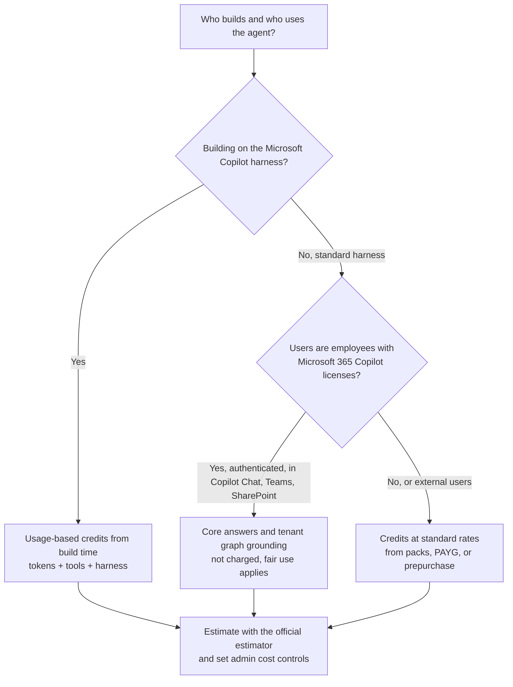

### When should it be used?

Consider licensing at **three moments**:

1. **Use-case selection:** who the users are and which licenses they hold.
2. **Design:** which features you use (generative answers vs. classic answers, tenant graph grounding, reasoning models, frequent triggers).
3. **Operations:** monitoring consumption and setting limits.

### Step-by-step: check your own situation

1. Find out which license you have: trial, user license, Microsoft 365 Copilot, or Teams plan. Ask your admin if you're not sure.
2. If you're on a **trial**, remember that you can build and test but **can't publish**.
3. Use the official [agent usage estimator](https://microsoft.github.io/copilot-studio-estimator/) to forecast a sample agent.
4. Admins: view consumption in the Power Platform admin center under **Licensing** > **Copilot Studio**. For agents on the Microsoft Copilot harness, the agent's **Monitor** page shows the credits it consumed.
5. Admins can set **environment credit allocations**, **agent limits**, and block environments from **drawing from the tenant pool**.

### Practical example

**Illustrative only** (standard harness; rates from the official table). An external FAQ agent answers 1,000 conversations a month, each with 3 generative answers: 3 × 2 = **6 credits per conversation**, which is **6,000 credits per month**. If the same agent also used tenant graph grounding for every answer, each answer would cost 2 + 10 = 12 credits. That's 36 credits per conversation, or **36,000 credits per month**, six times more. Always validate with the official estimator.

### Real-world enterprise scenario

A company with Microsoft 365 Copilot licenses for all office staff publishes its HR agent to Teams and Microsoft Copilot. Employee-facing generative answers by licensed, authenticated users aren't charged. Its **customer-facing** web agent, however, consumes credits from a prepaid pack. The pay-as-you-go billing policy is linked only to the production environment as an overflow. Finance reviews consumption monthly.

### Common mistakes

- Planning to **publish** from a trial license.
- Assuming unused prepaid credits roll over. They don't.
- Forgetting that Microsoft Copilot harness **testing and evaluations consume credits**.
- Assuming the Teams plan supports generative orchestration or Power Platform connector tools. It doesn't.
- Quoting prices from memory instead of the official Licensing Guide.

### Troubleshooting

| Symptom | Likely cause | Fix |
|---|---|---|
| The **Publish** option fails or is blocked | Trial license | Get a paid license or pay-as-you-go access through your admin |
| Service is denied mid-month | Capacity exceeded, so overage enforcement applied | Add capacity, enable pay-as-you-go, or reduce usage |
| An agent flow stopped running | The environment has no Copilot Credits available | Allocate credits; agent flow enforcement blocks new runs |
| Users outside the authors group can still author | Another license (trial, per-user, Microsoft 365 Copilot) grants access | Remove those licenses as well as group membership |

### Interview questions

1. **Explain Copilot Credits and how they're purchased.**
   *Model answer:* Copilot Credits are the common currency for Copilot Studio usage (since September 2025). They come from prepaid tenant packs (enforced monthly, no rollover), pay-as-you-go through an Azure subscription and billing policy, or a one-year prepurchase plan. Consumption depends on the features used and the harness.
2. **How does billing differ between the standard and Microsoft Copilot harnesses?**
   *Model answer:* The standard harness bills features at published rates after publishing; classic and generative answers and tenant graph grounding are included for Microsoft 365 Copilot-licensed authenticated employees. The Microsoft Copilot harness is usage-based (tokens, tools, harness) and charges from build time, including testing and evaluations.

### Assessment (knowledge check)

1. How many Copilot Credits does a generative answer cost on the standard harness (unlicensed user)?
2. True or false: a trial license lets you publish to Microsoft Teams.
3. Name the three ways to acquire Copilot Credits.

Show answers

1. **2** Copilot Credits.
2. **False.** You can create and test, but not publish.
3. Prepaid Copilot Credit pack subscription, pay-as-you-go (Azure billing policy), and the Copilot Credit prepurchase plan.

---

## Module summary

- Copilot Studio is Microsoft's low-code studio for **agents, workflows, and agent flows**, plus an app creation experience (preview), built on Power Platform.
- In 2026 everything runs on a **harness**: **Microsoft Copilot** (new experience, preview), **Customer Conversation** (preview), or **standard** (classic experience, GA). The harness determines features, channels, and billing.
- Copilot Studio evolved from **Power Virtual Agents** (2019), which became part of it in **November 2023**.
- **Microsoft Copilot** and **Microsoft 365 Copilot** are AI experiences people *use*. **Agent Builder** creates simple declarative agents. **Copilot Studio** builds governed, integrated agents for any audience.
- Agents combine **instructions, knowledge, tools, logic, triggers, state, a model, and channels**, grounded and orchestrated by generative AI.
- **Licensing** revolves around **Copilot Credits**, harness-specific billing, and the user's licenses.

Continue with [EXAMPLES.md](EXAMPLES.md) and then the [lab](STEP-BY-STEP-LAB.md).

## References

- [Overview – Microsoft Copilot Studio](https://learn.microsoft.com/en-us/microsoft-copilot-studio/fundamentals-what-is-copilot-studio)
- [Harnesses in Copilot Studio](https://learn.microsoft.com/en-us/microsoft-copilot-studio/harnesses-overview)
- [Agents overview](https://learn.microsoft.com/en-us/microsoft-copilot-studio/agents-overview)
- [Access standard harness agents and agent flows](https://learn.microsoft.com/en-us/microsoft-copilot-studio/agents-experience/switch-experiences)
- [FAQ for agents powered by the Microsoft Copilot harness](https://learn.microsoft.com/en-us/microsoft-copilot-studio/agents-experience/faqs-copilot-harness)
- [What's new in Copilot Studio](https://learn.microsoft.com/en-us/microsoft-copilot-studio/whats-new)
- [Upgrade classic chatbots to Copilot Studio](https://learn.microsoft.com/en-us/microsoft-copilot-studio/unified-authoring-conversion)
- [Choose between Agent Builder and Copilot Studio](https://learn.microsoft.com/en-us/microsoft-365/copilot/extensibility/copilot-studio-experience)
- [What is Microsoft Copilot?](https://learn.microsoft.com/en-us/copilot/plan/copilot-overview)
- [Orchestrate agent behavior with generative AI](https://learn.microsoft.com/en-us/microsoft-copilot-studio/advanced-generative-actions)
- [AI-based agent authoring overview](https://learn.microsoft.com/en-us/microsoft-copilot-studio/nlu-gpt-overview)
- [Event triggers overview](https://learn.microsoft.com/en-us/microsoft-copilot-studio/authoring-triggers-about)
- [Add an event trigger](https://learn.microsoft.com/en-us/microsoft-copilot-studio/authoring-trigger-event)
- [Select a primary AI model for your agent](https://learn.microsoft.com/en-us/microsoft-copilot-studio/authoring-select-agent-model)
- [Language support](https://learn.microsoft.com/en-us/microsoft-copilot-studio/authoring-language-support)
- [Create and delete agents](https://learn.microsoft.com/en-us/microsoft-copilot-studio/authoring-first-bot)
- [Application Card for Microsoft Copilot Studio](https://learn.microsoft.com/en-us/microsoft-copilot-studio/system-service-card-copilot-studio)
- [Responsible AI FAQs](https://learn.microsoft.com/en-us/microsoft-copilot-studio/responsible-ai-overview)
- [Standard harness licensing](https://learn.microsoft.com/en-us/microsoft-copilot-studio/billing-licensing)
- [Billing rates and management](https://learn.microsoft.com/en-us/microsoft-copilot-studio/requirements-messages-management)
- [Overview of usage-based billing (Microsoft Copilot harness)](https://learn.microsoft.com/en-us/microsoft-copilot-studio/agents-experience/billing-credit-overview)
- [Get access to Copilot Studio (trial and plans)](https://learn.microsoft.com/en-us/microsoft-copilot-studio/requirements-licensing-subscriptions)
- [Manage costs for agents powered by the Microsoft Copilot harness](https://learn.microsoft.com/en-us/power-platform/admin/manage-usage-microsoft-copilot-harness)
- [App registration, agent identities, and authentication](https://learn.microsoft.com/en-us/microsoft-copilot-studio/govern-agents-identities-overview)
- [Give your agent an account (Frontier)](https://learn.microsoft.com/en-us/microsoft-copilot-studio/agents-experience/authoring-agent-account)
- [Power Platform environments overview](https://learn.microsoft.com/en-us/power-platform/admin/environments-overview)
- [Microsoft Copilot Studio Licensing Guide](https://go.microsoft.com/fwlink/?linkid=2320995)
- [Microsoft blog: Power Virtual Agents is now generally available (2019)](https://www.microsoft.com/en-us/copilot/blog/copilot-studio/microsoft-power-virtual-agents-is-now-generally-available/)
- [Microsoft blog: Power Virtual Agents, now part of Microsoft Copilot Studio (2023)](https://www.microsoft.com/en-us/copilot/blog/copilot-studio/microsoft-power-virtual-agents-now-part-of-microsoft-copilot-studio/)
- [Microsoft blog: Unlocking autonomous agent capabilities (2024)](https://www.microsoft.com/en-us/copilot/blog/copilot-studio/unlocking-autonomous-agent-capabilities-with-microsoft-copilot-studio/)

_Last verified against Microsoft Learn: 18 November 2026._
