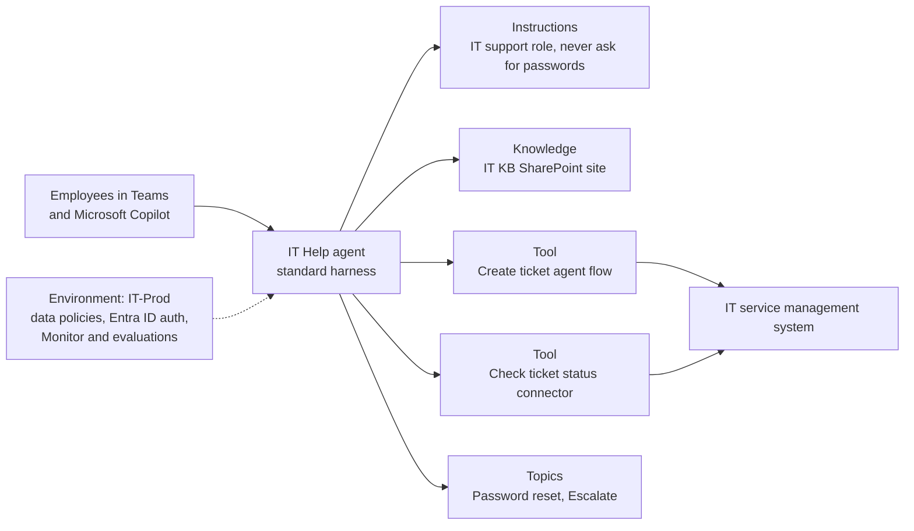

# Module 01 — Examples: Introduction to Microsoft Copilot Studio

Practical, reusable examples for every lesson in this module. Each one says which lesson it supports. Credit figures use the **official standard harness billing rates** (Microsoft Learn, November 2026) and are **illustrative only**; always validate with the [agent usage estimator](https://microsoft.github.io/copilot-studio-estimator/) and the [Licensing Guide](https://go.microsoft.com/fwlink/?linkid=2320995).

## Contents

1. [Writing a good agent description](#example-1-writing-a-good-agent-description)
2. [Starter instructions for a first agent](#example-2-starter-instructions-for-a-first-agent)
3. [Choosing a harness: eight decisions](#example-3-choosing-a-harness-eight-decisions)
4. [One request, four engines](#example-4-one-request-four-engines)
5. [Designing an autonomous agent trigger](#example-5-designing-an-autonomous-agent-trigger)
6. [Enterprise use-case catalog](#example-6-enterprise-use-case-catalog)
7. [A completed use-case canvas](#example-7-a-completed-use-case-canvas)
8. [Licensing scenarios](#example-8-licensing-scenarios)
9. [Copilot Credit estimation, worked](#example-9-copilot-credit-estimation-worked)
10. [Architecture sketch: IT Help agent](#example-10-architecture-sketch-it-help-agent)
11. [Translating old terminology](#example-11-translating-old-terminology)
12. [Explaining Copilot Studio to stakeholders](#example-12-explaining-copilot-studio-to-stakeholders)

---

## Example 1: Writing a good agent description

*Supports: Lessons [1](CONCEPTS.md#lesson-1-what-is-microsoft-copilot-studio), [11](CONCEPTS.md#lesson-11-agent-architecture)*

When you create a standard harness agent from a description (up to **1,024 characters**), the AI generates its name, description, and instructions, and suggests knowledge, tools, triggers, and channels. A better description gives you better starting suggestions.

| Quality | Description | Why |
|---|---|---|
| ❌ Weak | "A helpful HR bot." | No users, no scope, no source, no behavior |
| ⚠️ Better | "Answer employee HR questions." | A scope, but no source and no boundaries |
| ✅ Strong | "Help employees of Contoso find answers about leave, benefits, and expenses using the HR policies on our HR SharePoint site. Answer briefly, cite the policy, never give legal or medical advice, and suggest contacting HR when the policy doesn't cover the question." | States users, scope, source, tone, boundaries, and escalation |

**Pattern:** *Help [users] [do what] about [scope] using [source]. [Tone]. [Boundaries]. [Escalation].*

## Example 2: Starter instructions for a first agent

*Supports: Lessons [8](CONCEPTS.md#lesson-8-generative-ai-fundamentals), [11](CONCEPTS.md#lesson-11-agent-architecture). Full instruction design is in [Module 06](../06-Agent-Configuration-and-Instructions/README.md).*

Instructions can be up to **8,000 characters** on the standard harness. Start short and structured:

```text
# Role
You are the Contoso HR Policy Assistant for Contoso employees.

# Objective
Answer questions about leave, benefits, and expenses using only the connected HR policy knowledge.

# Scope
- In scope: leave, benefits, expenses, holidays.
- Out of scope: legal advice, medical advice, individual salary details.

# Response style
- Friendly, professional, concise (max 5 sentences or 5 bullets).
- Always cite the policy document you used.

# Rules
- If the policy does not contain the answer, say you could not find it and suggest contacting HR.
- Never ask for passwords, bank details, or health information.
```

## Example 3: Choosing a harness, eight decisions

*Supports: [Lesson 2](CONCEPTS.md#lesson-2-harnesses-and-the-new-vs-classic-experience)*

| # | Scenario | Harness | Reasoning |
|---|---|---|---|
| 1 | IT FAQ agent in Teams for 5,000 employees | Standard | Predictable Q&A, GA, broad channel support |
| 2 | Agent that reads supplier invoices (PDF), matches POs, and routes exceptions | Microsoft Copilot (🧪) | Multistep reasoning over files and tools |
| 3 | Bank card-services line with a phone number and web chat that escalates to representatives | Customer Conversation (🧪) | Voice and chat with human escalation is its purpose |
| 4 | Legal disclosure assistant with exact approved wording | Standard | Deterministic topics with message nodes |
| 5 | Learning topics, entities, and variables (Modules 07–08) | Standard | These features exist only on the standard harness |
| 6 | Agent that drafts a weekly Excel report from several data sources | Microsoft Copilot (🧪) | Native Excel creation and editing, multistep work |
| 7 | Agent that must be published to a channel the newer harness doesn't support yet | Standard | The Microsoft Copilot harness supports a smaller set of channels |
| 8 | Pilot with a very tight budget and many test iterations | Standard first | Microsoft Copilot harness bills from build and test time |

## Example 4: One request, four engines

*Supports: Lessons [2](CONCEPTS.md#lesson-2-harnesses-and-the-new-vs-classic-experience), [6](CONCEPTS.md#lesson-6-copilot-studio-vs-traditional-chatbots)*

User message: **"Change my delivery address to 12 Harbour Road and tell me your return policy."**

| Engine | Typical behavior |
|---|---|
| **Traditional chatbot** | Matches the "change address" intent (or nothing), runs a scripted dialog, and ignores the return-policy part, or asks the user to rephrase |
| **Standard harness, classic orchestration** | Triggers the single best-matching topic (for example, *Change address*) based on trigger phrases. Knowledge is used only as a fallback when no topic matches, or when a topic calls it explicitly. |
| **Standard harness, generative orchestration** | Selects the *Change address* topic **and** a knowledge search based on descriptions. Fills the address input from the message (or asks for any missing details), runs them in sequence, and replies with one combined answer. |
| **Microsoft Copilot harness** | Treats the message as a goal. It reasons through the steps, calls the relevant tools and knowledge, recovers from a failed step if possible, and responds. It uses skills or workflows instead of topics. |

> [!NOTE]
> These are *typical* behaviors. Actual results depend on your instructions, descriptions, tools, knowledge, and model. Use the activity map to see exactly what happened.

## Example 5: Designing an autonomous agent trigger

*Supports: [Lesson 7](CONCEPTS.md#lesson-7-ai-agents-and-autonomous-agents). Standard harness, which requires generative orchestration.*

**Scenario:** welcome new employees automatically.

| Element | Example |
|---|---|
| Trigger | *When a row is added, modified or deleted* (Dataverse), filtered to the **New hires** table and the *Added* change type |
| Payload instruction | "Use content from `Body`. Send the new employee a welcome message with links to the onboarding checklist." |
| Agent instruction (general) | "When you receive a new-hire event, look up the onboarding checklist in knowledge and send a concise welcome message. Never share other employees' data." |
| Tool | A connector or agent flow that posts a message |
| Human-in-the-loop | Not needed for a welcome message. Add approval if the agent were to grant system access. |
| Monitoring | Review runs on the **Activity** page during the pilot |

❌ **Conflicting instructions to avoid:**

- Payload says: *"Email the full employee record to the manager."*
- Agent instruction says: *"Never share employee data."*

Conflicts can cause errors or unexpected results. Keep payload and agent instructions aligned.

## Example 6: Enterprise use-case catalog

*Supports: [Lesson 12](CONCEPTS.md#lesson-12-enterprise-use-cases). These map to the projects in [Module 20](../20-Real-World-Projects/README.md).*

| Use case | Users | Channel | Knowledge | Actions | Harness | Key metric | Risk |
|---|---|---|---|---|---|---|---|
| HR employee assistant | Employees | Teams, Microsoft Copilot | HR SharePoint | Open HR case | Standard | HR ticket deflection | Medium |
| IT helpdesk agent | Employees | Teams | IT KB | Create or check ticket | Standard | First-contact resolution | Medium |
| Customer support agent | Customers | Website | Product docs | Order status, returns | Standard (or Customer Conversation 🧪 for voice) | Resolution rate, CSAT | High |
| Company knowledge assistant | Employees | Teams | Intranet, SharePoint | None | Standard | Answer accuracy | Low |
| Employee policy assistant | Employees | Teams | Policy library | None | Standard | Policy-question volume | Medium |
| Product FAQ agent | Prospects, customers | Website | Public product site | None | Standard | Containment rate | Low |
| Sales information assistant | Sellers | Teams | Price lists, CRM data | CRM lookup | Standard | Time to answer | Medium |
| Internal business assistant | Ops staff | Teams | Procedures | Request forms | Standard | Requests automated | Medium |
| Document Q&A agent | Analysts | Teams | Uploaded documents | None | Standard | Groundedness score | Medium |
| Invoice processing agent | Finance | Teams | Invoices, POs | Route exceptions for approval | Microsoft Copilot (🧪) | Invoices processed per day | High |

## Example 7: A completed use-case canvas

*Supports: [Lesson 12](CONCEPTS.md#lesson-12-enterprise-use-cases)*

| Field | Employee Policy Assistant |
|---|---|
| **Problem** | HR receives about 1,200 policy questions a month, and the average reply takes 2 days |
| **Users / channel** | All 8,000 employees, in Microsoft Teams and Microsoft Copilot |
| **Top jobs** | Leave rules, benefits enrollment, expenses, travel, holidays, remote work, code of conduct, parental leave, training budget, equipment |
| **Knowledge** | HR policy SharePoint library (owner: HR Operations); all employees have read access |
| **Actions** | Phase 1: none. Phase 2: "Open HR case" tool. |
| **Risk** | Medium. Answers must cite policy; legal and medical topics are out of scope; escalate to HR. |
| **Harness / licensing** | Standard harness. 60% of staff hold Microsoft 365 Copilot licenses (employee-facing answers by authenticated licensed users aren't charged); the other 40% consume credits. |
| **Metrics** | Baseline 1,200 tickets a month → target 700 (−40%); CSAT ≥ 4/5; ≥ 95% answers with citations |
| **Owners** | Business: HR Director. Technical: Power Platform CoE maker. |

## Example 8: Licensing scenarios

*Supports: [Lesson 13](CONCEPTS.md#lesson-13-licensing-fundamentals)*

| Scenario | What applies | Watch out for |
|---|---|---|
| A student wants to learn Copilot Studio with a work or school account | Trial license: create and test | **Can't publish**. Extend by 30 days when the trial expires. |
| Org has Microsoft 365 E5 and wants a simple Teams-only FAQ agent | Possibly the **Copilot Studio for Teams plan** | Classic orchestration only, Teams only, no Power Platform connector tools, Dataverse for Teams. ⚠️ Dataverse for Teams environments are **deprecated**, so prefer a standard environment for new work. |
| Org wants a customer-facing website agent | Copilot Credits via **prepaid pack**, **pay-as-you-go**, or **prepurchase plan**, plus maker access | External users aren't covered by Microsoft 365 Copilot licenses |
| Employees with Microsoft 365 Copilot licenses use an HR agent in Teams | Classic and generative answers and tenant graph grounding aren't charged (authenticated, fair use) | Agent flows only included via the *When an agent calls the flow* trigger; computer use isn't included |
| Makers with Microsoft 365 Copilot licenses build in the new experience | Microsoft 365 Copilot license grants building for the **Microsoft Copilot harness** | Building, testing, evaluating, and running still consume Copilot Credits (usage-based). This usage **isn't included** in the Microsoft 365 Copilot license. |
| Admin wants to stop overspending | Power Platform admin center cost controls: environment allocations, agent limits, block drawing from the tenant pool | Unused prepaid credits don't roll over; overage enforcement can deny service |

## Example 9: Copilot Credit estimation, worked

*Supports: [Lesson 13](CONCEPTS.md#lesson-13-licensing-fundamentals). Standard harness rates: classic answer 1, generative answer 2, agent action 5, tenant graph grounding 10, agent flow actions 13 per 100 actions, reasoning premium 10 per 1,000 tokens.*

> [!CAUTION]
> These calculations use simplified **assumptions** to teach the method. Real metering depends on what actually happens in each conversation (visible on the activity map). Use the official estimator for real plans.

**A. External FAQ website agent (unauthenticated customers)**

- 2,000 sessions a month. Each session has 1 authored topic reply (classic answer) and 2 generative answers.
- Per session: 1×1 + 2×2 = **5 credits** → 2,000 × 5 = **10,000 credits a month**.

**B. Employee agent with tenant graph grounding**

- 5,000 sessions a month, each with 3 generative answers using tenant graph grounding.
- Unlicensed user session: 3 × (2 + 10) = **36 credits**.
- 30% of sessions come from users **without** Microsoft 365 Copilot: 1,500 × 36 = **54,000 credits a month**.
- The 70% from licensed, authenticated users in Teams aren't charged for these features (fair use applies).

**C. Autonomous agent on a Recurrence trigger**

- Assumption: each run = 2 agent actions (trigger step and tool call) + 1 generative answer = 5×2 + 2 = **12 credits**. It also calls an agent flow with 20 billed flow actions (the trigger execution counts as one).
- **Every 10 minutes:** 4,320 runs a month → 4,320 × 12 = 51,840, plus flow 4,320 × 20 = 86,400 actions → 864 × 13 = 11,232. Total ≈ **63,072 credits a month**.
- **Every hour:** 720 runs → 720 × 12 = 8,640, plus 14,400 actions → 144 × 13 = 1,872. Total ≈ **10,512 credits a month**.
- **Lesson:** trigger frequency multiplies cost.

**D. Reasoning model premium**

- A generative answer on a standard model costs **2 credits**.
- The same answer orchestrated by a reasoning model that bills 6,000 tokens costs 2 + (6,000 ÷ 1,000 × 10) = **62 credits**, which is 31 times more.
- **Lesson:** use reasoning models only where they add clear value.

## Example 10: Architecture sketch, IT Help agent

*Supports: [Lesson 11](CONCEPTS.md#lesson-11-agent-architecture)*



## Example 11: Translating old terminology

*Supports: [Lesson 3](CONCEPTS.md#lesson-3-evolution-from-power-virtual-agents)*

| You read (older material) | Say today | Notes |
|---|---|---|
| Power Virtual Agents, PVA | Microsoft Copilot Studio | PVA became part of Copilot Studio in November 2023 |
| Bot / chatbot / copilot (as the thing you build) | Agent | Older PVA bots are "classic chatbots" |
| Messages (billing) | Copilot Credits | Changed 1 September 2025 |
| Analytics page | **Monitor** page | Current Learn articles use "Monitor" |
| "Turn off New experience" | **…** > **Open classic experience** | Both layouts appear in current docs |
| "GitHub Copilot harness" (in some URLs and anchors) | Microsoft Copilot harness | Use the name from the current harness overview |

## Example 12: Explaining Copilot Studio to stakeholders

*Supports: Lessons [1](CONCEPTS.md#lesson-1-what-is-microsoft-copilot-studio), [4](CONCEPTS.md#lesson-4-copilot-studio-vs-microsoft-copilot), [5](CONCEPTS.md#lesson-5-copilot-studio-vs-microsoft-365-copilot), [13](CONCEPTS.md#lesson-13-licensing-fundamentals)*

| Audience | 30-second pitch |
|---|---|
| **CEO** | "Copilot Studio lets our teams build AI agents that answer questions from our own content and complete tasks in our systems, in Teams, Microsoft Copilot, or on our website, with IT governance built in." |
| **CISO** | "Agents run in governed Power Platform environments with Entra ID authentication, data policies, sharing controls, agent inventory, and an Entra Agent ID for every new agent. Knowledge is grounded in data the user has permission to access." |
| **CFO** | "Usage is measured in Copilot Credits. For employee-facing standard harness agents, Microsoft 365 Copilot licenses cover many interactions. Microsoft Copilot harness usage is always metered. Admins can set per-agent and per-environment spending limits." |
| **End users** | "Ask the agent in Teams like you'd ask a colleague. It answers from official sources, shows where the answer came from, and hands you to a person when needed." |

## References

- [Create and delete agents](https://learn.microsoft.com/en-us/microsoft-copilot-studio/authoring-first-bot)
- [Harnesses in Copilot Studio](https://learn.microsoft.com/en-us/microsoft-copilot-studio/harnesses-overview)
- [Orchestrate agent behavior with generative AI](https://learn.microsoft.com/en-us/microsoft-copilot-studio/advanced-generative-actions)
- [Event triggers overview](https://learn.microsoft.com/en-us/microsoft-copilot-studio/authoring-triggers-about)
- [Billing rates and management](https://learn.microsoft.com/en-us/microsoft-copilot-studio/requirements-messages-management)
- [Standard harness licensing](https://learn.microsoft.com/en-us/microsoft-copilot-studio/billing-licensing)
- [Get access to Copilot Studio](https://learn.microsoft.com/en-us/microsoft-copilot-studio/requirements-licensing-subscriptions)
- [FAQ for agents powered by the Microsoft Copilot harness](https://learn.microsoft.com/en-us/microsoft-copilot-studio/agents-experience/faqs-copilot-harness)
- [Application Card for Microsoft Copilot Studio](https://learn.microsoft.com/en-us/microsoft-copilot-studio/system-service-card-copilot-studio)
- [Microsoft Copilot Studio agent usage estimator](https://microsoft.github.io/copilot-studio-estimator/)

_Last verified against Microsoft Learn: 18 November 2026._
