# Module 01 — Introduction to Microsoft Copilot Studio

> [!NOTE]
> **Status: ✅ Complete.** All eight module files are developed and verified against Microsoft Learn (18 November 2026).

## At a glance

| | |
|---|---|
| **Level** | Beginner |
| **Estimated time** | 5 hours (about 2.5 h lessons, 1.5 h lab, 1 h assessment) |
| **Prerequisites** | None. A work or school account is needed for the lab. |
| **Harness focus** | All three harnesses (concepts). Hands-on work uses the **standard harness** in the classic experience. |
| **Lab** | [Understand and explore Copilot Studio](STEP-BY-STEP-LAB.md) |

## Why this module matters

Before you build anything, you need an accurate mental model of what Copilot Studio is in **2026**. It's no longer just the chatbot designer that grew out of Power Virtual Agents. It's a multi-harness platform for agents, workflows, and agent flows (plus an app creation experience in preview), with usage-based billing and enterprise governance. Beginners who skip this foundation follow outdated tutorials, build on the wrong harness, or are surprised by licensing.

For professionals, this module provides the vocabulary and decision frameworks used throughout the course:

- Choosing a harness.
- Positioning Copilot Studio against Microsoft Copilot, Microsoft 365 Copilot, and Agent Builder.
- Reasoning about grounding, models, and cost.
- Scoping enterprise use cases.

## Learning objectives

By the end of this module you will be able to:

1. **Define** Microsoft Copilot Studio and its building blocks (agents, workflows, and agent flows), and the related preview experiences for apps and natural-language building.
2. **Compare** the Microsoft Copilot, Customer Conversation, and standard harnesses, and **select** one for a scenario.
3. **Describe** the evolution from Power Virtual Agents to today's platform, and **translate** legacy terminology.
4. **Differentiate** Copilot Studio from Microsoft Copilot, Microsoft 365 Copilot, and Agent Builder.
5. **Contrast** traditional chatbots with classic and generative orchestration.
6. **Explain** AI agents, autonomous agents, and event triggers, including their constraints.
7. **Explain** generative AI, grounding, RAG, LLMs, tokens, and NLP as they apply to Copilot Studio.
8. **Diagram** the architecture of an agent and its request lifecycle.
9. **Evaluate** enterprise use cases with a use-case canvas and success metrics.
10. **Summarize** Copilot Studio licensing: Copilot Credits, acquisition options, access routes, and billing by harness.

## Module map

```mermaid
flowchart LR
    L1["1 What is Copilot Studio"] --> L2["2 Harnesses and experiences"]
    L2 --> L3["3 Evolution from PVA"]
    L3 --> L4["4 vs Microsoft Copilot"]
    L4 --> L5["5 vs Microsoft 365 Copilot"]
    L5 --> L6["6 vs traditional chatbots"]
    L6 --> L7["7 AI and autonomous agents"]
    L7 --> L8["8 Generative AI"]
    L8 --> L9["9 LLMs"]
    L9 --> L10["10 NLP"]
    L10 --> L11["11 Agent architecture"]
    L11 --> L12["12 Enterprise use cases"]
    L12 --> L13["13 Licensing"]
    L13 --> LAB["Lab"]
    LAB --> ASSESS["Assessment"]
```

## Lessons

| # | Lesson | Key takeaway |
|---|---|---|
| 1 | [What is Microsoft Copilot Studio?](CONCEPTS.md#lesson-1-what-is-microsoft-copilot-studio) | A low-code studio for agents, workflows, and agent flows, on Power Platform |
| 2 | [Harnesses and the new vs. classic experience](CONCEPTS.md#lesson-2-harnesses-and-the-new-vs-classic-experience) | The harness determines features, channels, and billing. The classic experience is the standard harness. |
| 3 | [Evolution from Power Virtual Agents](CONCEPTS.md#lesson-3-evolution-from-power-virtual-agents) | PVA (2019) → Copilot Studio (Nov 2023) → agents and autonomy → harnesses (2026) |
| 4 | [Copilot Studio vs. Microsoft Copilot](CONCEPTS.md#lesson-4-copilot-studio-vs-microsoft-copilot) | People *use* Microsoft Copilot; makers *build* agents that can appear in it |
| 5 | [Copilot Studio vs. Microsoft 365 Copilot](CONCEPTS.md#lesson-5-copilot-studio-vs-microsoft-365-copilot) | Agent Builder for simple declarative agents; Copilot Studio for integration, external channels, and ALM |
| 6 | [Copilot Studio vs. traditional chatbots](CONCEPTS.md#lesson-6-copilot-studio-vs-traditional-chatbots) | Descriptions and planning beat rigid intents; keep topics for exact wording |
| 7 | [AI agents and autonomous agents](CONCEPTS.md#lesson-7-ai-agents-and-autonomous-agents) | Event triggers need generative orchestration, data-policy approval, and a credit budget |
| 8 | [Generative AI fundamentals](CONCEPTS.md#lesson-8-generative-ai-fundamentals) | Ground, cite, and govern; answers aren't deterministic |
| 9 | [Large language models (LLMs)](CONCEPTS.md#lesson-9-large-language-models-llms) | Default GA model first; mind reasoning cost and cross-geo tags |
| 10 | [Natural language processing (NLP)](CONCEPTS.md#lesson-10-natural-language-processing-nlp) | NLU finds intent and entities; English has the highest accuracy |
| 11 | [Agent architecture](CONCEPTS.md#lesson-11-agent-architecture) | Instructions, knowledge, tools, logic, triggers, state, model, channels |
| 12 | [Enterprise use cases](CONCEPTS.md#lesson-12-enterprise-use-cases) | Score value, feasibility, and risk; measure against baselines |
| 13 | [Licensing fundamentals](CONCEPTS.md#lesson-13-licensing-fundamentals) | Copilot Credits; billing differs by harness; a trial can't publish |

## How to study this module

1. Read this README.
2. Study [CONCEPTS.md](CONCEPTS.md) lesson by lesson. Complete each lesson's knowledge check before moving on.
3. Review [EXAMPLES.md](EXAMPLES.md) for worked scenarios, including credit estimation.
4. Complete the [lab](STEP-BY-STEP-LAB.md) and fill in the exploration worksheet.
5. Read [COMMON-MISTAKES.md](COMMON-MISTAKES.md) and complete its self-check.
6. Take the [assessment](ASSESSMENT.md), then compare with [ANSWERS.md](ANSWERS.md).
7. Practise the [interview questions](INTERVIEW-QUESTIONS.md) out loud.
8. Record your progress in [LEARNING-PROGRESS.md](../LEARNING-PROGRESS.md).

## Files in this module

| File | Purpose | Status |
|---|---|---|
| [README.md](README.md) | Module overview, objectives, and study path | ✅ |
| [CONCEPTS.md](CONCEPTS.md) | 13 lessons, each following the 11-part teaching sequence | ✅ |
| [STEP-BY-STEP-LAB.md](STEP-BY-STEP-LAB.md) | Hands-on lab: explore Copilot Studio and create a first agent | ✅ |
| [EXAMPLES.md](EXAMPLES.md) | 12 practical examples (descriptions, harness choice, credits, architecture) | ✅ |
| [ASSESSMENT.md](ASSESSMENT.md) | 24 items: 10 MCQ, 5 true/false, 5 short answer, 2 practical, 1 scenario, 1 troubleshooting | ✅ |
| [ANSWERS.md](ANSWERS.md) | Answers, explanations, why wrong options are wrong, rubrics | ✅ |
| [INTERVIEW-QUESTIONS.md](INTERVIEW-QUESTIONS.md) | 30 interview questions with model answers | ✅ |
| [COMMON-MISTAKES.md](COMMON-MISTAKES.md) | 18 common mistakes, quick troubleshooting, self-check | ✅ |

## Completion checklist

- [ ] All 13 lesson knowledge checks attempted
- [ ] Lab worksheet completed (13 rows)
- [ ] Assessment score recorded (target ≥ 75%)
- [ ] Common-mistakes self-check completed
- [ ] Interview questions practised

## Key official documentation

- [Overview – Microsoft Copilot Studio](https://learn.microsoft.com/en-us/microsoft-copilot-studio/fundamentals-what-is-copilot-studio)
- [Harnesses in Copilot Studio](https://learn.microsoft.com/en-us/microsoft-copilot-studio/harnesses-overview)
- [Agents overview](https://learn.microsoft.com/en-us/microsoft-copilot-studio/agents-overview)
- [Quickstart: Create and deploy an agent with the standard harness](https://learn.microsoft.com/en-us/microsoft-copilot-studio/fundamentals-get-started)
- [Choose between Agent Builder and Copilot Studio](https://learn.microsoft.com/en-us/microsoft-365/copilot/extensibility/copilot-studio-experience)
- [Standard harness licensing](https://learn.microsoft.com/en-us/microsoft-copilot-studio/billing-licensing)
- [What's new in Copilot Studio](https://learn.microsoft.com/en-us/microsoft-copilot-studio/whats-new)

## Navigation

⬅️ [Course home](../README.md) | 🗺️ [Course roadmap](../COURSE-ROADMAP.md) | 📈 [Learning progress](../LEARNING-PROGRESS.md) | ➡️ [Module 02 — Power Platform Fundamentals](../02-Power-Platform-Fundamentals/README.md)

## References

- [Overview – Microsoft Copilot Studio](https://learn.microsoft.com/en-us/microsoft-copilot-studio/fundamentals-what-is-copilot-studio)
- [Harnesses in Copilot Studio](https://learn.microsoft.com/en-us/microsoft-copilot-studio/harnesses-overview)
- [Agents overview](https://learn.microsoft.com/en-us/microsoft-copilot-studio/agents-overview)
- [Quickstart: Create and deploy an agent with the standard harness](https://learn.microsoft.com/en-us/microsoft-copilot-studio/fundamentals-get-started)
- [Choose between Agent Builder and Copilot Studio](https://learn.microsoft.com/en-us/microsoft-365/copilot/extensibility/copilot-studio-experience)
- [Standard harness licensing](https://learn.microsoft.com/en-us/microsoft-copilot-studio/billing-licensing)
- [What's new in Copilot Studio](https://learn.microsoft.com/en-us/microsoft-copilot-studio/whats-new)

_Last verified against Microsoft Learn: 18 November 2026._
