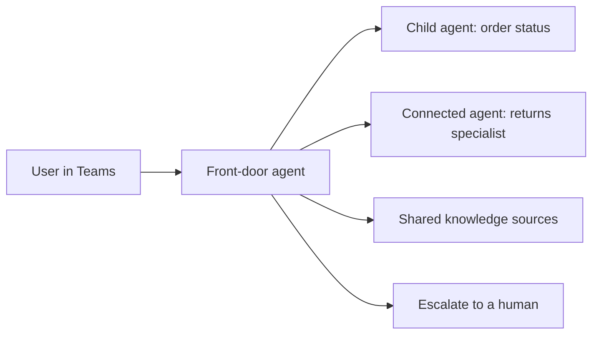

# Module 18 — Advanced Agent Development

> [!NOTE]
> **Status: 🔜 Planned.** This syllabus is published; the full lesson files are developed in Step 8 of the [course build plan](../COURSE-ROADMAP.md).

This module moves from single agents to sophisticated solutions: advanced orchestration, complex conversation and multi-topic design, multi-agent collaboration, skills, memory, autonomous triggers, agent accounts, human handoff, and the reliability, scalability, and performance practices that keep advanced agents dependable.

## At a glance

| Item | Details |
|---|---|
| **Level** | Advanced |
| **Estimated time** | 7 hours |
| **Prerequisites** | [Module 17 — Agent Management and Governance](../17-Agent-Management-and-Governance/README.md) |
| **Harness focus** | Multi-agent design (child, connected, A2A, Microsoft Foundry, and Microsoft 365 Agents SDK agents) plus skills, memory, triggers, agent accounts, and handoff — with the GA or preview status of each option stated per harness. |
| **Lab** | Build a multi-agent solution with a front-door agent and specialist agents |

## Why this module matters

**For beginners:** as an agent grows, adding "just one more" topic or tool eventually makes it slower and less accurate. Learning when and how to split work across specialist agents, skills, and reusable components is the step from building agents to engineering them.

**For the enterprise:** real business processes span departments, systems, and teams. Multi-agent architectures let different teams own different specialists with independent lifecycles, while a front-door agent gives users one place to start. The trade-offs — latency, testing surface, governance, and preview-versus-GA risk — are exactly what architects are paid to judge.

## Learning objectives

By the end of this module you will be able to:

1. **Design** advanced generative orchestration with clear descriptions, explicit references in instructions, and controlled tool exposure.
2. **Architect** complex, multi-topic conversations that stay maintainable as they grow.
3. **Compare** child agents, connected agents, external agents (A2A, Microsoft Foundry, Microsoft 365 Agents SDK, Fabric data agents), skills, task agents, and sub-agents, and **choose** the right one for a requirement.
4. **Identify** which multi-agent options are 🟢 GA and which are 🧪 Preview on each harness.
5. **Build** a front-door agent that routes to specialist agents and returns results to the user.
6. **Manage** context across agents, including conversation-history passing, inputs and outputs, and memory.
7. **Implement** human handoff and autonomous patterns such as event triggers.
8. **Evaluate** reliability, scalability, and performance trade-offs, and **optimize** an advanced solution.

## Topics covered

- **Advanced generative orchestration** — controlling which tools the orchestrator may choose dynamically, referencing agents and tools with `/` in instructions, plan-completion and response-interception triggers, and Learn's guidance that selection can degrade beyond roughly 30–40 choices.
- **Complex conversation design** — multi-turn journeys that mix deterministic topics with generative steps, confirmation and recovery loops, and conversation-history effects.
- **Multi-topic architecture** — organizing many topics by domain, topic inputs and outputs, returning results as outputs instead of messages, and avoiding duplicate responses.
- **Multi-agent concepts** — child (inline) agents versus connected agents versus external agents; when splitting helps (independent teams, separate settings, reuse, ALM) and what it costs (latency, testing, governance).
- **Agent collaboration where supported** — the options and their status on each harness (see the table below), connected-agent delegation limits, and the rule that standard-harness and Microsoft Copilot harness agents can't invoke each other directly.
- **Advanced instructions** — instructions for main agents versus child and connected agents, delegation hints, and instructions that guide task agents on the Microsoft Copilot harness.
- **Context management** — the **Pass conversation history to this agent** option for connected agents, explicit inputs and outputs, variable evaluation timing, and per-user **memory** on the Microsoft Copilot harness (🧪 **Preview**, production-ready preview).
- **Reusable patterns** — component collections, shared tools, skills that can be exported and shared (marketplace-shared skills are 🧪 **Preview**), and Learn's multi-agent orchestration patterns.
- **Complex business scenarios** — autonomous agents with event triggers (standard harness) and triggers on the Microsoft Copilot harness (🧪 **Preview**), hooks (🧪 **Preview**), workflows that call agents, and giving an agent its own account with a mailbox and Teams presence (🧪 **Preview** through the Frontier program; 💳 requires specific Microsoft 365 and Agent 365 licensing and an early release cycle environment).
- **Human handoff** — escalating to live agents through engagement hubs (for example Dynamics 365 Customer Service, Genesys, LivePerson, Salesforce, ServiceNow, or a generic hub) with context, and the Customer Conversation harness's per-sub-agent escalation paths (🧪 **Preview**).
- **Reliability** — error paths for every tool and agent call, retries and fallbacks, asynchronous responses for long-running agent flows, and agent readiness and issue status (🧪 **Preview**).
- **Scalability** — splitting specialists into connected agents, independent publishing and ALM, solution-based promotion, and Copilot Credit implications of chattier architectures.
- **Performance optimization** — reducing orchestration hops, trimming tool and knowledge lists, choosing models deliberately, compact data handoffs between agents, and measuring latency and accuracy with evaluations.

### Multi-agent options and their status

| Option | Standard harness | Microsoft Copilot harness | Customer Conversation harness |
|---|---|---|---|
| Child agents (inside the main agent) | 🟢 GA | Not available — use skills or connected agents | Sub-agents share configuration and ALM with the primary agent (🧪 harness in preview) |
| Connected Copilot Studio agents | 🟢 GA (same environment, published, connections allowed) | 🧪 Available on a harness in production-ready preview; only other Microsoft Copilot harness agents | — (Learn documents Microsoft Foundry agents as connected agents for this harness) |
| Agent2Agent (A2A) protocol agents | 🟢 GA | 🧪 Preview | — |
| Microsoft Foundry agents | 🧪 Preview | 🧪 Available on a harness in production-ready preview | 🧪 Preview |
| Microsoft 365 Agents SDK agents | 🧪 Preview | 🧪 Available on a harness in production-ready preview | — |
| Microsoft Fabric data agents | 🧪 Preview | — | — |
| Delegation depth | Main agent → connected agent; an agent with connected agents can't also be connected to a second main agent | One level only — a connected agent can't invoke another connected agent | — |

*"—" means the option isn't documented for that harness on Microsoft Learn as of the verification date.*

## Planned hands-on lab

**Lab: Build a multi-agent solution with a front-door agent and specialist agents**

After the lab you will have:

- An architecture decision record that justifies each specialist as a child agent or a connected agent, and records the GA or preview status of every component.
- A standard-harness front-door agent with one child agent and one connected specialist agent, each with precise descriptions, instructions, and inputs and outputs.
- Deliberate context settings, including whether conversation history is passed to the connected agent.
- A human-handoff path that works from any specialist.
- A routing test set run against the solution, with latency and accuracy observations and at least one tuning iteration.
- Optional: a Microsoft Copilot harness variant that uses a connected agent and a skill, compared with the standard-harness design.

**What you need:**

- Your course environment and solution. A connected Copilot Studio agent must be **published** before another agent can connect to it, so that step needs a license path that can publish — the trial license **can't publish**. Child agents work with a trial.
- 💳 The optional Microsoft Copilot harness variant consumes Copilot Credits while building, previewing, and evaluating, and uses preview capabilities.

## Planned assessment

`ASSESSMENT.md` will follow the course-wide 24-item pattern, and `ANSWERS.md` will provide correct answers, detailed explanations (including why incorrect options are wrong), expected practical outcomes, and rubrics.

| Item type | Count | Planned focus for this module |
|---|---|---|
| Multiple-choice questions | 10 | Child vs connected agents, GA vs preview options per harness, context passing, handoff |
| True/false questions | 5 | Statements such as "a standard-harness agent can call a Microsoft Copilot harness agent as a connected agent" |
| Short-answer questions | 5 | When splitting into connected agents is justified; how to reduce orchestration latency |
| Practical implementation tasks | 2 | Add a child agent with inputs and outputs; connect and tune a specialist agent |
| Real-world scenario challenge | 1 | Design a multi-department employee-services solution with independent team ownership |
| Troubleshooting challenge | 1 | The front-door agent routes to the wrong specialist and the specialist re-asks for known data — fix descriptions and context passing |
| **Total** | **24** | |

**Grading bands:** 0–59% Beginner · 60–74% Intermediate · 75–89% Advanced · 90–100% Professional Ready.

## Files in this module

| File | Purpose | Status |
|---|---|---|
| `README.md` | Syllabus: objectives, topics, lab outline, assessment plan (this file) | ✅ Syllabus |
| `CONCEPTS.md` | Full lessons for every topic using the course teaching sequence | 🔜 Planned |
| `STEP-BY-STEP-LAB.md` | Guided multi-agent lab with checkpoints | 🔜 Planned |
| `EXAMPLES.md` | Multi-agent patterns, decision records, and handoff designs | 🔜 Planned |
| `ASSESSMENT.md` | 24-item module assessment | 🔜 Planned |
| `ANSWERS.md` | Answers, explanations, and rubrics | 🔜 Planned |
| `INTERVIEW-QUESTIONS.md` | Interview questions with model answers | 🔜 Planned |
| `COMMON-MISTAKES.md` | Common mistakes, symptoms, and fixes | 🔜 Planned |

## Key official documentation

- [Add other agents overview (standard harness)](https://learn.microsoft.com/en-us/microsoft-copilot-studio/authoring-add-other-agents)
- [Add a child agent](https://learn.microsoft.com/en-us/microsoft-copilot-studio/add-agent-child-agent)
- [Connect to an existing Copilot Studio agent](https://learn.microsoft.com/en-us/microsoft-copilot-studio/add-agent-copilot-studio-agent)
- [Connected agents overview (Microsoft Copilot harness)](https://learn.microsoft.com/en-us/microsoft-copilot-studio/agents-experience/authoring-add-other-agents)
- [Multi-agent orchestration patterns and best practices](https://learn.microsoft.com/en-us/microsoft-copilot-studio/guidance/multi-agent-patterns)
- [Skills overview for agents (Microsoft Copilot harness)](https://learn.microsoft.com/en-us/microsoft-copilot-studio/agents-experience/skills-overview)
- [Memory (Microsoft Copilot harness, preview)](https://learn.microsoft.com/en-us/microsoft-copilot-studio/agents-experience/memory-overview)
- [Hand off to a live agent](https://learn.microsoft.com/en-us/microsoft-copilot-studio/advanced-hand-off)

## Navigation

⬅️ [Module 17 — Agent Management and Governance](../17-Agent-Management-and-Governance/README.md) | 🗺️ [Course roadmap](../COURSE-ROADMAP.md) | 📈 [Learning progress](../LEARNING-PROGRESS.md) | ➡️ [Module 19 — Enterprise Copilot Studio Architecture](../19-Enterprise-Copilot-Architecture/README.md)

## References

- https://learn.microsoft.com/en-us/microsoft-copilot-studio/authoring-add-other-agents
- https://learn.microsoft.com/en-us/microsoft-copilot-studio/add-agent-child-agent
- https://learn.microsoft.com/en-us/microsoft-copilot-studio/add-agent-copilot-studio-agent
- https://learn.microsoft.com/en-us/microsoft-copilot-studio/agents-experience/authoring-add-other-agents
- https://learn.microsoft.com/en-us/microsoft-copilot-studio/guidance/multi-agent-patterns
- https://learn.microsoft.com/en-us/microsoft-copilot-studio/agents-experience/skills-overview
- https://learn.microsoft.com/en-us/microsoft-copilot-studio/agents-experience/memory-overview
- https://learn.microsoft.com/en-us/microsoft-copilot-studio/advanced-hand-off

_Last verified against Microsoft Learn: 18 November 2026._
