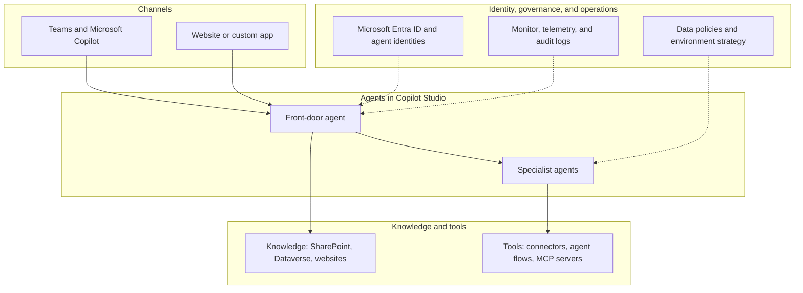
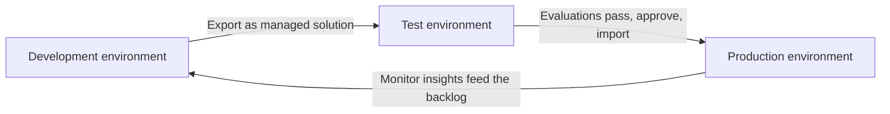

# Module 19 — Enterprise Copilot Studio Architecture

> [!NOTE]
> **Status: 🔜 Planned.** This syllabus is published; the full lesson files are developed in Step 8 of the [course build plan](../COURSE-ROADMAP.md).

This module brings everything together at enterprise scale. You'll learn to choose the right harness for each workload, design agent, knowledge, security, and governance architectures, plan environments and the deployment lifecycle, size licensing and capacity, and document it all in a blueprint that stakeholders can approve. The full lessons include Mermaid architecture diagrams; two previews appear below.

## At a glance

| Item | Details |
|---|---|
| **Level** | Professional |
| **Estimated time** | 6 hours |
| **Prerequisites** | [Module 18 — Advanced Agent Development](../18-Advanced-Agent-Development/README.md) |
| **Harness focus** | Harness selection strategy plus enterprise architecture — when to use the standard harness, the Microsoft Copilot harness, or the Customer Conversation harness, and how they coexist in one estate. |
| **Lab** | Produce an enterprise architecture blueprint for a Copilot Studio rollout |

## Why this module matters

**For beginners stepping up:** individual agents can be built by intuition; an organization-wide rollout can't. Architecture gives you a structured way to make — and explain — decisions about harnesses, environments, identity, data, and cost before they become expensive to change.

**For the enterprise:** Copilot Studio now offers three harnesses with different capabilities, billing models, and maturity levels, alongside fast-moving preview features. Architects must match each workload to the right harness, avoid over-engineering simple problems (which Learn notes can increase credit consumption and latency without improving outcomes), and design security, governance, monitoring, and capacity plans that hold up as the agent estate grows.

## Learning objectives

By the end of this module you will be able to:

1. **Select** a harness for a workload using Learn's criteria — task weight, duration, coordination needs, channels, control, and consumption — and **justify** the choice.
2. **Design** an enterprise agent architecture covering channels, agents, knowledge, tools, identity, and operations.
3. **Apply** agent design patterns such as front-door routing, specialist agents, deterministic topics or workflows inside generative agents, and human-in-the-loop steps.
4. **Design** knowledge, security, and governance architectures that respect permissions, data policies, and data residency.
5. **Define** an environment strategy and a deployment lifecycle using solutions and ALM practices.
6. **Plan** monitoring, licensing, and capacity, including Copilot Credit forecasting and spending controls.
7. **Evaluate** scalability limits such as rate limits, orchestration choice counts, and connected-agent depth.
8. **Produce** an architecture blueprint with diagrams, decision records, and risks, including preview-feature risks.

## Topics covered

- **Enterprise agent architecture** — layered reference architecture: channels, agents, knowledge, tools, identity, governance, and operations, and where each harness fits.
- **Agent design patterns** — front-door and specialist agents, deterministic paths (topics on the standard harness, workflows on the Microsoft Copilot harness) inside generative agents, autonomous agents with triggers, and human-in-the-loop review.
- **Knowledge architecture** — source-of-truth ownership, permission-aware retrieval, segmenting knowledge by agent or domain, freshness processes, and per-harness source support.
- **Security architecture** — Microsoft Entra ID authentication, agent identities, least-privilege tool credentials, network isolation, customer-managed keys, and threat-protection options.
- **Governance architecture** — data policies, sharing controls, knowledge-source restrictions, inventory, quarantine, audit logging, and Microsoft Agent 365 as a central control plane.
- **Environment strategy** — development, test, and production environments, Managed Environments and environment groups, regions and data residency, and policy for the default environment.
- **Multi-agent strategy** — when to split into specialists, child versus connected agents, cross-harness limitations (standard and Microsoft Copilot harness agents can't invoke each other directly), and the GA or preview status of each option.
- **Deployment lifecycle** — solutions, managed versus unmanaged, deployment automation and source control, release gates with evaluations, and the 🧪 **Preview** upgrade path from the standard harness to the Microsoft Copilot harness (instructions, tools, and suggested prompts carry over; knowledge sources, Power Fx, and child agents don't; the upgrade consumes credits).
- **Monitoring** — the **Monitor** page per agent, Application Insights telemetry (environment-level export is 🧪 **Preview**), audit logs in Microsoft Purview and Microsoft Sentinel, and fleet-level visibility.
- **Licensing and capacity planning** — Copilot Credits across harnesses (standard harness bills after publish; the Microsoft Copilot harness bills from build time), access paths per persona, the agent usage estimator for standard-harness forecasting, and admin spending controls. 💳 **Licensing/Region:** confirm with the Microsoft Copilot Studio Licensing Guide.
- **Scalability** — rate limits and throughput planning, the roughly 30–40 choice guideline for orchestration, connected-agent delegation limits, and capacity enforcement behavior.
- **Enterprise best practices** — Learn's guidance on project planning, success criteria, responsible AI, harness choice, and migrating only when there's a scenario-level benefit.

### Preview: reference architecture

### Preview: deployment lifecycle

## Planned hands-on lab

**Lab: Produce an enterprise architecture blueprint for a Copilot Studio rollout**

After the lab you will have:

- A harness-selection matrix for a portfolio of six business use cases, each with a written justification.
- A reference architecture diagram (Mermaid) covering channels, agents, knowledge, tools, identity, governance, and monitoring.
- An environment strategy and deployment lifecycle, including release gates and rollback approach.
- Security and governance architecture notes mapped to concrete Copilot Studio and Power Platform controls.
- A capacity and licensing plan with credit forecasts and spending controls.
- A risk register that flags every preview dependency and its mitigation.

**What you need:**

- The knowledge from Modules 01–18; this is a design lab, so no agent is built or published and no Copilot Credits are consumed.
- Access to Microsoft Learn guidance and the agent usage estimator described on Learn.

## Planned assessment

`ASSESSMENT.md` will follow the course-wide 24-item pattern, and `ANSWERS.md` will provide correct answers, detailed explanations (including why incorrect options are wrong), expected practical outcomes, and rubrics.

| Item type | Count | Planned focus for this module |
|---|---|---|
| Multiple-choice questions | 10 | Harness selection, architecture layers, environment strategy, ALM, capacity planning |
| True/false questions | 5 | Statements such as "upgrading to the Microsoft Copilot harness migrates knowledge sources" |
| Short-answer questions | 5 | Justify a harness for a scenario; explain a deployment gate |
| Practical implementation tasks | 2 | Draw a reference architecture; write an architecture decision record |
| Real-world scenario challenge | 1 | Blueprint a global rollout with data residency constraints and a fixed credit budget |
| Troubleshooting challenge | 1 | A production agent slowed down after adding specialists — diagnose architectural causes |
| **Total** | **24** | |

**Grading bands:** 0–59% Beginner · 60–74% Intermediate · 75–89% Advanced · 90–100% Professional Ready.

## Files in this module

| File | Purpose | Status |
|---|---|---|
| `README.md` | Syllabus: objectives, topics, lab outline, assessment plan (this file) | ✅ Syllabus |
| `CONCEPTS.md` | Full lessons for every topic with Mermaid architecture diagrams | 🔜 Planned |
| `STEP-BY-STEP-LAB.md` | Guided blueprint lab with checkpoints | 🔜 Planned |
| `EXAMPLES.md` | Sample blueprints, decision records, and harness-selection matrices | 🔜 Planned |
| `ASSESSMENT.md` | 24-item module assessment | 🔜 Planned |
| `ANSWERS.md` | Answers, explanations, and rubrics | 🔜 Planned |
| `INTERVIEW-QUESTIONS.md` | Interview questions with model answers | 🔜 Planned |
| `COMMON-MISTAKES.md` | Common mistakes, symptoms, and fixes | 🔜 Planned |

> [!TIP]
> The course-level [architecture overview](../COPILOT-STUDIO-ARCHITECTURE.md) summarizes the platform architecture this module builds on.

## Key official documentation

- [Harnesses in Copilot Studio](https://learn.microsoft.com/en-us/microsoft-copilot-studio/harnesses-overview)
- [Compare Copilot Studio agent harnesses](https://learn.microsoft.com/en-us/microsoft-copilot-studio/guidance/choose-harness)
- [Microsoft Copilot Studio guidance documentation](https://learn.microsoft.com/en-us/microsoft-copilot-studio/guidance/)
- [Define your solution architecture](https://learn.microsoft.com/en-us/microsoft-copilot-studio/guidance/architecture-overview)
- [Establish an application lifecycle management (ALM) strategy](https://learn.microsoft.com/en-us/microsoft-copilot-studio/guidance/alm)
- [Security and governance](https://learn.microsoft.com/en-us/microsoft-copilot-studio/security-and-governance)
- [Agent usage estimator](https://learn.microsoft.com/en-us/microsoft-copilot-studio/agent-usage-estimator)
- [Upgrade agents to the Microsoft Copilot harness (preview)](https://learn.microsoft.com/en-us/microsoft-copilot-studio/upgrade-to-microsoft-copilot-from-standard-harness)

## Navigation

⬅️ [Module 18 — Advanced Agent Development](../18-Advanced-Agent-Development/README.md) | 🗺️ [Course roadmap](../COURSE-ROADMAP.md) | 📈 [Learning progress](../LEARNING-PROGRESS.md) | ➡️ [Module 20 — Real-World Projects](../20-Real-World-Projects/README.md)

## References

- https://learn.microsoft.com/en-us/microsoft-copilot-studio/harnesses-overview
- https://learn.microsoft.com/en-us/microsoft-copilot-studio/guidance/choose-harness
- https://learn.microsoft.com/en-us/microsoft-copilot-studio/guidance/
- https://learn.microsoft.com/en-us/microsoft-copilot-studio/guidance/architecture-overview
- https://learn.microsoft.com/en-us/microsoft-copilot-studio/guidance/alm
- https://learn.microsoft.com/en-us/microsoft-copilot-studio/security-and-governance
- https://learn.microsoft.com/en-us/microsoft-copilot-studio/agent-usage-estimator
- https://learn.microsoft.com/en-us/microsoft-copilot-studio/upgrade-to-microsoft-copilot-from-standard-harness

_Last verified against Microsoft Learn: 18 November 2026._
