# Microsoft Copilot Studio Reference Architecture

A course-level, end-to-end architecture of Microsoft Copilot Studio as of November 2026: the platform layers, the three harnesses, how a request flows at runtime, and the knowledge, tools, identity, data, channel, ALM, observability, billing, and governance architecture around every agent you build.

**Quick links:** [Course home](README.md) · [Course roadmap](COURSE-ROADMAP.md) · [Glossary](GLOSSARY.md)

> [!IMPORTANT]
> Copilot Studio changed significantly in 2026. Everything you build now runs on one of three **harnesses**: the **Microsoft Copilot harness** (the default "new experience", 🧪 production-ready preview), the **Customer Conversation harness** (🧪 Preview), and the **standard harness** (the "classic experience" with topics, nodes, entities, and generative or classic orchestration). If you learned Copilot Studio before mid-2026, read [Section 3](#3-harness-architecture) first.

## Contents

1. [How to read this document](#1-how-to-read-this-document)
2. [Big picture: the layered platform view](#2-big-picture-the-layered-platform-view)
3. [Harness architecture](#3-harness-architecture)
4. [Anatomy of an agent](#4-anatomy-of-an-agent)
5. [Runtime request flows](#5-runtime-request-flows)
6. [Knowledge and grounding architecture](#6-knowledge-and-grounding-architecture)
7. [Tools and extensibility architecture](#7-tools-and-extensibility-architecture)
8. [Multi-agent architecture](#8-multi-agent-architecture)
9. [Autonomous agents](#9-autonomous-agents)
10. [Identity and security architecture](#10-identity-and-security-architecture)
11. [Data, storage, and residency](#11-data-storage-and-residency)
12. [Channels and publishing architecture](#12-channels-and-publishing-architecture)
13. [ALM and environment strategy](#13-alm-and-environment-strategy)
14. [Observability and quality](#14-observability-and-quality)
15. [Billing and capacity architecture](#15-billing-and-capacity-architecture)
16. [Governance architecture](#16-governance-architecture)
17. [Architecture decision checklist and anti-patterns](#17-architecture-decision-checklist-and-anti-patterns)
18. [Where each area is taught](#18-where-each-area-is-taught)
19. [References](#references)

---

## 1. How to read this document

### Audience and reading paths

| If you are… | Read first | Skip on the first pass |
|---|---|---|
| A complete beginner | The **In plain words** paragraph of each section, the diagrams, and the first column of each table | **Architect's notes** |
| A maker who builds agents | Sections 3–9, 12, and 14 | Sections 15–16 detail |
| An architect, admin, or technical lead | Everything, especially the **Architect's notes**, the [checklist](#17-architecture-decision-checklist-and-anti-patterns), and Sections 10, 15, and 16 | — |

Every section follows the same pattern:

1. **In plain words** — a beginner-friendly explanation with no assumed knowledge.
2. **How it works** — professional depth, grounded in Microsoft Learn.
3. **Diagram or table** — a visual model. All diagrams are Mermaid and render on GitHub.
4. **Architect's notes** — design guidance, trade-offs, and traps.

### Harness legend

| Harness | One-line meaning | Where you build it |
|---|---|---|
| **Microsoft Copilot harness** | Runtime for reasoning-heavy, multistep agents and workflows that can plan, use tools, work with files, and recover from failures. | The default **new experience** in Copilot Studio. |
| **Customer Conversation harness** | Runtime for customer-facing voice and chat agents (Learn calls them *Customer Assist Agents*) built from a primary agent plus specialized sub-agents that can escalate to a human representative. | Copilot Studio or the Microsoft Contact Center Intelligence portal. |
| **standard harness** | Runtime for rule-based agents and agent flows: topics, nodes, variables, entities, and generative or classic orchestration. | The **classic experience** (**Open classic experience** or **Other ways to build**). |

When something is harness-specific, this document says so with an **Applies to:** line, for example *Applies to: standard harness*.

> [!NOTE]
> Some Learn URLs and anchors still contain the older string `github-copilot-harness`. That is a URL artifact: it always means the **Microsoft Copilot harness**. One Learn article about switching experiences also mentions a "Copilot chat" harness and "four harnesses"; the [Harnesses overview](https://learn.microsoft.com/en-us/microsoft-copilot-studio/harnesses-overview) and [Agents overview](https://learn.microsoft.com/en-us/microsoft-copilot-studio/agents-overview) (both updated 13 November 2026) document three harnesses for building agents, and this course follows them.

### Status legend

- 🟢 **GA** — generally available
- 🧪 **Preview** — public preview (includes Microsoft's "production-ready preview"); behavior can change; check terms before production use
- ⚠️ **Deprecated** — still works, being phased out
- ⛔ **Retired** — no longer available
- 💳 **Licensing/Region** — subject to licensing, billing, cloud (for example GCC), or regional limitations

How the badges are assigned in this document:

- 🟢 is used when Learn marks a feature generally available, or documents a standard-harness feature without any preview label.
- Features of the **Microsoft Copilot harness** inherit the harness's 🧪 production-ready preview status unless Learn states otherwise (for example, Work IQ is 🟢 GA).
- "—" means the capability isn't covered by this reference or Learn doesn't document it for that harness. Check the linked article before assuming support. "Not supported" or "Not available" means Learn explicitly says so.

### Conventions

- **Bold** words are UI labels exactly as Microsoft Learn names them.
- Diagrams show documented behavior at the level Microsoft documents it. When Microsoft doesn't document an internal detail (for example, the internal reasoning loop of a harness), the diagram is marked *conceptual*.
- There are no screenshots in this course. Each section links to the official article, where you can see current screenshots.
- There are no prices here. For prices and contractual terms, always use the [Microsoft Copilot Studio Licensing Guide](https://go.microsoft.com/fwlink/?linkid=2320995).

---

## 2. Big picture: the layered platform view

### In plain words

Microsoft Copilot Studio is "a graphical, low-code studio for building and managing AI-powered agents and workflows" ([Overview](https://learn.microsoft.com/en-us/microsoft-copilot-studio/fundamentals-what-is-copilot-studio)). You, the maker, describe what an agent should do. A **harness** runs the agent, a **model** supplies reasoning and language, **knowledge** and **tools** give the agent facts and actions, **channels** put it in front of users, and the **Power Platform** plus Microsoft's **governance and identity** services keep everything secure and manageable.

### How it works

Copilot Studio's building blocks are **agents**, **workflows** (a drag-and-drop designer where each step can reason and act, with human-in-the-loop controls), and **agent flows** (the established, Power Automate-like flow format that runs standalone or as an agent tool). An app creation experience (**apps**) is also available in 🧪 Preview, and **Build with natural language** (🧪 Preview) can create several assets in one session. Everything you build runs on a harness.

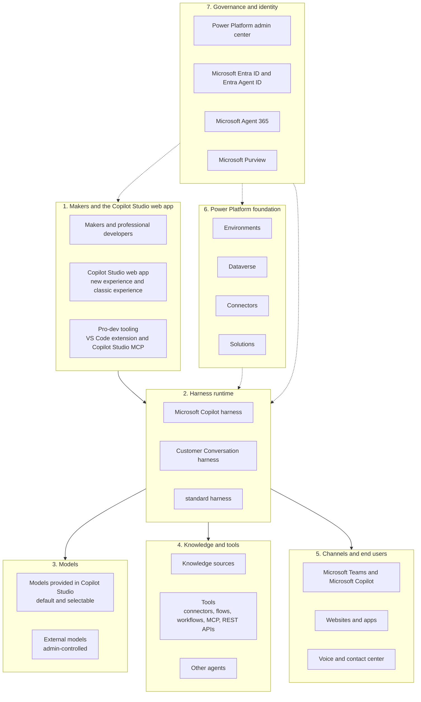

| Layer | What lives here | Key verified facts |
|---|---|---|
| 1. Makers and web app | The Copilot Studio web app at `https://copilotstudio.microsoft.com`, in the new experience (default) and the classic experience. Pro-dev options include the [Copilot Studio extension for Visual Studio Code](https://learn.microsoft.com/en-us/microsoft-copilot-studio/visual-studio-code-extension-overview) (🟢 since January 2026) and [Copilot Studio MCP](https://learn.microsoft.com/en-us/microsoft-copilot-studio/agents-experience/copilot-studio-mcp) (October 2026), which lets tools such as VS Code and GitHub Copilot CLI create, test, deploy, and monitor agents. | Supported browsers: Microsoft Edge or Chrome 122+, Firefox 127+, Safari 17+. |
| 2. Harness runtime | Microsoft Copilot harness, Customer Conversation harness, standard harness. | The harness decides how work gets done, what you can build out of the box, and how usage is billed ([Harnesses overview](https://learn.microsoft.com/en-us/microsoft-copilot-studio/harnesses-overview)). |
| 3. Models | On the standard harness, a selectable primary model; GPT-5.5 Chat became the default in October 2026. External models from Anthropic, Mistral, and xAI need admin approval. On the Microsoft Copilot harness, a model dropdown that also offers experimental models. | After a default-model upgrade you can stay on the current model for up to 30 days ([What's new](https://learn.microsoft.com/en-us/microsoft-copilot-studio/whats-new)). |
| 4. Knowledge and tools | Knowledge sources, tools, other agents. | See Sections 6–8. |
| 5. Channels and users | Teams and Microsoft Copilot, websites and apps, voice and contact center. | The channel set differs per harness — see [Section 12](#12-channels-and-publishing-architecture). |
| 6. Power Platform foundation | Environments store your agents; Dataverse stores agent definitions, uploaded files, and transcripts; connectors and solutions. | See Sections 11 and 13. |
| 7. Governance and identity | Power Platform admin center, Microsoft Entra ID and Entra Agent ID, Microsoft Agent 365, Microsoft Purview. | See Sections 10 and 16. |

### Architect's notes

- **The harness is the first architectural decision.** It determines features, channels, billing start point, and migration options.
- **The environment is the unit of isolation.** Agents, Dataverse data, connections, policies, and credit allocations all attach to environments.
- **Governance spans several admin surfaces**: the Power Platform admin center, the Microsoft Entra admin center, the Microsoft 365 admin center (Agent 365, external model providers), and the Microsoft Purview portal. Plan who owns each.

---

## 3. Harness architecture

### In plain words

A harness is the engine behind your agent. Microsoft Learn describes it this way: "The harness is a *runtime* that exists between the two: it determines when to call the model, what components to send it, interprets what comes back, and calls the right tools" ([Harnesses overview](https://learn.microsoft.com/en-us/microsoft-copilot-studio/harnesses-overview)). Put simply, "the model provides the reasoning capability, while the harness equips and directs it" ([Compare Copilot Studio agent harnesses](https://learn.microsoft.com/en-us/microsoft-copilot-studio/guidance/choose-harness)).

### How it works: the three harnesses

| Consideration | Microsoft Copilot harness | Customer Conversation harness | standard harness |
|---|---|---|---|
| Status | 🧪 Production-ready preview (since June 2026); the default new experience | 🧪 Preview (since October 2026) | 🟢 Fully supported; no forced switch and no deprecation announced |
| Best for | Complex, multistep business processes | Customer-facing, contact-center-style voice and chat | Rule-based agents and structured, repeatable conversations |
| How it works | Reasons through a goal on its own, step by step | A primary agent plus specialized sub-agents, each with its own escalation path to a human representative | Follows the topics and rules you define; natural language understanding (NLU) or generative orchestration selects what runs |
| Recovers from problems | Retries and finds alternative paths automatically | Escalates to a human representative through a defined path | Follows the paths you built |
| Works with files | Creates, edits, and reasons over Word, Excel, PowerPoint, and PDF files | Not a focus | Not a focus |
| Skills and memory | Yes | Yes | Not a focus |
| Topics | No topics; use skills and workflows | *Topic skills* (deterministic, authored flows) alongside generative skills | Yes — system and custom topics |
| Authoring surface | **Build**, **Preview**, **Evaluate**, **Monitor** tabs | **Build**, **Preview**, **Evaluate**, **Deploy**, **Monitor** tabs | Classic pages such as **Overview**, **Knowledge**, **Tools**, **Agents**, **Topics**, **Activity**, **Monitor**, **Channels**, **Settings**, plus the test panel |
| Publishing | Internal teams or external customers (a smaller channel set today) | Website chat or a phone number | Internal teams or external customers (the widest channel set) |
| Billing | 💳 Usage-based Copilot Credits; billing starts when you start building | 💳 Usage-based Copilot Credits | 💳 Standard licensing model; billing starts after publish |

Sources: [Harnesses overview](https://learn.microsoft.com/en-us/microsoft-copilot-studio/harnesses-overview), [About agents powered by the Microsoft Copilot harness](https://learn.microsoft.com/en-us/microsoft-copilot-studio/agents-experience/overview), [Customer Conversation harness overview](https://learn.microsoft.com/en-us/microsoft-copilot-studio/agents-experience/overview-customer-conversation), [FAQ for the Microsoft Copilot harness](https://learn.microsoft.com/en-us/microsoft-copilot-studio/agents-experience/faqs-copilot-harness).

> [!NOTE]
> The analytics page of a standard-harness agent is now named **Monitor** in Learn ([Monitor agent performance](https://learn.microsoft.com/en-us/microsoft-copilot-studio/analytics-overview), [Monitor conversational agent effectiveness](https://learn.microsoft.com/en-us/microsoft-copilot-studio/analytics-improve-agent-effectiveness)). Older material calls it **Analytics**.

### Choosing a harness

Learn's [harness comparison guidance](https://learn.microsoft.com/en-us/microsoft-copilot-studio/guidance/choose-harness) gives four principles:

1. **Start with the scenario.** Both harnesses can plan, call tools, and combine AI with deterministic steps. "Without optimization, a more capable harness can overwork a simple problem, increasing Copilot Credit consumption and latency without improving the outcome."
2. **Match capabilities to task weight.** Light tasks have a bounded working set, a stable action set, and one primary outcome. Heavy work runs longer, spans systems, iterates over large files, and produces several outputs — the stronger case for the Microsoft Copilot harness.
3. **Use agentic loops where the path can't be specified in advance.** The Microsoft Copilot harness adds dynamic orchestration, a Bash container for secure data processing, and a larger shared context with persistent memory.
4. **Consider consumption and governance**, across the whole lifecycle: building, testing, evaluating, and running.

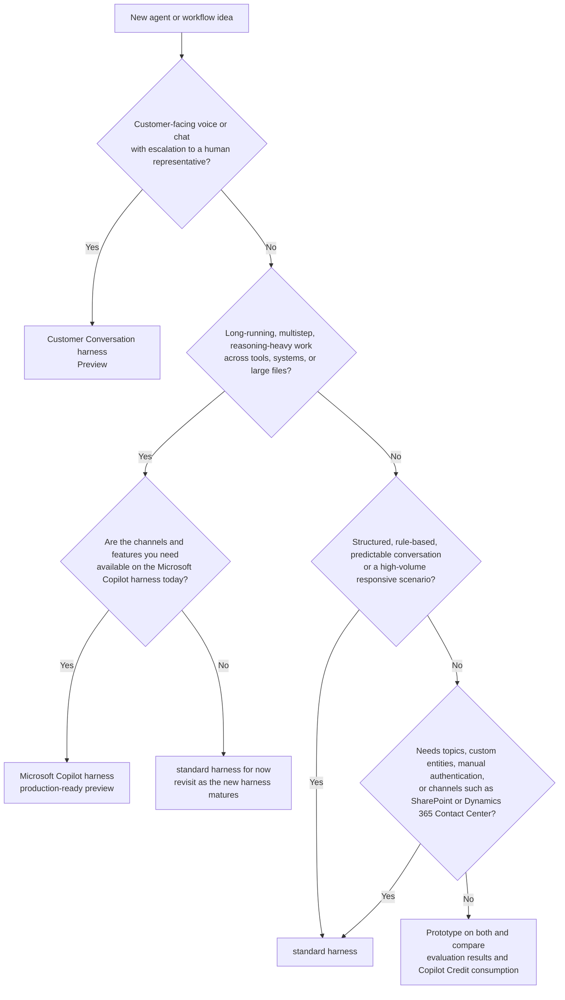

Learn also describes a **joint pattern**: a Microsoft Copilot harness agent runs autonomously on a schedule to curate large workbooks and SharePoint repositories into better-structured data, while high-volume standard harness agents remain the responsive conversational layer for users ([Compare Copilot Studio agent harnesses](https://learn.microsoft.com/en-us/microsoft-copilot-studio/guidance/choose-harness)).

### How the new and classic experiences relate

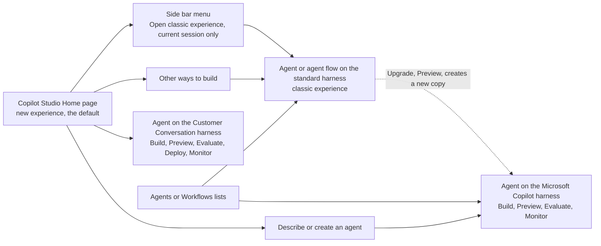

- The new experience is the default. To use the classic experience, select the three dots (**…**) at the bottom of the Home page side bar, then **Open classic experience**. This applies to your current session only; there's no tenant-wide setting to make it the default ([Access standard harness agents](https://learn.microsoft.com/en-us/microsoft-copilot-studio/agents-experience/switch-experiences)).
- **Other ways to build** on the Home page creates new standard-harness agents and agent flows. Existing agents and flows open from the **Agents** or **Workflows** lists.
- Agents created on the Microsoft Copilot harness can't be transferred to the standard harness ([About agents powered by the Microsoft Copilot harness](https://learn.microsoft.com/en-us/microsoft-copilot-studio/agents-experience/overview)).
- 🧪 [Upgrade to the Microsoft Copilot harness](https://learn.microsoft.com/en-us/microsoft-copilot-studio/upgrade-to-microsoft-copilot-from-standard-harness): ask Copilot Studio on the Home page to upgrade a standard agent. It creates a copy, carries over instructions, tools, and suggested prompts, can rebuild custom topics as skills or workflows, and produces a report of what migrated, what needs attention, and what was skipped. Knowledge sources, Power Fx expressions, and child agents aren't migrated. The upgrade consumes Copilot Credits.
- There's no setting to turn the Microsoft Copilot harness on or off. Admins govern it through Dataverse security roles, data policies, sharing controls, and credit limits (see [Section 16](#16-governance-architecture)).

### Architect's notes

- **Migrate only for a scenario-level benefit** (quality, more efficient orchestration, long-running execution, or a needed capability or model). Learn recommends treating migration "as re-architecture rather than component conversion".
- **Validate channels and features first.** The Microsoft Copilot harness supports fewer channels and doesn't support some standard-harness features today (see Sections 4 and 12).
- **Budget for build-time consumption** on the Microsoft Copilot and Customer Conversation harnesses: building, previewing, and evaluating can consume Copilot Credits.

---

## 4. Anatomy of an agent

### In plain words

An agent is like a new team member. **Instructions** are its job description, **knowledge** is what it can read, **tools** are what it can do, the **model** is its reasoning ability, **triggers** decide when it starts working, **channels** are where people can reach it, and **settings** control security and behavior. On the standard harness you also design **topics** (scripted conversation paths); on the Microsoft Copilot harness you package reusable know-how as **skills** instead.

### How it works: components per harness

| Component | What it is | standard harness | Microsoft Copilot harness | Customer Conversation harness |
|---|---|---|---|---|
| Instructions | Identity, tone, scope, and behavior | Agent instructions on the **Overview** page; you can reference child or connected agents with **/** | **Instructions** on the **Build** tab | Primary agent instructions, with separate **Speech** and **Chat** tabs for modality-specific guidance |
| Knowledge | Grounding data | **Knowledge** page or a generative answers node inside a topic | **Add knowledge** on the **Build** tab | Knowledge on the **Build** tab; sources that need end-user sign-in work only in chat |
| Tools | Actions on external systems | **Tools** page or tool nodes in topics | **Tools** on the **Build** tab (connectors, MCP, workflows) | Tools, including prebuilt contact-center tools such as **Escalate** and **Biometric Authentication** |
| Topics vs skills | Deterministic conversation units vs reusable instruction packages | System and custom topics with trigger phrases or descriptions | Skills (name, description, Markdown instructions); built-in skills for document and data files; no topics | Generative skills and Topic skills |
| Triggers | What starts work | Topic triggers (for example **User says a phrase**, or **The agent chooses** with generative orchestration), plus event triggers | 🧪 Triggers for autonomous agents; 🧪 hooks for lifecycle events | Events such as **Conversation Start**, **End of Conversation**, and **On Error** |
| Variables vs memory | State within and across conversations | Topic, global, and system variables, Power Fx, entities | Working context during a task, plus 🧪 per-user **Memory** across conversations | A separate structured Memory capability |
| Model | Reasoning and language | Selectable primary model; external models need admin approval | Model dropdown, including experimental models | — |
| Other agents | Delegation | Child agents and connected agents | Connected agents and 🧪 task agents | Sub-agents and connected agents |
| Channels | Where users interact | Widest set | Smaller set today | Speech and Chat |
| Settings | Configuration | **Settings** pages such as **Generative AI**, **Security**, and **Advanced** | **Agent settings** dialog with **Agent details**, **AI & behavior**, **Safety & access**, **Greeting & prompts** | — (channels are set on the **Deploy** tab) |

Sources: [About agents powered by the Microsoft Copilot harness](https://learn.microsoft.com/en-us/microsoft-copilot-studio/agents-experience/overview), [Customer Conversation harness overview](https://learn.microsoft.com/en-us/microsoft-copilot-studio/agents-experience/overview-customer-conversation), [Skills overview](https://learn.microsoft.com/en-us/microsoft-copilot-studio/agents-experience/skills-overview), [Memory](https://learn.microsoft.com/en-us/microsoft-copilot-studio/agents-experience/memory-overview), [Hooks](https://learn.microsoft.com/en-us/microsoft-copilot-studio/agents-experience/hooks-overview), [Agent settings](https://learn.microsoft.com/en-us/microsoft-copilot-studio/agents-experience/settings-overview), [Variables](https://learn.microsoft.com/en-us/microsoft-copilot-studio/authoring-variables-about), [Topic triggers](https://learn.microsoft.com/en-us/microsoft-copilot-studio/authoring-triggers).

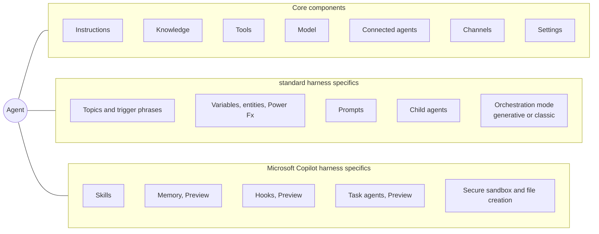

### Mapping: standard harness to Microsoft Copilot harness

Only mappings documented on Microsoft Learn are listed.

| standard harness concept | Microsoft Copilot harness equivalent | Learn source |
|---|---|---|
| Custom topics | Rebuilt as skills or workflows during the upgrade | [FAQ](https://learn.microsoft.com/en-us/microsoft-copilot-studio/agents-experience/faqs-copilot-harness), [Upgrade](https://learn.microsoft.com/en-us/microsoft-copilot-studio/upgrade-to-microsoft-copilot-from-standard-harness) |
| Topics triggered on user intent and other system triggers (for example **Message received**) | 🧪 Hooks, which run workflows at lifecycle points such as session start or before a tool runs | [Feature comparison](https://learn.microsoft.com/en-us/microsoft-copilot-studio/agents-experience/overview) |
| Prompts (prompt tool) | Skills — there's no separate prompts feature | [FAQ](https://learn.microsoft.com/en-us/microsoft-copilot-studio/agents-experience/faqs-copilot-harness) |
| Child agents | A skill for a capability inside the agent, a connected agent for a fully separate agent, or 🧪 task agents where available | [FAQ](https://learn.microsoft.com/en-us/microsoft-copilot-studio/agents-experience/faqs-copilot-harness) |
| Connected agents | Connected agents — Copilot Studio agents on the same harness, Microsoft Foundry agents, Microsoft 365 Agents SDK agents, and 🧪 A2A agents. Standard and Microsoft Copilot harness agents can't invoke each other | [FAQ](https://learn.microsoft.com/en-us/microsoft-copilot-studio/agents-experience/faqs-copilot-harness) |
| Generative or classic orchestration setting | One enhanced orchestration runtime for every agent; not configurable | [Overview](https://learn.microsoft.com/en-us/microsoft-copilot-studio/agents-experience/overview) |
| Separate pages for knowledge, tools, channels, and settings | Components on the **Build** tab plus the four-tab **Agent settings** dialog | [FAQ](https://learn.microsoft.com/en-us/microsoft-copilot-studio/agents-experience/faqs-copilot-harness) |
| Test panel | **Preview** tab, with the **Evaluate** tab for test sets | [Overview](https://learn.microsoft.com/en-us/microsoft-copilot-studio/agents-experience/overview) |
| Activity and run history | **Monitor** tab (sessions and runs) | [Feature comparison](https://learn.microsoft.com/en-us/microsoft-copilot-studio/agents-experience/overview) |
| Event triggers for autonomous agents | 🧪 Triggers, or an **Agent** node in a workflow | [Feature comparison](https://learn.microsoft.com/en-us/microsoft-copilot-studio/agents-experience/overview) |
| Code interpreter (opt-in) | Code interpreter is native | [Feature comparison](https://learn.microsoft.com/en-us/microsoft-copilot-studio/agents-experience/overview) |
| Languages explicitly added and enabled | Supported out of the box; response language is controlled by the instructions | [Feature comparison](https://learn.microsoft.com/en-us/microsoft-copilot-studio/agents-experience/overview) |
| Custom entities | Not supported | [Feature comparison](https://learn.microsoft.com/en-us/microsoft-copilot-studio/agents-experience/overview) |
| **Authenticate manually** | Not supported (only **No authentication** and **Authenticate with Microsoft**) | [Feature comparison](https://learn.microsoft.com/en-us/microsoft-copilot-studio/agents-experience/overview), [Agent settings](https://learn.microsoft.com/en-us/microsoft-copilot-studio/agents-experience/settings-overview) |
| Azure AI Search knowledge | Not supported; connect Foundry IQ as a tool, or use a search action from the Azure AI Search connector | [Upgrade](https://learn.microsoft.com/en-us/microsoft-copilot-studio/upgrade-to-microsoft-copilot-from-standard-harness) |
| Computer use tool | Planned | [Feature comparison](https://learn.microsoft.com/en-us/microsoft-copilot-studio/agents-experience/overview) |
| Power Fx expressions | Not migrated by the upgrade | [Upgrade](https://learn.microsoft.com/en-us/microsoft-copilot-studio/upgrade-to-microsoft-copilot-from-standard-harness) |

### Architect's notes

- **Descriptions are architecture.** On the standard harness with generative orchestration and on the Microsoft Copilot harness, the names and descriptions of topics, tools, skills, knowledge sources, and agents drive selection at runtime.
- **Don't port component by component.** Inventory what each topic, flow, variable, and prompt is *for*, then map those purposes onto instructions, skills, tools, workflows, memory, code execution, and connected agents ([Compare harnesses](https://learn.microsoft.com/en-us/microsoft-copilot-studio/guidance/choose-harness)).
- **Keep deterministic steps deterministic.** Use topics (standard harness) or workflows (Microsoft Copilot harness) for steps that must always run the same way, such as approvals and record creation.

---

## 5. Runtime request flows

### In plain words

When a user sends a message, the harness decides what happens next. On the standard harness with **classic orchestration**, the agent looks for the topic whose trigger phrases best match the message. With **generative orchestration**, a planner reads the *descriptions* of everything the agent can use and builds a plan. On the **Microsoft Copilot harness**, the agent treats the request as a goal and works through it step by step, using skills, tools, and a secure sandbox until the goal is met.

### 5a. standard harness with classic orchestration

*Applies to: standard harness.* On the standard harness, "the agent uses natural language understanding to match a request to the best *topic*: a portion of a conversation you design with connected steps, questions, and conditions" ([Overview](https://learn.microsoft.com/en-us/microsoft-copilot-studio/fundamentals-what-is-copilot-studio), [Create and edit topics](https://learn.microsoft.com/en-us/microsoft-copilot-studio/authoring-create-edit-topics)). With classic orchestration, "an agent responds to users by triggering the topic whose trigger phrases most closely match the user's query" ([Orchestrate agent behavior](https://learn.microsoft.com/en-us/microsoft-copilot-studio/advanced-generative-actions)).

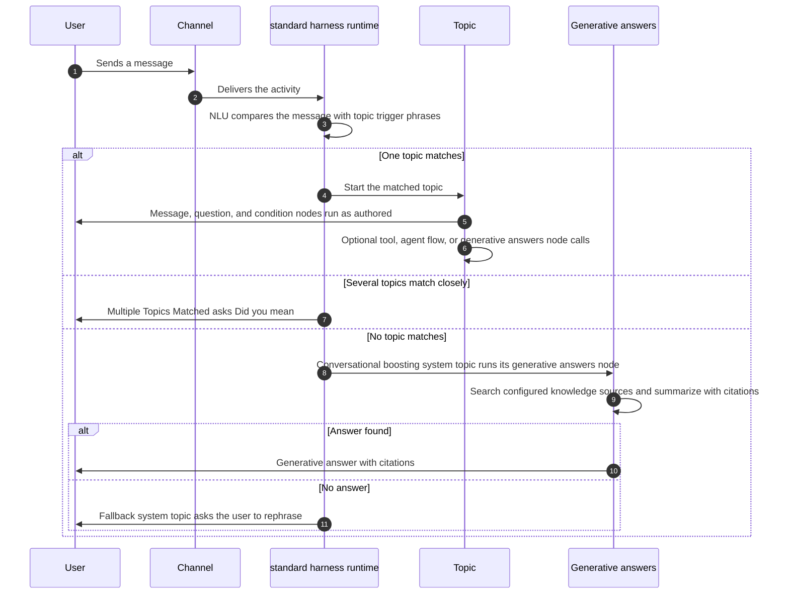

What Learn documents:

- Topics are selected by matching the user query with trigger phrases; the agent tries to select a **single** topic.
- Tools can only be called explicitly from within a topic, and you author messages and questions with **Message** and **Question** nodes.
- Knowledge works as a fallback when no topic matches, or explicitly through a generative answers node in a topic; generative answers can serve as a primary information source or as a fallback when authored topics can't answer ([AI-based agent authoring overview](https://learn.microsoft.com/en-us/microsoft-copilot-studio/nlu-gpt-overview)). The **Conversational boosting** system topic "creates generative answers from external data sources" and contains a generative answers node to which agent-level knowledge sources are added. Generative answers sit "in the Conversational Boosting topic before Fallback" ([AI capabilities guidance](https://learn.microsoft.com/en-us/microsoft-copilot-studio/guidance/ai-capabilities)).
- **Multiple Topics Matched** ("did you mean") triggers when a message closely matches several topics; **Fallback** informs users their query couldn't be matched and asks them to try again ([System topics](https://learn.microsoft.com/en-us/microsoft-copilot-studio/authoring-system-topics)).
- Classic orchestration has per-type knowledge limits in Conversational boosting: Azure OpenAI connections 5, Bing Custom Search configuration IDs 2, custom data sources 3, Dataverse 2 sources with up to 15 tables each, SharePoint URLs 4, website URLs 4, uploaded files unlimited ([Knowledge sources summary](https://learn.microsoft.com/en-us/microsoft-copilot-studio/knowledge-copilot-studio)).
- If an admin turns off generative orchestration in an environment, agents created there can use only classic orchestration.

### 5b. standard harness with generative orchestration

*Applies to: standard harness.* New agents use generative orchestration by default. The agent "can choose the best tools, knowledge, topics, and other agents to answer user queries or respond to event triggers" ([Orchestrate agent behavior](https://learn.microsoft.com/en-us/microsoft-copilot-studio/advanced-generative-actions)). The diagram is simplified: Learn documents the selection signals and the resulting behavior, not the planner's internal prompts.

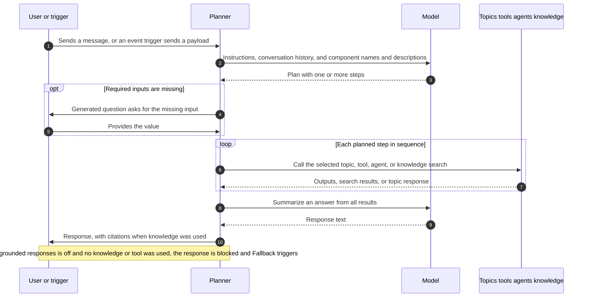

What Learn documents:

- **Selection signals**: "The most important factor is the description" of topics, tools, agents, and knowledge sources, followed by names, input and output parameters, and the conversation history. Multi-intent requests can trigger several topics or tools, called in sequence after the agent asks for any missing inputs.
- **Response**: the agent summarizes an answer from everything it called. Topics can return results as output variables instead of sending messages, so the orchestrator can compose a contextual reply.
- **Controls**: the **End all topics** node cancels the remaining plan; the **AI response generated** and **Plan complete** topic triggers let you react to orchestration events; a **Clear variable values** node with **Conversation history for the current session** clears the history the planner uses.
- **Knowledge**: when there are more than 25 knowledge sources, an internal GPT model filters them (uploaded files don't count toward the 25). Custom data and Bing Custom Search work only inside a generative answers node. The Conversational boosting topic isn't used ([Knowledge sources summary](https://learn.microsoft.com/en-us/microsoft-copilot-studio/knowledge-copilot-studio)).
- **Limitations**: tools and topics don't support custom entities (closed lists, regex) as inputs — use a **Question** node instead. Response time grows when the planner performs several rounds.
- **Debugging**: open the activity map in the test panel to follow the plan ([Review activity](https://learn.microsoft.com/en-us/microsoft-copilot-studio/authoring-review-activity)).

### 5c. Microsoft Copilot harness

*Applies to: Microsoft Copilot harness.* What you build "reasons from the instructions and knowledge you provide. It interprets the request, chooses the right tools, and works through the steps needed to complete the task" ([Overview](https://learn.microsoft.com/en-us/microsoft-copilot-studio/fundamentals-what-is-copilot-studio)). All agents use the same enhanced orchestration model; unlike the standard harness, you can't configure the orchestration mode.

> [!NOTE]
> This diagram is **conceptual**. Learn documents the capabilities involved (goal-based reasoning, skills, tools, connected and task agents, a secure sandbox, file creation, memory, hooks, retries) but not the internal reasoning algorithm.

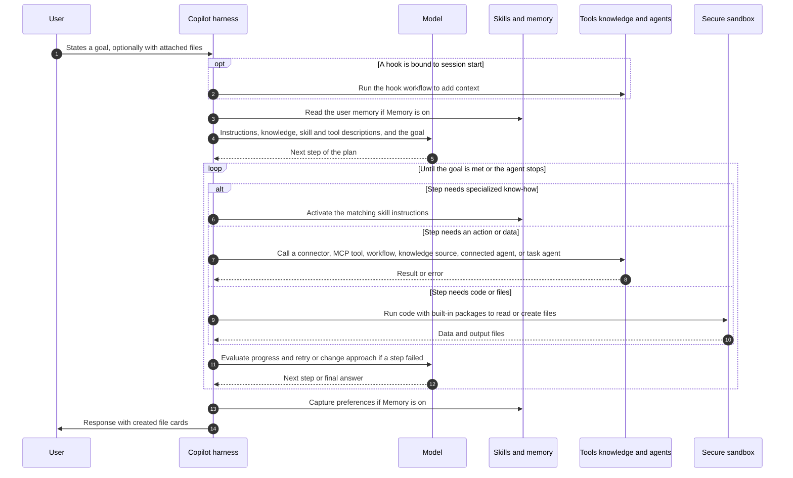

What Learn documents:

- **Goal-based reasoning and recovery**: the harness "can take a goal, break it into steps, call the right tools across connectors, knowledge, MCP, and connected agents, and adjust when a step fails or a request changes" ([Harnesses overview](https://learn.microsoft.com/en-us/microsoft-copilot-studio/harnesses-overview)). In an agentic loop, the agent evaluates its progress and decides whether to continue, try a different approach, delegate, or stop ([Compare harnesses](https://learn.microsoft.com/en-us/microsoft-copilot-studio/guidance/choose-harness)).
- **Skills** activate when a request matches the skill's description; the harness also provides built-in skills for CSV, Word, HTML, Markdown, PDF, PowerPoint, and Excel files ([Skills overview](https://learn.microsoft.com/en-us/microsoft-copilot-studio/agents-experience/skills-overview)).
- **Sandbox and files**: each task runs in a secure sandbox governed by Copilot Studio; a Bash container gives access to tools and libraries. Built-in Python packages (for example `python-docx`, `openpyxl`, `python-pptx`, `reportlab`, `pandas`, `matplotlib`) create files and analyze data. Each created file is capped at 10 MB and kept for 28 days after the last conversation activity ([Files the agent creates](https://learn.microsoft.com/en-us/microsoft-copilot-studio/agents-experience/created-files-overview), 🧪).
- **Delegation**: connected agents run in their own orchestration context, one level deep; 🧪 task agents get their own context window and can run in parallel ([Connected agents](https://learn.microsoft.com/en-us/microsoft-copilot-studio/agents-experience/authoring-add-other-agents), [Task agents](https://learn.microsoft.com/en-us/microsoft-copilot-studio/agents-experience/task-agents-overview)).
- **Hooks** (🧪) run a workflow every time an event fires — for example at session start, before a tool runs (and can block it), after a tool runs, or on errors ([Hooks](https://learn.microsoft.com/en-us/microsoft-copilot-studio/agents-experience/hooks-overview)).
- **Memory** (🧪) is per user and per agent, captures preferences, and is deleted after 28 days without interaction ([Memory](https://learn.microsoft.com/en-us/microsoft-copilot-studio/agents-experience/memory-overview)).

### Architect's notes

- **Classic orchestration** gives maximum predictability, but every path must be authored.
- **Generative orchestration** reduces authoring and handles multi-intent requests; quality depends on crisp, non-overlapping descriptions. Learn's rule of thumb is that selection can degrade beyond about 30 to 40 choices (tools, topics, and agents) in one agent ([Add other agents](https://learn.microsoft.com/en-us/microsoft-copilot-studio/authoring-add-other-agents)).
- **The Microsoft Copilot harness** trades predictability for autonomy. Keep must-always-happen rules in hooks or workflows, and keep business procedures in skills so they're versioned and reviewable.

---

## 6. Knowledge and grounding architecture

### In plain words

Knowledge is the content an agent is allowed to read before it answers: websites, files, SharePoint, Dataverse tables, and more. Instead of relying on what the model remembers from training, the agent first **retrieves** relevant passages and then **generates** an answer from them, with citations. This pattern is called **retrieval-augmented generation (RAG)**.

### How it works: the RAG pipeline

*Applies to: standard harness (as documented).* Learn describes a four-step RAG process — query rewriting, content retrieval, summarization and response generation, and safety and governance validation — with content moderation applied to both the user's input and the agent's output ([RAG guidance](https://learn.microsoft.com/en-us/microsoft-copilot-studio/guidance/retrieval-augmented-generation), [FAQ for generative answers](https://learn.microsoft.com/en-us/microsoft-copilot-studio/faqs-generative-answers)).

```mermaid
flowchart LR
    Q["User question"] --> MOD1["Input moderation<br/>harmful content and prompt attacks"]
    MOD1 --> RW["Query rewriting<br/>adds context from recent turns"]
    RW --> RET["Retrieval from each configured source"]
    subgraph SRC["Knowledge sources"]
        direction TB
        S1["Public websites through Bing<br/>no user sign-in"]
        S2["Uploaded files in Dataverse<br/>no user sign-in"]
        S3["SharePoint, OneDrive, Dataverse, Copilot connectors<br/>user-delegated and security trimmed"]
        S4["Azure AI Search<br/>not delegated, no security trimming"]
    end
    RET --> SRC
    SRC --> SUM["Summarization<br/>instructions applied, citations generated"]
    SUM --> VAL["Safety and grounding validation<br/>output moderation"]
    VAL --> A["Answer with citations"]
    VAL -.->|"No grounded answer"| FB["Fallback or no answer"]
```

| Step | What Learn documents |
|---|---|
| 1. Query rewriting | Clarifies meaning, adds contextual signals from the last 10 turns, and generates search-friendly queries. |
| 2. Content retrieval | Runs the query against all configured sources and takes the top three results from each source. |
| 3. Summarization | Synthesizes retrieved content, applies custom instructions, and generates citations. |
| 4. Validation | Moderates harmful, malicious, noncompliant, or copyrighted answers and validates grounding. "No customer data trains language models." |

### Knowledge source types

| Source | standard harness | Microsoft Copilot harness | Identity used at retrieval | Key documented limits and notes |
|---|---|---|---|---|
| Public websites | 🟢 | 🧪 | None (Bing index) | Generative orchestration: up to 25 websites; classic: 4 URLs. Websites must be indexed by Bing. |
| Uploaded files | 🟢 | 🧪 | None | Up to 500 files per agent and 512 MB per file; stored in Dataverse file storage; requires Dataverse search. Encrypted files (sensitivity labels, passwords) aren't supported. |
| SharePoint | 🟢 | 🧪 | Agent user's Entra ID (delegated) | Generative: 25 URLs; classic: 4 URLs per generative answers node. Users need at least **Read**. Blocked if Restricted SharePoint Search is on. Learn's RAG guidance cites 15 MB files for detailed snippets, and up to 200 MB with tenant graph grounding. |
| SharePoint lists | 🟢 | — | User's SharePoint credentials | Lists are ingested into Dataverse; use up to 10 lists per agent; lists over 35,000 rows affect quality and latency. |
| OneDrive for Business | Files and folders through the unstructured-data upload option | 🧪 (October 2026) | Delegated | Supports Microsoft Purview sensitivity labels. |
| Dataverse tables | 🟢 | 🧪 (unstructured Multiline Text and File columns 🧪) | Delegated | Classic: 2 sources with up to 15 tables each; generative: unlimited. |
| Copilot connectors (indexed in Microsoft Graph) | 🟢 | 🧪 | Delegated | Classic: 2 per agent; generative: unlimited. |
| Power Platform connectors as knowledge (real-time) | 🧪 | — | The signed-in user's connections | Live data from systems such as Salesforce, ServiceNow, Zendesk, or Azure SQL; each user must create connections to the target systems ([RAG guidance](https://learn.microsoft.com/en-us/microsoft-copilot-studio/guidance/retrieval-augmented-generation), [Use connectors](https://learn.microsoft.com/en-us/microsoft-copilot-studio/advanced-connectors)). |
| Business-system sources in the **Add knowledge** dialog (Salesforce, ServiceNow, Azure SQL, Confluence, Jira, Azure DevOps) | — | 🧪 | — | Listed on the **Featured** and **Advanced** tabs; what you see varies by environment, installed connectors, and licensing. |
| Azure AI Search | 🟢 | Not supported | Not delegated — no security trimming | Use Foundry IQ as a tool or the Azure AI Search connector on the Microsoft Copilot harness. |
| Bing Custom Search | 🟢 (inside a generative answers node) | 🧪 (one instance per agent) | None | Curated public web index. |
| Custom data | 🟢 (classic data in a generative answers node) | — | Depends on how you fetch it | Needs `Content`, plus optional `ContentLocation` and `Title` for citations. |
| Web search (**Use information from the web**) | 🟢 (generative orchestration) | — | None | Uses Grounding with Bing Search across all public websites. |
| Tenant graph grounding with semantic search | 💳 extra cost | — | Requires **Authenticate with Microsoft** | Improves SharePoint and connector retrieval; needs Microsoft 365 Copilot licensing in the tenant. |
| Work IQ | — | 🟢 GA (October 2026) | User | Added by default to every new Microsoft Copilot harness agent; write operations are on by default, subject to permissions. |
| Foundry IQ and Fabric IQ | — | 🧪 | — | Ground responses in Foundry knowledge bases or Fabric semantic models. |

Sources: [Knowledge sources summary](https://learn.microsoft.com/en-us/microsoft-copilot-studio/knowledge-copilot-studio), [Upload files](https://learn.microsoft.com/en-us/microsoft-copilot-studio/knowledge-add-file-upload), [SharePoint](https://learn.microsoft.com/en-us/microsoft-copilot-studio/knowledge-add-sharepoint), [Knowledge sources for the Microsoft Copilot harness](https://learn.microsoft.com/en-us/microsoft-copilot-studio/agents-experience/knowledge-sources-overview), [What's new](https://learn.microsoft.com/en-us/microsoft-copilot-studio/whats-new).

### How permissions and authentication affect retrieval

- **Delegated sources return only what the user can see.** "When a specific user asks a question of the agent, the agent only surfaces content that the specific user can access" ([Knowledge sources summary](https://learn.microsoft.com/en-us/microsoft-copilot-studio/knowledge-copilot-studio)).
- **Authentication is a prerequisite.** SharePoint, Dataverse, and Copilot connectors need user authentication. With **No authentication**, the agent doesn't retrieve information from SharePoint. With **Authenticate manually**, you add the `Sites.Read.All` and `Files.Read.All` scopes; they don't give users extra permissions ([SharePoint](https://learn.microsoft.com/en-us/microsoft-copilot-studio/knowledge-add-sharepoint)).
- **Non-delegated sources show the same content to everyone**: public websites, uploaded files, and Azure AI Search (which has no security trimming).
- **Sensitivity labels**: Microsoft Purview supports sensitivity labels for agents built in Copilot Studio when the knowledge source is SharePoint (including OneDrive) or Dataverse with auto-labeling. When a label applies encryption, users need the **EXTRACT** and **VIEW** usage rights for the agent to return the data ([Purview for Copilot Studio](https://learn.microsoft.com/en-us/purview/ai-copilot-studio)).
- **Speech channels** on the Customer Conversation harness don't support end-user sign-in, so knowledge that needs end-user credentials works only in chat.

### Citations and grounding controls

- **Allow ungrounded responses** (standard harness, **Generative AI** settings): when off, the agent blocks a response in any turn where it used no knowledge source or tool, and Fallback triggers. It also withholds an answer that lacks an in-text citation, so add citation instructions to the agent's instructions.
- **Channel rendering**: in Microsoft Teams a response shows at most 20 citations, with titles shortened to about 80 characters and snippets to about 480 characters. If you customize a generative answer (for example with an Adaptive Card), you must render citations yourself.
- Citations can't be used as inputs to other tools, and might not be preserved when one agent returns output to another.
- **Admin controls**: the 🧪 **Knowledge sources for agents** setting in the Power Platform admin center allows or blocks local file uploads, SharePoint and OneDrive, and public websites (with **Custom** allow and deny lists) per environment or environment group. [Endpoint filtering](https://learn.microsoft.com/en-us/power-platform/admin/connector-endpoint-filtering) can allow or deny specific SharePoint or website endpoints ([Choose knowledge sources](https://learn.microsoft.com/en-us/microsoft-copilot-studio/choose-knowledge-sources), [Configure knowledge sources for agents](https://learn.microsoft.com/en-us/power-platform/admin/knowledge-sources-for-agents-rule)).

### Architect's notes

- **RAG is for factual Q&A.** Learn states RAG "works best for factual questions and answers, not deep document analysis" — it isn't intended for full document comparison, policy compliance evaluation, or complex reasoning over long documents. For those, consider the Microsoft Copilot harness's whole-file reasoning.
- **Pick the source by permission model first, then by content type.** If different users must see different content, use a delegated source.
- **Curate content quality.** Clear SharePoint document titles improve retrieval on the Microsoft Copilot harness, and knowledge-source descriptions drive selection under generative orchestration.

---

## 7. Tools and extensibility architecture

### In plain words

Knowledge lets an agent *know* things; tools let it *do* things — create a ticket, send an email, read a database, run an approval, or even click through a website. Each tool has a name and a description, and the orchestrator reads them to decide when to use it.

### How it works

On the standard harness, an agent uses tools in two ways: **automatically** through generative orchestration, or **explicitly** from a node in a topic. With classic orchestration, tools run only from topics ([Add tools to custom agents](https://learn.microsoft.com/en-us/microsoft-copilot-studio/add-tools-custom-agent)). On the Microsoft Copilot harness, the orchestrator selects tools from their names and descriptions and the agent's instructions; you don't create triggers or topic flows for tool calls ([Tools overview](https://learn.microsoft.com/en-us/microsoft-copilot-studio/agents-experience/tools-overview)).

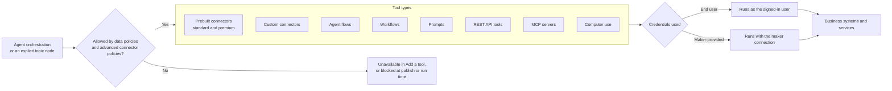

| Tool type | What it does | standard harness | Microsoft Copilot harness | Notes |
|---|---|---|---|---|
| Prebuilt connectors | Power Platform connectors to Microsoft and non-Microsoft services | 🟢 | 🧪 (**Connectors** tab) | Standard connectors are included with all Copilot Studio plans; premium connectors are available in select plans 💳. |
| Custom connectors | Your own API wrapped as a Power Platform connector | 🟢 | — | Must be viewable and shared across your organization. |
| Agent flows | Deterministic flows with the **When an agent calls the flow** trigger and **Respond to the agent** action | 🟢 | — | Must respond in real time, within the 100-second action limit, and be published. Each action consumes capacity. |
| Workflows | Flows on the new workflow designer, powered by the Microsoft Copilot harness | Supported (per Learn's feature comparison) | 🧪 | Add workflows with the **When an agent calls the workflow** trigger as tools. |
| Prompts | Single-turn model prompts with inputs, knowledge, and optional code generation | 🟢 | Not supported — use skills | Prompts run on Microsoft Foundry models and need Copilot Credits. |
| REST API | Endpoints from an OpenAPI specification | 🧪 | — | You provide an OpenAPI v2 specification; v3 is translated to v2. |
| MCP servers | Tools and resources from a Model Context Protocol server | 🟢 (requires generative orchestration) | 🧪 | Copilot Studio supports MCP tools and resources. Blocking the underlying Power Platform connectors also blocks the MCP server. |
| Computer use | Operates websites and desktop apps through their UI | 🟢 GA since May 2026 (requires generative orchestration) | Planned | 💳 Not included in the Microsoft 365 Copilot license; standalone computer-use tools are 🧪. |
| HTTP request node | Calls an HTTP endpoint from a topic | 🟢 | — | Block with the **HTTP** connector in data policies, or use endpoint filtering. |
| Azure Bot Service skills and client tools | Code-based extensions and client-side actions | 🟢 | — | *Azure Bot Service skills* are different from *agent skills* on the newer harnesses. |
| Agent skills (not a tool) | Reusable Markdown instruction packages | Not supported | 🧪 (harness) | Marketplace-shared skills are 🧪. |
| Hooks (not a tool) | Run a workflow every time a lifecycle event fires | — | 🧪 | Same workflow can serve as tool and hook. |

Sources: [Add tools to custom agents](https://learn.microsoft.com/en-us/microsoft-copilot-studio/add-tools-custom-agent), [Use connectors](https://learn.microsoft.com/en-us/microsoft-copilot-studio/advanced-connectors), [Agent flows](https://learn.microsoft.com/en-us/microsoft-copilot-studio/flows-overview), [Add an agent flow as a tool](https://learn.microsoft.com/en-us/microsoft-copilot-studio/flow-agent), [Workflows](https://learn.microsoft.com/en-us/microsoft-copilot-studio/workflows-experience/flows-overview), [Prompts](https://learn.microsoft.com/en-us/microsoft-copilot-studio/prompts-overview), [REST API tools](https://learn.microsoft.com/en-us/microsoft-copilot-studio/agent-extend-action-rest-api), [MCP](https://learn.microsoft.com/en-us/microsoft-copilot-studio/agent-extend-action-mcp), [Computer use](https://learn.microsoft.com/en-us/microsoft-copilot-studio/computer-use), [Available tools (Microsoft Copilot harness)](https://learn.microsoft.com/en-us/microsoft-copilot-studio/agents-experience/tools-available), [Add a tool (Microsoft Copilot harness)](https://learn.microsoft.com/en-us/microsoft-copilot-studio/agents-experience/add-tools-custom-agent).

### Tool configuration (standard harness)

Each tool's configuration page has three sections ([Add tools to custom agents](https://learn.microsoft.com/en-us/microsoft-copilot-studio/add-tools-custom-agent)):

- **Details** — **Name**, **Description** (used by generative orchestration), **Allow agent to decide dynamically when to use the tool**, **Ask the end user before running** (default **No**), and **Authentication**: the user's credentials (**End user**, the default) or the maker's (**Maker-provided**).
- **Inputs** — by default **Dynamically fill with AI** (the agent finds values in the conversation or asks the user); or a **Custom value**, variable, or Power Fx formula.
- **Completion** — **Don't respond** (default), **Write the response with generative AI**, **Send specific response**, or **Send an adaptive card**. Use **Send specific response** or an adaptive card when links or card content must be reproduced exactly.

On the Microsoft Copilot harness you add tools from the **Add a tool** dialog (**Featured**, **Model Context Protocol (MCP)**, **Connectors**, **Workflows** tabs); custom tools are MCP servers or workflows. MCP servers count against the agent's total number of tools, and the number of MCP server instances running concurrently in one conversation is capped ([Tools overview](https://learn.microsoft.com/en-us/microsoft-copilot-studio/agents-experience/tools-overview)).

> [!TIP]
> Tools in an agent aren't the same as a **Microsoft 365 Copilot plugin**. A plugin packages skills, tools such as MCP servers, and agents for use across Copilot experiences and is managed in the Microsoft 365 admin center; Power Platform data policies still control which tools makers can add in Copilot Studio.

### Architect's notes

- **Prefer end-user credentials** for actions on user data. Use maker-provided credentials only for deliberately shared, least-privilege service scenarios — sharing an agent that uses the maker's credentials lets every user act with the maker's access.
- **Write tool descriptions like API contracts**: what it does, when to use it, what it returns, and what it doesn't do.
- **Use flows or workflows for deterministic multistep work** and keep the agent's reasoning for choosing *when* to run them.

---

## 8. Multi-agent architecture

### In plain words

Instead of one giant agent that does everything, you can build a **front-door agent** that hands specialized work to other agents — just like a receptionist routing calls to the right department. Each harness offers different ways to do this.

### How it works

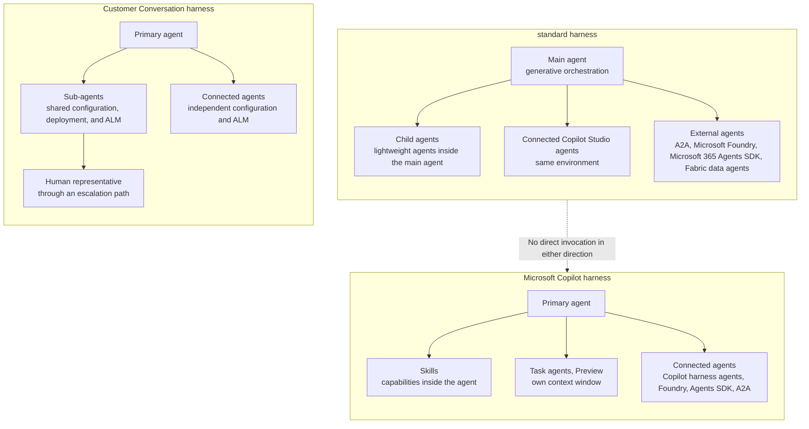

| Pattern | standard harness | Microsoft Copilot harness | Customer Conversation harness |
|---|---|---|---|
| In-agent specialists | 🟢 Child agents | Skills (no child agents) | Sub-agents (share configuration, deployment, and ALM with the primary agent) |
| Other Copilot Studio agents | 🟢 Connected agents in the same environment (a 🧪 admin setting governs connections across environments) | 🧪 Connected agents built on the Microsoft Copilot harness; each agent's **Allow other agents to connect** setting controls whether others can invoke it | Connected agents with independent configuration and ALM |
| Agent2Agent (A2A) protocol agents | 🟢 GA since April 2026 | 🧪 Preview | — |
| Microsoft Foundry agents | 🧪 Preview | Supported since October 2026 (harness 🧪) | Supported (for example, an agent hosted in Microsoft Foundry) |
| Microsoft 365 Agents SDK agents | 🧪 Preview | Supported since October 2026 (harness 🧪) | — |
| Microsoft Fabric data agents | 🧪 Preview (not functional when the main agent is deployed to Microsoft Copilot) | — | — |
| Task agents | — | 🧪 Only in early release cycle environments | — |
| Expose your agent to external clients | — | 🧪 MCP client and A2A client channels (early release cycle environments) | — |
| Cross-harness calls | Not supported | Not supported | — |

Sources: [Add other agents](https://learn.microsoft.com/en-us/microsoft-copilot-studio/authoring-add-other-agents), [Connected agents (Microsoft Copilot harness)](https://learn.microsoft.com/en-us/microsoft-copilot-studio/agents-experience/authoring-add-other-agents), [Task agents](https://learn.microsoft.com/en-us/microsoft-copilot-studio/agents-experience/task-agents-overview), [FAQ](https://learn.microsoft.com/en-us/microsoft-copilot-studio/agents-experience/faqs-copilot-harness), [Customer Conversation harness overview](https://learn.microsoft.com/en-us/microsoft-copilot-studio/agents-experience/overview-customer-conversation), [What's new](https://learn.microsoft.com/en-us/microsoft-copilot-studio/whats-new).

**How delegation works on the Microsoft Copilot harness:** the primary agent's runtime evaluates each message, delegates matching requests, and sends relevant conversation history to the connected agent, which runs in its own orchestration context and returns a response. The orchestrating model writes the task description and might rephrase the request, so don't depend on the original prompt being forwarded verbatim. Handoffs are subject to a payload limit, and delegation is **one level** only.

**Task agents** (🧪) handle a bounded assignment inside one request. Each has its own context window, can run in parallel with others, shares the parent's tools and workspace files under the same permissions, and finishes before the parent's turn ends. They can increase total token and Copilot Credit consumption.

### Known constraints (standard harness)

- An agent that has its own connected agents can't also be used as a connected agent by a second main agent.
- Multi-agent hops add latency because each connected agent runs its own orchestration.
- Citations might not be maintained when outputs pass back from one agent to another.
- A main agent that uses Generic OAuth 2.0 (token passthrough) can't call a connected agent that requires user sign-in.
- Admins can control whether agents connect across environments with the 🧪 **Connected Agents Copilot Studio** setting in the Power Platform admin center ([Configure channel publishing and connected agent access](https://learn.microsoft.com/en-us/power-platform/admin/security/configure-channel-connected-agent-publishing)).

### Architect's notes

- **Start with one agent.** Learn's guidance: use child agents when one team owns a single solution and doesn't need separate settings, authentication, or publishing; split into connected agents when selection quality degrades (roughly 30 to 40 choices), when different teams own parts, when parts need their own ALM, model, or channels, or when you want reuse.
- **Don't mix harnesses in one call chain.** Standard and Microsoft Copilot harness agents can't invoke each other directly.
- **Measure the cost of delegation**: every hop adds latency and, on the newer harnesses, consumption. Read [Multi-agent orchestration patterns](https://learn.microsoft.com/en-us/microsoft-copilot-studio/guidance/multi-agent-patterns) before designing large hierarchies.

---

## 9. Autonomous agents

### In plain words

Most agents wait for someone to type a message. An **autonomous agent** starts work on its own when something happens — a new email arrives, a SharePoint item is created, a Dataverse row changes, or a schedule fires. Because nobody is watching each run, you must decide carefully *whose identity* the agent uses and *what it's allowed to do*.

### How it works

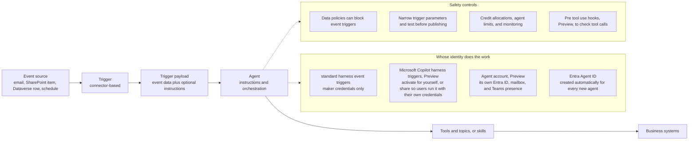

#### Event triggers on the standard harness

*Applies to: standard harness.* Event triggers require generative orchestration. An event sends a **trigger payload** (JSON or plain text, optionally with instructions) through a connector; the agent then follows its instructions and the payload instructions to choose actions or topics ([Event triggers overview](https://learn.microsoft.com/en-us/microsoft-copilot-studio/authoring-triggers-about)).

- **Billing**: each payload is processed like a user message and billed at Copilot Credit rates. Agent flows called while responding to a trigger are charged at the standard rate even for users with Microsoft 365 Copilot licenses, and they're blocked when the environment has no credits.
- **Identity**: event triggers can use **only the agent author's credentials**. If you publish an agent with authenticated triggers, users might access information or trigger actions with the author's credentials; Copilot Studio warns you before you publish.
- **Prerequisites and limits**: solution-aware cloud flow sharing must be turned on in the environment; frequent triggers can exceed quotas and be throttled; Learn recommends calling fewer than 15 actions or topics consecutively.
- **Governance**: admins can block event triggers with a data policy on the **Microsoft Copilot Studio** connector.

#### Triggers on the Microsoft Copilot harness

*Applies to: Microsoft Copilot harness* (🧪). Add triggers such as a new SharePoint item, an incoming email, or a scheduled time. The agent doesn't run autonomously until you publish it. After publishing you choose **Activate for myself** (runs with your maker credentials) or **Share with others** (users run it with their own credentials and can edit only the trigger options you mark **Editable by user**). Usage is billed through the environment that hosts the agent ([Add triggers](https://learn.microsoft.com/en-us/microsoft-copilot-studio/agents-experience/authoring-add-event-trigger)).

#### The agent's own account

🧪 Preview (Frontier program) 💳. An agent can get [its own account](https://learn.microsoft.com/en-us/microsoft-copilot-studio/agents-experience/authoring-agent-account): a Microsoft Entra ID, a mailbox, and presence in Microsoft Teams and your directory, so it can take part in email, Teams, and Office-comment processes under its own identity. Documented prerequisites include an early release cycle environment, a Microsoft 365 E5 license with the Microsoft Agent 365 add-on or a Microsoft 365 E7 license, Frontier program enrollment, and an available **Microsoft 365 Frontier for AI Teammates** license per agent. Admins must activate the Copilot Studio agent template in the Microsoft 365 admin center and turn on **Agent accounts** in the Power Platform admin center. Agents with an account can't read documents protected with labels such as **Confidential** or **Internal Only**, and you can't change the agent's email address after you publish.

#### Microsoft Entra Agent ID

Copilot Studio automatically creates a [Microsoft Entra Agent ID](https://learn.microsoft.com/en-us/microsoft-copilot-studio/admin-use-entra-agent-identities) for every new agent, and you can no longer opt out. (The Entra Agent ID article dates the change to May 2026; What's new lists it under July 2026.) Benefits include audit logging in Entra ID, lifecycle management, Entra ID Governance integration, visibility of connector permissions as API permissions on the agent identity, and the ability to target those permissions with Conditional Access. Older agents keep their app registrations until migrated. Deleting an agent deletes its agent identity. Keep the **Microsoft Copilot Studio agent identity blueprint** enterprise application enabled, or identity provisioning, environment copy, and restore operations fail.

### Safety considerations

- **Least privilege**: give each connection and identity only the access the job needs; an agent account doesn't automatically grant tool permissions.
- **Know the identity per step**: maker credentials on a shared or triggered agent are a data-exfiltration risk.
- **Treat payloads as untrusted input**: trigger payloads can contain sensitive data that actions might write elsewhere — test what each trigger sends and what each action outputs.
- **Bound the blast radius**: narrow trigger parameters, avoid very frequent recurrences, set agent credit limits, and monitor autonomous runs (see [Section 14](#14-observability-and-quality)).
- **Add human checkpoints** for high-impact actions: approvals in flows or workflows, **Ask the end user before running** for interactive tools, human supervision for computer use, and 🧪 hooks that check tool calls before they run.

### Architect's notes

- Autonomous agents are a governance topic, not just an authoring feature. Agree with admins on who may publish triggered agents, in which environments, and with which credentials.
- Prefer user-scoped activation ("Share with others" on the Microsoft Copilot harness) over a single maker identity when each user's data should stay separate.

---

## 10. Identity and security architecture

### In plain words

Security answers three questions: **Who is the user?** (end-user authentication), **Whose permissions does the agent use when it reads data or calls a tool?** (delegated user credentials, maker credentials, or the agent's own identity), and **What are makers and agents allowed to do at all?** (admin policies).

### How it works

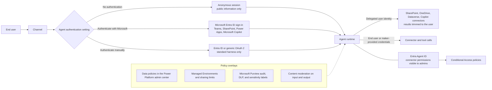

#### End-user authentication options

| Option | Behavior | standard harness | Microsoft Copilot harness |
|---|---|---|---|
| **No authentication** | Anyone with the link can chat; the agent can access only public information and can't use tools that require user credentials. Unavailable when a data policy requires authentication. | 🟢 | 🧪 |
| **Authenticate with Microsoft** | The default for new agents. Entra ID authentication works automatically in Teams, SharePoint, Power Apps, and Microsoft Copilot; required for the built-in **Teams + Microsoft 365** channel. Provides `User.Id` and `User.DisplayName`, but not `User.AccessToken`. | 🟢 | 🧪 |
| **Authenticate manually** | Entra ID (including V2 with federated credentials, certificates, or client secrets) or any OAuth 2.0 provider (Generic OAuth 2). Needed for authentication on other channels; exposes `User.AccessToken`; supports **Require users to sign in**. | 🟢 | Not supported |

Authentication changes take effect only after you publish. Sources: [Configure user authentication](https://learn.microsoft.com/en-us/microsoft-copilot-studio/configuration-end-user-authentication), [Agent settings (Microsoft Copilot harness)](https://learn.microsoft.com/en-us/microsoft-copilot-studio/agents-experience/settings-overview).

**Single sign-on (SSO).** **Authenticate with Microsoft** provides automatic SSO in supported Teams chats. For a custom website, configure manual Entra ID authentication with a token exchange URL and a separate canvas app registration. Learn lists SSO as supported for custom websites, Teams, SharePoint, and the Omnichannel live chat channel, and not supported for the demo website, mobile apps, Facebook, Azure Bot Service channels, or Power Pages ([Configure SSO with Microsoft Entra ID](https://learn.microsoft.com/en-us/microsoft-copilot-studio/configure-sso)).

#### Maker credentials versus end-user credentials

| Where | Default | Options and cautions |
|---|---|---|
| Connector and other tools (standard harness) | **End user** | **Maker-provided** credentials require an authenticated channel. With **No authentication**, tools that need user credentials can't work. |
| Computer use | **Maker-provided credentials** | Learn warns: if you share an agent with this setting, anyone using it can act with the author's access on the configured machine. **End user credentials** require each user to have machine access. |
| Event triggers (standard harness) | Maker credentials only | Users of a published agent with authenticated triggers might act with the author's credentials. |
| Triggers (Microsoft Copilot harness) | Maker, when **Activate for myself** | **Share with others** lets each user run the agent with their own credentials. |
| Agent account | The agent's own identity | Tools set to end-user authentication use the agent's identity and consent. |

Sources: [Add tools to custom agents](https://learn.microsoft.com/en-us/microsoft-copilot-studio/add-tools-custom-agent), [Use connectors](https://learn.microsoft.com/en-us/microsoft-copilot-studio/advanced-connectors), [Computer use](https://learn.microsoft.com/en-us/microsoft-copilot-studio/computer-use), [Event triggers](https://learn.microsoft.com/en-us/microsoft-copilot-studio/authoring-triggers-about), [Configure user authentication for tools](https://learn.microsoft.com/en-us/microsoft-copilot-studio/configure-enduser-authentication).

#### Admin and platform controls

- **Data policies** in the Power Platform admin center classify connectors as Business, Non-business, or Blocked. Copilot Studio-specific connectors let admins require user authentication (block **Chat without Microsoft Entra ID authentication in Copilot Studio**), block Power Platform connectors as tools, block HTTP requests, block Azure Bot Service skills, block publishing to specific channels, block event triggers, and block Application Insights connections. Enforcement has applied to all tenants since early 2025, and exemptions are no longer supported ([Configure data policies for agents](https://learn.microsoft.com/en-us/microsoft-copilot-studio/admin-data-loss-prevention)).
- **Managed Environments** add premium controls such as sharing limits, environment groups, IP firewall, customer-managed keys, Lockbox, and Application Insights export 💳 ([Managed environments overview](https://learn.microsoft.com/en-us/power-platform/admin/managed-environment-overview)).
- **Sharing**: share an agent *for chat* with individuals, security groups, or the whole organization, or invite *collaborators* to author it. Controlling who can chat requires Entra ID-based authentication ([Share agents](https://learn.microsoft.com/en-us/microsoft-copilot-studio/admin-share-bots), [Sharing limits](https://learn.microsoft.com/en-us/power-platform/admin/managed-environment-sharing-limits)).
- **Microsoft Entra Agent ID** makes each agent a governable identity with sign-in logs and Conditional Access on its connector permissions (see [Section 9](#9-autonomous-agents)).
- **Microsoft Purview** supports auditing, DSPM for AI, data classification, sensitivity labels, DLP, Insider Risk Management, Communication Compliance, eDiscovery, Data Lifecycle Management, and Compliance Manager for Copilot Studio agents. Managing AI interactions for agents published to non-Microsoft channels requires Purview pay-as-you-go billing 💳 ([Purview for Copilot Studio](https://learn.microsoft.com/en-us/purview/ai-copilot-studio)).
- **Built-in protections**: content moderation checks user input and agent output, including attempts at jailbreaking and prompt injection ([FAQ for generative answers](https://learn.microsoft.com/en-us/microsoft-copilot-studio/faqs-generative-answers)); an automatic security scan and agent runtime protection status warn makers before publishing ([Security scan](https://learn.microsoft.com/en-us/microsoft-copilot-studio/security-scan), [Security and governance](https://learn.microsoft.com/en-us/microsoft-copilot-studio/security-and-governance)); admins can control image rendering and embedded URLs in responses ([Image rendering and embedded URLs](https://learn.microsoft.com/en-us/microsoft-copilot-studio/image-render-embedded-url)).
- **Customer Lockbox and customer-managed keys (CMK)** are supported; Lockbox doesn't cover Purview security audit telemetry or Agent 365 governance events ([Security and governance](https://learn.microsoft.com/en-us/microsoft-copilot-studio/security-and-governance), [CMK](https://learn.microsoft.com/en-us/microsoft-copilot-studio/admin-customer-managed-keys)).

### Architect's notes

- **Default to Authenticate with Microsoft** for internal agents; reserve **No authentication** for genuinely public content.
- **Decide the identity model per data source and per tool** and document it — it's the core of your threat model.
- **Layer controls**: environment boundaries, data policies, sharing limits, Entra Conditional Access, Purview, and runtime moderation each cover different risks.

---

## 11. Data, storage, and residency

### In plain words

For agents on the standard harness, the agent's design, its uploaded files, and its conversation records are stored in your organization's Power Platform environment, in the region you chose when you created that environment. Some features — certain AI models, some channels, and a few Microsoft 365-powered capabilities — can move data elsewhere, so architects must know which features they turn on.

### How it works: what is stored where

| Data | Where Learn says it's stored | Retention and access notes |
|---|---|---|
| Agent definition (standard harness) | Dataverse **Agent** (`bot`) table and **Copilot component** (`botcomponent`) table, which "holds key authoring components of a Copilot such as topics, entities, variables" | Moves between environments in solutions ([bot table](https://learn.microsoft.com/en-us/power-apps/developer/data-platform/reference/entities/bot), [botcomponent table](https://learn.microsoft.com/en-us/power-apps/developer/data-platform/reference/entities/botcomponent)). |
| Uploaded knowledge files | Dataverse file storage | Count limited by the environment's file storage; requires Dataverse search ([Upload files](https://learn.microsoft.com/en-us/microsoft-copilot-studio/knowledge-add-file-upload)). |
| SharePoint lists used as knowledge | Ingested into Dataverse and indexed | Users still authenticate with their SharePoint credentials. |
| Conversation transcripts | Dataverse **ConversationTranscript** table, when transcript saving is allowed | Saved after 30 minutes of inactivity; records split above 1 MB; viewing requires the **Bot Transcript Viewer** role; admins control saving, viewing, downloading, and Dataverse retention. Not written for Dataverse for Teams environments or for Microsoft Copilot agents ([Transcript controls](https://learn.microsoft.com/en-us/microsoft-copilot-studio/admin-transcript-controls), [Transcripts in Power Apps](https://learn.microsoft.com/en-us/microsoft-copilot-studio/analytics-transcripts-powerapps)). |
| Session and transcript data in the service | Copilot Studio storage | Up to 28 days, then automatically deleted. |
| Memory (Microsoft Copilot harness, 🧪) | A dedicated per-user folder in Microsoft-managed storage | Private to the user; deleted after 28 days without interaction ([Memory](https://learn.microsoft.com/en-us/microsoft-copilot-studio/agents-experience/memory-overview)). |
| Created files and attachments (Microsoft Copilot harness, 🧪) | Stored with the conversation | 28 days after the last activity; 10 MB per created file ([Files the agent creates](https://learn.microsoft.com/en-us/microsoft-copilot-studio/agents-experience/created-files-overview)). |
| Historical activity data | Microsoft 365, in the region of the end user's Exchange mailbox | Covered by Microsoft 365 terms and data residency commitments ([Data locations](https://learn.microsoft.com/en-us/microsoft-copilot-studio/data-location)). |

> [!NOTE]
> Learn doesn't publish the internal storage layout of Microsoft Copilot harness or Customer Conversation harness agents beyond what's listed above. The agent inventory reports every agent's harness and its Dataverse agent ID ([Agent inventory](https://learn.microsoft.com/en-us/microsoft-copilot-studio/admin-agent-inventory)).

```mermaid
flowchart TD
    AGENT["Agent runtime"]
    subgraph ENV["Power Platform environment in a chosen region"]
        direction TB
        DV1["Dataverse bot and botcomponent tables<br/>agent definition and authoring components"]
        DV2["Dataverse file storage<br/>uploaded knowledge files"]
        DV3["ConversationTranscript table<br/>if transcript saving is allowed"]
    end
    subgraph MMS["Microsoft-managed service storage"]
        direction TB
        SS1["Session and transcript data<br/>up to 28 days"]
        SS2["Created files and attachments<br/>28 days after last activity"]
        SS3["Per-user memory<br/>deleted after 28 days without interaction"]
    end
    subgraph M365["Microsoft 365 boundary"]
        MA["Historical activity data<br/>region of the user's Exchange mailbox"]
    end
    subgraph EXT["Can leave your geography, depending on configuration"]
        direction TB
        X1["Generative AI features served from other regions"]
        X2["External model providers"]
        X3["Third-party channels such as WhatsApp or Facebook"]
    end
    AGENT --> ENV
    AGENT --> MMS
    AGENT --> M365
    AGENT -.-> EXT
```

### Geography and data residency

- **You choose the region** when you create an environment; Learn lists supported Azure geographies (for example Europe, United Kingdom, India, Japan, and the United States). If a tenant's location isn't listed, data is stored in the United States. Microsoft might replicate data within the same geography for durability; Brazil South data might be replicated to South Central US for disaster recovery ([Data locations](https://learn.microsoft.com/en-us/microsoft-copilot-studio/data-location)).
- **EU Data Boundary**: a tenant with an EU or EFTA billing address is in scope when it also creates all environments in regions inside the boundary ([Geographic data residency](https://learn.microsoft.com/en-us/microsoft-copilot-studio/geo-data-residency)).
- **Exceptions** include support and legal requirements, inherently global services (for example parts of Microsoft Entra ID), external services you configure (for example handoff and third-party channels), and Microsoft 365-powered features.
- **The Customer Conversation harness** has its own list of supported geographies ([Customer Conversation harness data locations](https://learn.microsoft.com/en-us/microsoft-copilot-studio/agents-experience/data-location-customer-conversation)).

### The external-model and cross-region caveat

- 💳 **Generative AI across regions**: in some non-US geographies, generative AI features (which draw on Azure OpenAI and Bing Search) must be made available by an admin, and "accessing Copilot Studio generative AI features from regions outside the United States results in data movement across regional boundaries" — data moved while the setting was on can't be reversed by withdrawing consent ([Configure data movement](https://learn.microsoft.com/en-us/microsoft-copilot-studio/manage-data-movement-outside-us)).
- 💳 **External models**: Anthropic operates as a Microsoft subprocessor; Mistral and xAI models are hosted outside Microsoft under their own terms. Admins must turn on external models in the Power Platform admin center and allow each provider in the Microsoft 365 admin center. Learn notes that some models might require data processing and storage outside your organization's geographic boundaries, and the March 2026 general availability of several Claude models excludes GCC environments ([Choose an external model](https://learn.microsoft.com/en-us/microsoft-copilot-studio/authoring-select-external-response-model), [What's new](https://learn.microsoft.com/en-us/microsoft-copilot-studio/whats-new)).
- **Third-party channels**: publishing to WhatsApp shares agent content and user chat content with WhatsApp, outside your organization's compliance and geographic boundaries ([WhatsApp](https://learn.microsoft.com/en-us/microsoft-copilot-studio/publication-add-bot-to-whatsapp)).
- **Model training**: Learn states that no customer data trains language models, and that conversations are stored temporarily in a secured, Microsoft-operated store ([RAG guidance](https://learn.microsoft.com/en-us/microsoft-copilot-studio/guidance/retrieval-augmented-generation)).

### Architect's notes

- Put agents for regulated data in environments created in the right region, and document which cross-region features you enable.
- Treat external models and third-party channels as data-flow decisions that need privacy and compliance sign-off.
- Size Dataverse capacity for transcripts and uploaded files, and set transcript retention deliberately.

---

## 12. Channels and publishing architecture

### In plain words

Building an agent and making it available are separate steps. You **publish** to make your latest changes live, and you connect **channels** — Teams, Microsoft Copilot, a website, a phone number — so people can reach the agent. Each harness supports a different set of channels.

### How it works: the publish lifecycle

- **standard harness**: publish from Copilot Studio; publishing updates **all** connected channels. You can add channels after the first publish. Users get the latest version when a new session starts (most channels end a session after 30 minutes of inactivity); in Teams, type `start over` to switch immediately, otherwise it can take up to an hour. Publish for yourself first, test, then make the agent available more widely. The demo website is for testing with stakeholders, not production ([Publish and deploy](https://learn.microsoft.com/en-us/microsoft-copilot-studio/publication-fundamentals-publish-channels)). A trial license can't publish ([Licensing](https://learn.microsoft.com/en-us/microsoft-copilot-studio/billing-licensing)).
- **Microsoft Copilot harness**: Create → Build → Test (**Preview**, **Evaluate**) → Publish → Monitor. Settings and hooks take effect after you save and publish. Autonomous agents need publishing *and* activation ([About the Microsoft Copilot harness](https://learn.microsoft.com/en-us/microsoft-copilot-studio/agents-experience/overview)).
- **Customer Conversation harness**: publish from the **Deploy** tab to Speech and Chat channels ([Customer Conversation harness overview](https://learn.microsoft.com/en-us/microsoft-copilot-studio/agents-experience/overview-customer-conversation)).
- 🧪 [Agent readiness and issue status](https://learn.microsoft.com/en-us/microsoft-copilot-studio/authoring-agent-status) surfaces publishing errors, runtime issues, and configuration blocks.

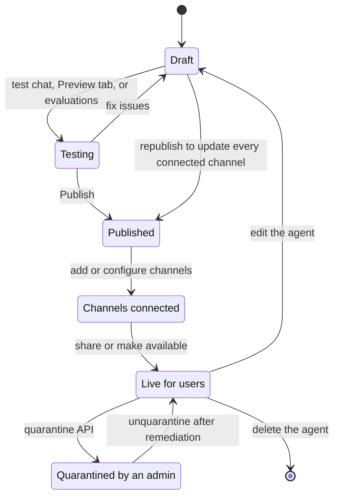

### Channel matrix

| Channel | standard harness | Microsoft Copilot harness | Customer Conversation harness |
|---|---|---|---|
| Microsoft Teams | 🟢 (Teams and Microsoft Copilot channel) | 🧪 Available | — |
| Microsoft Copilot | 🟢 (Teams and Microsoft Copilot channel) | 🧪 Available | — |
| SharePoint | 🟢 | Not available | — |
| Demo website | 🟢 (testing only) | 🧪 Available | — |
| Custom website or web app | 🟢 Custom website | 🧪 Web app (iframe embedding) | 🧪 Website chat |
| Mobile or native app (Direct Line) | 🟢 | Not available | — |
| Facebook | 🟢 | Not available | — |
| WhatsApp (Azure Communication Services) | ⚠️ No new connections after 23 October 2026; agents connected before then keep working | Not available | — |
| Azure Bot Service channels (for example Slack, Telegram, Twilio, Line, GroupMe, Direct Line Speech, Email) | 🟢 | Not available | — |
| Dynamics 365 Contact Center and Omnichannel | 🟢 | Not available | Live contact center only through the Microsoft Contact Center Intelligence portal |
| Telephony and voice | Supported (🧪 real-time voice agents) | — | 🧪 Phone number (Speech) |
| MCP client (expose the agent as a remote MCP server) | — | 🧪 Early release cycle environments only | — |
| A2A client (expose the agent over Agent2Agent) | — | 🧪 Early release cycle environments only | — |

Sources: [Publish and deploy](https://learn.microsoft.com/en-us/microsoft-copilot-studio/publication-fundamentals-publish-channels), [Available channels (Microsoft Copilot harness)](https://learn.microsoft.com/en-us/microsoft-copilot-studio/agents-experience/publication-channels-overview), [MCP and A2A channels](https://learn.microsoft.com/en-us/microsoft-copilot-studio/agents-experience/publication-channels-mcp-agent-to-agent), [WhatsApp](https://learn.microsoft.com/en-us/microsoft-copilot-studio/publication-add-bot-to-whatsapp), [Customer Conversation harness overview](https://learn.microsoft.com/en-us/microsoft-copilot-studio/agents-experience/overview-customer-conversation), [What's new](https://learn.microsoft.com/en-us/microsoft-copilot-studio/whats-new).

### Channel and authentication interplay

- The built-in **Teams + Microsoft 365** channel needs **Authenticate with Microsoft**. WhatsApp needs **No authentication** or **Authenticate manually**. For authentication on other channels, use **Authenticate manually** ([Configure user authentication](https://learn.microsoft.com/en-us/microsoft-copilot-studio/configuration-end-user-authentication)).
- The MCP and A2A client channels publish an HTTPS endpoint; clients authenticate with Microsoft Entra ID on behalf of the signed-in user, and Copilot Studio still checks that the user has access to the agent. You need an Entra app registration with the delegated `MCS.InvokeAsMCP` or `MCS.InvokeAsA2A` permissions.
- **Admin controls**: data policies can block specific channel connectors (for example **Direct Line channels in Copilot Studio** or **WhatsApp channel in Copilot Studio**); 🧪 **Agent access channels** in the Power Platform admin center restricts channels per environment or environment group ([Configure channel publishing](https://learn.microsoft.com/en-us/power-platform/admin/security/configure-channel-connected-agent-publishing)). If no allowed channel is configured, agents can't be published.

### Architect's notes

- **Choose the channel before the harness is locked in.** Channel availability is one of the biggest practical differences between harnesses.
- **Design for channel rendering differences**: Teams renders at most six suggested actions per question node, shows the satisfaction survey as text, and limits citations.
- **Use a display name suffix** (🧪, via environment variables) to tell development, test, and production copies apart in Teams and Microsoft 365 Copilot ([Display name suffix](https://learn.microsoft.com/en-us/microsoft-copilot-studio/publication-agent-display-name-suffix)).

---

## 13. ALM and environment strategy

### In plain words

Professional teams never build directly in production. They build in a **development** environment, check the agent in a **test** environment, and then move the finished version to **production** — using **solutions** as the "shipping container" for agents and their components.

### How it works

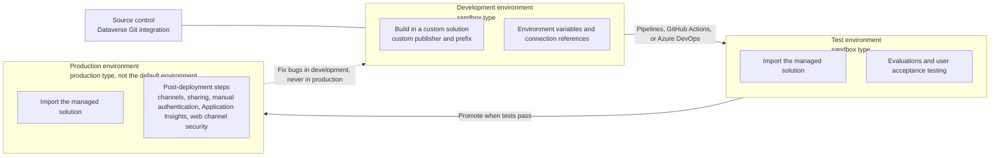

What Learn documents ([ALM guidance](https://learn.microsoft.com/en-us/microsoft-copilot-studio/guidance/alm), [Solutions in Copilot Studio](https://learn.microsoft.com/en-us/microsoft-copilot-studio/authoring-solutions-overview), [Environments](https://learn.microsoft.com/en-us/microsoft-copilot-studio/environments-first-run-experience)):

- **Environments**: use at least development, test, and production. Make production a production-type environment and the others sandbox type; secure each with a Microsoft Entra security group. Use a non-default production environment for production agents. Trial environments expire after 30 days and their agents are deleted.
- ⚠️ **Unmanaged developer environments are deprecated**: to keep an existing developer environment, enable Managed Environments on it before 15 December 2026 ([Managed environments overview](https://learn.microsoft.com/en-us/power-platform/admin/managed-environment-overview)).
- **Solutions**: every agent is created inside a solution (by default the default solution). To move agents between environments, use a custom solution; set a **preferred solution**; export managed solutions except to development environments. The solution explorer and **Pipelines** are available directly in Copilot Studio. On the Microsoft Copilot harness, you pick the **Solution** in the **Agent details** tab before the first save; it becomes read-only afterwards ([Agent settings](https://learn.microsoft.com/en-us/microsoft-copilot-studio/agents-experience/settings-overview)).
- **Golden rules**: don't customize outside development; always work in solutions; use a custom publisher and prefix; split solutions only for independent deployment; put settings and secrets that change across environments in [environment variables](https://learn.microsoft.com/en-us/power-apps/maker/data-platform/environmentvariables) and use connection references; consider automation.
- **Not solution-aware** (redo after each deployment): Azure Application Insights settings, manual authentication settings, Direct Line and web channel security settings, deployed channels, and sharing.
- **Reuse**: [component collections](https://learn.microsoft.com/en-us/microsoft-copilot-studio/authoring-export-import-copilot-components) share topics, knowledge, actions, and entities across agents and can move through solutions.

| ALM automation option | Best for | Setup complexity (per Learn) |
|---|---|---|
| [Pipelines in Power Platform](https://learn.microsoft.com/en-us/power-platform/alm/pipelines) | Organizations empowering citizen developers | Low |
| [GitHub Actions for Power Platform](https://learn.microsoft.com/en-us/power-platform/alm/devops-github-actions) | Dev and admin teams managing multiple environments | Moderate |
| [Azure DevOps with Power Platform Build Tools](https://learn.microsoft.com/en-us/power-platform/alm/devops-build-tools) | Enterprise teams needing full ALM control | High |
| [Dataverse Git integration](https://learn.microsoft.com/en-us/power-platform/alm/git-integration/overview) | Native source control | — |

You can also run evaluations in CI/CD with the Copilot Studio connector or the 🧪 evaluation REST API ([Evaluation REST API](https://learn.microsoft.com/en-us/microsoft-copilot-studio/analytics-agent-evaluation-rest-api), [Automate evaluations](https://learn.microsoft.com/en-us/microsoft-copilot-studio/analytics-agent-evaluation-automate-tools)).

### Architect's notes

- **Write a post-deployment runbook** for the non-solution-aware items; they're the most common cause of "works in test, broken in production".
- **Keep one environment strategy for all harnesses**, but expect different credit profiles: development and test on the Microsoft Copilot harness consume credits.
- **Separate makers from production**: limit authoring access in production and in environments with large credit allocations ([Manage costs for the Microsoft Copilot harness](https://learn.microsoft.com/en-us/power-platform/admin/manage-usage-microsoft-copilot-harness)).

---

## 14. Observability and quality

### In plain words

You can't improve what you can't see. Copilot Studio gives you a **test chat** or **Preview** tab while building, **evaluations** (automated test sets) before release, the **Monitor** page after release, **transcripts** for detailed review, and **Application Insights** for engineering-grade telemetry.

### How it works

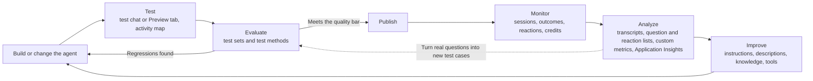

| Signal | Where | Applies to | Documented details |
|---|---|---|---|
| Test chat and activity map | Copilot Studio test panel | standard harness | Follow the orchestration plan step by step ([Review activity](https://learn.microsoft.com/en-us/microsoft-copilot-studio/authoring-review-activity), [Test your agent](https://learn.microsoft.com/en-us/microsoft-copilot-studio/authoring-test-bot)). Test-chat activity doesn't appear on the **Monitor** page. |
| **Preview** tab | Copilot Studio | Microsoft Copilot and Customer Conversation harnesses | Interactive testing; can consume Copilot Credits on these harnesses. |
| Evaluations | Test sets in Copilot Studio (**Evaluate** tab on the newer harnesses) | All harnesses | 🟢 GA since March 2026. Test methods: general quality, content safety, compare meaning, tool use, keyword match, text similarity, exact match, and custom; single-response and multi-turn tests ([Evaluation methods](https://learn.microsoft.com/en-us/microsoft-copilot-studio/analytics-agent-evaluation-overview), [Multi-turn tests](https://learn.microsoft.com/en-us/microsoft-copilot-studio/analytics-agent-evaluation-multi-turn)). |
| **Monitor** page | Copilot Studio | standard and Microsoft Copilot harnesses | On the standard harness: conversational and autonomous-agent analytics, data for up to 360 days, session details and transcripts for 28 days, UTC timestamps; share view-only access with the **Analytics Viewer** role ([Monitor agent performance](https://learn.microsoft.com/en-us/microsoft-copilot-studio/analytics-overview)). On the Microsoft Copilot harness: production health, outcomes, reactions, sessions, and credit usage. |
| Custom metrics | **Monitor** page | standard harness | 🧪 Up to three per agent, for conversational agents only ([Custom metrics](https://learn.microsoft.com/en-us/microsoft-copilot-studio/analytics-custom-metrics)). |
| User questions and reactions lists | **Monitor** page | standard harness | Filter, export, and turn into evaluation test sets ([Question and reaction lists](https://learn.microsoft.com/en-us/microsoft-copilot-studio/analytics-question-reaction-lists)). |
| Conversation transcripts | Copilot Studio and Dataverse | As documented in Section 11 | Need the **Bot Transcript Viewer** role; admins control saving and access ([Transcripts in Copilot Studio](https://learn.microsoft.com/en-us/microsoft-copilot-studio/analytics-transcripts-studio)). |
| Agent-level Application Insights | Azure Monitor | standard harness | Connect an agent to your Application Insights resource; admins can block it with the **Application Insights in Copilot Studio** data policy connector ([Capture telemetry](https://learn.microsoft.com/en-us/microsoft-copilot-studio/advanced-bot-framework-composer-capture-telemetry)). |
| Environment-level telemetry | Power Platform admin center to Application Insights | Managed environments | 🧪 OpenTelemetry-aligned agent traces (`InvokeAgent`, `ExecuteTool`, `OutputMessages` spans). The article states it applies to both harnesses but currently lists only standard-harness agent logs as available ([Environment-level telemetry](https://learn.microsoft.com/en-us/microsoft-copilot-studio/advanced-environment-level-agent-telemetry)). |
| Audit and security monitoring | Microsoft Purview, Microsoft Sentinel | All | Maker audit logs in Purview; alerts on agent activities in Sentinel ([Security and governance](https://learn.microsoft.com/en-us/microsoft-copilot-studio/security-and-governance)). |

> [!WARNING]
> Generative answers aren't deterministic. Learn warns that repeating fixed queries in regression tests or automated health checks "is likely to result in varying answers and false positive error reports" ([FAQ for generative answers](https://learn.microsoft.com/en-us/microsoft-copilot-studio/faqs-generative-answers)). Prefer meaning-based test methods (general quality, compare meaning) over exact match for generated text.

### Architect's notes

- **Make evaluations a release gate** and automate them in your pipeline.
- **Feed production back into testing**: export real user questions and failed sessions into new test cases.
- **Decide your telemetry strategy early**: agent-level Application Insights is configured per agent and isn't solution-aware; environment-level export needs Managed Environments.

---

## 15. Billing and capacity architecture

### In plain words

Copilot Studio usage is measured in **Copilot Credits** — the common currency across Copilot Studio capabilities (they replaced "messages" on 1 September 2025). Your organization acquires credits, admins assign them to environments, and agents consume them. When billing starts depends on the harness: after publishing on the standard harness, from the first build activity on the Microsoft Copilot harness.

> [!IMPORTANT]
> This section explains the *architecture* of billing. For prices, rates, and contractual terms, always use the [Microsoft Copilot Studio Licensing Guide](https://go.microsoft.com/fwlink/?linkid=2320995), the [billing rates article](https://learn.microsoft.com/en-us/microsoft-copilot-studio/requirements-messages-management), and the [agent usage estimator](https://microsoft.github.io/copilot-studio-estimator/).

### How it works

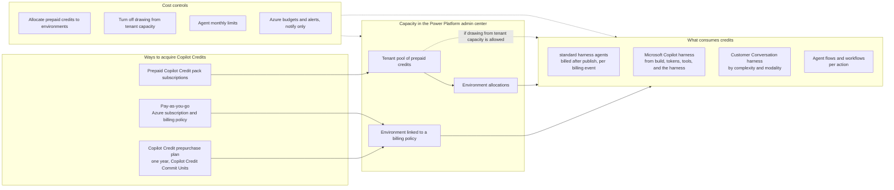

#### Acquiring credits and access

| Mechanism | What Learn documents |
|---|---|
| Prepaid Copilot Credit pack subscription | Tenant-wide capacity; a prerequisite for assigning the free Copilot Studio user license. |
| Pay-as-you-go | Link environments to an Azure subscription with a billing policy in the Power Platform admin center; pay monthly for actual use; unlink at any time ([Pay-as-you-go overview](https://learn.microsoft.com/en-us/power-platform/admin/pay-as-you-go-overview)). |
| Copilot Credit prepurchase plan | One-year prepaid pool of Copilot Credit Commit Units (CCCUs), purchased in the Azure portal and used through a billing policy. |
| Maker access | Copilot Studio user license (free, needs the tenant prepaid pack), the **Copilot Studio authors** security group setting (pay-as-you-go scenarios), a Microsoft 365 Copilot license (lets users build agents on the Microsoft Copilot harness), or a trial license (create and test, but not publish). The authors setting doesn't revoke access granted by other licenses. |

Source: [Standard harness licensing](https://learn.microsoft.com/en-us/microsoft-copilot-studio/billing-licensing). Copilot Studio is available in the US Government Community Cloud (GCC) 💳 ([GCC](https://learn.microsoft.com/en-us/microsoft-copilot-studio/requirements-licensing-gcc)).

#### Consumption per harness

| Aspect | standard harness | Microsoft Copilot harness | Customer Conversation harness |
|---|---|---|---|
| Model | Standard licensing model; credits per billing event | Usage-based: LLM tokens, tools (including knowledge and MCP), and the harness itself | Usage-based, varying with conversation complexity and modality (digital, GenAI voice, premium voice) |
| When billing starts | After publish; testing in the test chat and flow designer isn't billed | From the start of building: natural-language creation, preview and testing, and evaluations consume credits | Building, testing, evaluating, and using can consume credits |
| Microsoft 365 Copilot license holders | Classic answers, generative answers, and tenant graph grounding in Copilot Chat, Teams, or SharePoint aren't charged when the agent runs with the user's authenticated identity | Not included in the Microsoft 365 Copilot license | — |
| Where to see usage | Power Platform admin center: **Licensing** > **Copilot Studio** | The agent's **Monitor** page, plus the admin center | The admin center ([Manage costs for agents powered by the Customer Conversation harness](https://learn.microsoft.com/en-us/power-platform/admin/manage-usage-customer-conversation-harness)) |

Sources: [Usage-based billing](https://learn.microsoft.com/en-us/microsoft-copilot-studio/agents-experience/billing-credit-overview), [Standard harness licensing](https://learn.microsoft.com/en-us/microsoft-copilot-studio/billing-licensing), [Billing rates](https://learn.microsoft.com/en-us/microsoft-copilot-studio/requirements-messages-management).

**Billing events on the standard harness** include classic answers, generative answers, agent actions (including computer use), tenant graph grounding, agent flow actions, AI tools (text and generative AI tools, content processing), voice tiers, and a premium token-based meter when a reasoning model orchestrates the agent. One interaction can use several events — Learn's example: an agent grounded in the tenant graph could use 12 Copilot Credits for one complex prompt (10 for tenant graph grounding plus 2 for the generative answer).

The Power Platform admin center article lists what is covered by a Microsoft 365 Copilot license: standard harness agents in Microsoft 365 channels, agent flows called through **When an agent calls the flow** while a licensed, authenticated user interacts with the agent, and workflows and prompts run inside a standard harness agent by a licensed user. Computer use and Microsoft Copilot harness agents are billed for all usage.

#### Enforcement and cost controls

- **Enforcement**: purchased capacity is enforced monthly; unused credits don't carry over; overage can lead to service denial. When an environment has no credits, new agent flow and workflow runs are blocked while runs in progress complete ([Agent flows](https://learn.microsoft.com/en-us/microsoft-copilot-studio/flows-overview), [Credit enforcement](https://learn.microsoft.com/en-us/microsoft-copilot-studio/agents-experience/enforcement-policy-credits)).
- **Controls in the Power Platform admin center**: allocate prepaid credits to an environment (prepaid packs only); clear **Draw from the available capacity in my tenant** so the environment stops at its allocation (this doesn't stop pay-as-you-go consumption); set agent-level monthly limits (an agent must consume some credits first); apply allocations programmatically. Azure budgets and alerts notify but don't stop consumption. These controls apply across Copilot Studio, not only to the Microsoft Copilot harness ([Manage costs](https://learn.microsoft.com/en-us/power-platform/admin/manage-usage-microsoft-copilot-harness), [Govern credit consumption](https://learn.microsoft.com/en-us/microsoft-copilot-studio/guidance/govern-credit-consumption)).
- **Other controls**: admins can set pay-as-you-go Copilot credit caps ([Copilot hub](https://learn.microsoft.com/en-us/power-platform/admin/copilot/copilot-hub), [Manage Copilot Studio credits and capacity](https://learn.microsoft.com/en-us/power-platform/admin/manage-copilot-studio-messages-capacity)), and Microsoft Agent 365 cost management breaks consumption down by user, group, agent, and service and lets admins set spending limits for groups and users ([Agent 365](https://learn.microsoft.com/en-us/microsoft-agent-365/overview)).

### Architect's notes

- **Estimate before you build** with the agent usage estimator, and re-estimate after evaluations show real behavior.
- **Separate who can build from how much they can spend**: permissions and credit controls do different jobs — use both.
- **Watch the hidden meters**: autonomous triggers, frequent recurrences, reasoning models, computer use, and build-time activity on the Microsoft Copilot harness.

---

## 16. Governance architecture

### In plain words

Governance is how an organization stays in control as hundreds of makers build agents: who can build, where they can build, what data and tools agents can use, who can use the agents, how much they can spend, and how admins find and stop a risky agent.

### How it works

```mermaid
flowchart TD
    subgraph PPAC["Power Platform admin center"]
        direction TB
        A1["Environments, environment groups, and rules"]
        A2["Managed Environments and sharing limits"]
        A3["Data policies and endpoint filtering"]
        A4["Knowledge sources for agents, Preview"]
        A5["Agent access channels and connected agents, Preview"]
        A6["Transcript controls and generative AI settings"]
        A7["Copilot Credits, allocations, and limits"]
        A8["Agent inventory and the quarantine API"]
    end
    subgraph ENTRA["Microsoft Entra"]
        direction TB
        E1["Entra Agent ID for each agent"]
        E2["Conditional Access and ID governance"]
    end
    subgraph A365["Microsoft Agent 365"]
        direction TB
        G1["Agent registry and agent map"]
        G2["Ownership, approval, and policy templates"]
        G3["Risk signals and blocking"]
        G4["Cost management"]
    end
    subgraph PUR["Microsoft Purview"]
        direction TB
        R1["Audit and DSPM for AI"]
        R2["Sensitivity labels and DLP"]
        R3["eDiscovery and data lifecycle management"]
    end
    subgraph MAC["Microsoft 365 admin center"]
        direction TB
        N1["External model providers"]
        N2["Plugins and agent templates"]
    end
    AGENTS["Copilot Studio agents in environments"]
    PPAC --> AGENTS
    ENTRA --> AGENTS
    A365 --> AGENTS
    PUR --> AGENTS
    MAC --> AGENTS
```

| Control | Where | What it governs | Status per Learn |
|---|---|---|---|
| [Environment groups and rules](https://learn.microsoft.com/en-us/power-platform/admin/environment-groups) | Power Platform admin center | Groups managed environments and enforces rules (security, sharing, AI features, retention, ALM) that become read-only in member environments; no per-environment exceptions | Premium; managed environments only 💳 |
| [Managed Environments](https://learn.microsoft.com/en-us/power-platform/admin/managed-environment-overview) | Power Platform admin center | Sharing limits, data policies, pipelines, IP firewall, CMK, Lockbox, Application Insights export, and more | Entitlement with standalone Copilot Studio licenses 💳 |
| [Data policies](https://learn.microsoft.com/en-us/microsoft-copilot-studio/admin-data-loss-prevention) | Power Platform admin center | Connectors as tools, authentication, HTTP, Azure Bot Service skills, channels, event triggers, Application Insights | Enforced for all tenants since early 2025 |
| [Knowledge sources for agents](https://learn.microsoft.com/en-us/power-platform/admin/knowledge-sources-for-agents-rule) | **Security** > **Data and privacy** | Local file uploads, SharePoint and OneDrive, public websites | 🧪 |
| [Agent access channels and connected agents](https://learn.microsoft.com/en-us/power-platform/admin/security/configure-channel-connected-agent-publishing) | **Security** > **Identity and access**; **Copilot** > **Settings** | Which channels agents can publish to; cross-environment connected agents | 🧪 |
| [Transcript controls](https://learn.microsoft.com/en-us/microsoft-copilot-studio/admin-transcript-controls) | Environment **Settings** > **Product** > **Features** | Whether makers can view or download transcripts and whether transcripts are saved to Dataverse | — |
| Generative AI controls | Power Platform admin center (plus Microsoft 365 admin center for model providers) | Publishing agents that use generative AI, data movement across geographies, [external models](https://learn.microsoft.com/en-us/power-platform/admin/allow-llm-generative-responses) | — |
| [Credits and capacity](https://learn.microsoft.com/en-us/power-platform/admin/manage-usage-microsoft-copilot-harness) | **Licensing** > **Copilot Studio** | Environment allocations, tenant draw, agent limits | — |
| [Agent inventory](https://learn.microsoft.com/en-us/microsoft-copilot-studio/admin-agent-inventory) | Power Platform admin center, Power Platform API, Azure Resource Graph | Every Copilot Studio and Agent Builder agent (draft and published), including harness, owner, channels, authentication, and Entra identity fields; refreshes within about 20 minutes | Fields marked GA or Preview individually |
| [Quarantine](https://learn.microsoft.com/en-us/microsoft-copilot-studio/admin-api-quarantine) | Power Platform API (`copilotstudio` namespace) | Isolates a noncompliant agent: makers can still test it, but users can't interact with it in any other channel | — |
| [Microsoft Entra Agent ID](https://learn.microsoft.com/en-us/microsoft-copilot-studio/admin-use-entra-agent-identities) | Microsoft Entra admin center | Agent identities, sign-in logs, connector permissions, Conditional Access, ID governance | Automatic for every new agent |
| [Microsoft Agent 365](https://learn.microsoft.com/en-us/microsoft-agent-365/overview) | Microsoft 365 admin center | Registry and agent map; ownership and approval; policy templates; risk signals from Defender, Entra, and Purview; block a risky agent; cost management | 🟢 GA for the Commercial segment; per-user licensing 💳 |
| [Microsoft Purview](https://learn.microsoft.com/en-us/purview/ai-copilot-studio) | Microsoft Purview portal | Audit, DSPM for AI, labels, DLP, eDiscovery, Insider Risk Management, Communication Compliance, Data Lifecycle Management | 💳 Pay-as-you-go needed for agents on non-Microsoft channels |

**Governing the Microsoft Copilot harness.** There's no on/off switch. Admins use four kinds of control: who can build (Dataverse security roles in each environment), what data and connectors agents can reach (data policies and advanced connector policies), who agents are shared with (Managed Environment sharing controls and environment security groups), and how much an agent can spend (credit allocations and limits). They monitor and respond with usage reports, the agent inventory, and blocking or quarantining an agent ([FAQ](https://learn.microsoft.com/en-us/microsoft-copilot-studio/agents-experience/faqs-copilot-harness)).

Since August 2026, organizations can onboard Copilot Studio agents to Microsoft Agent 365 for centralized governance, including identity representation in Microsoft Entra, Conditional Access, access governance workflows, and centralized observability ([Security and governance](https://learn.microsoft.com/en-us/microsoft-copilot-studio/security-and-governance)).

### Architect's notes

- **Use environment groups** to apply the same rules to every development, test, or production environment instead of configuring each one.
- **Route makers to safe spaces**: environment routing and maker welcome content help new makers start in a governed environment ([Environments](https://learn.microsoft.com/en-us/microsoft-copilot-studio/environments-first-run-experience)).
- **Write an incident runbook**: find the agent in the inventory, quarantine or block it, review Purview audit records, then remediate and unquarantine.

---

## 17. Architecture decision checklist and anti-patterns

### Decision checklist

Use this list in design reviews. Each item points back to a section of this document.

**Harness and scope**

- [ ] The harness is chosen per scenario (task weight, predictability, channels, features, billing), and the rationale is written down ([Section 3](#3-harness-architecture)).
- [ ] Every channel the business needs is available on the chosen harness today ([Section 12](#12-channels-and-publishing-architecture)).
- [ ] Every 🧪 dependency is listed with a fallback plan, and preview terms were reviewed before production use.
- [ ] If an existing standard agent is being upgraded, there's a documented business benefit and a re-architecture plan, not a component-by-component port.

**Environments and ALM**

- [ ] At least development, test, and production environments exist; production is a non-default, production-type environment; each environment is secured with an Entra security group ([Section 13](#13-alm-and-environment-strategy)).
- [ ] Development environments are managed (unmanaged developer environments are ⚠️ deprecated — enable Managed Environments before 15 December 2026).
- [ ] Agents live in a custom solution with a custom publisher; environment variables and connection references hold per-environment values; managed solutions go downstream.
- [ ] A post-deployment runbook covers the non-solution-aware items (channels, sharing, manual authentication, Application Insights, web channel security).

**Knowledge, tools, and orchestration**

- [ ] Each knowledge source is mapped to its permission model (delegated or not), and no confidential content relies on a non-delegated source such as Azure AI Search ([Section 6](#6-knowledge-and-grounding-architecture)).
- [ ] **Allow ungrounded responses**, web search, and moderation level are set deliberately, and the instructions ask for citations.
- [ ] Names and descriptions of topics, tools, skills, knowledge, and agents are specific and non-overlapping; no single agent exceeds roughly 30 to 40 choices ([Section 5](#5-runtime-request-flows)).
- [ ] Each tool's credentials (end user or maker-provided) are justified, and high-impact actions require confirmation or an approval step ([Section 7](#7-tools-and-extensibility-architecture)).
- [ ] Any multi-agent split is justified by ownership, ALM, reuse, or selection quality, and no design relies on cross-harness invocation or nested connected agents ([Section 8](#8-multi-agent-architecture)).

**Identity, security, and data**

- [ ] The end-user authentication option is chosen per audience and channel; internal agents use Entra ID-based authentication ([Section 10](#10-identity-and-security-architecture)).
- [ ] Data policies classify the Copilot Studio connectors (authentication, channels, HTTP, triggers, Application Insights) for each environment or environment group.
- [ ] Autonomous agents have documented trigger identities, payload handling, narrow trigger parameters, and credit limits ([Section 9](#9-autonomous-agents)).
- [ ] Entra Agent IDs are governed (owners, Conditional Access on connector permissions), and the blueprint enterprise application stays enabled.
- [ ] Microsoft Purview auditing and sensitivity labeling are in place for SharePoint and OneDrive knowledge, and Purview pay-as-you-go is planned for non-Microsoft channels.
- [ ] Environment regions, cross-region generative AI settings, external model approvals, and third-party channels are reviewed for residency requirements ([Section 11](#11-data-storage-and-residency)).
- [ ] Transcript saving, viewing, download, and retention are configured, and only the right people hold the **Bot Transcript Viewer** role.

**Quality, operations, and cost**

- [ ] An evaluation test set (including content safety) gates every release and runs in the pipeline ([Section 14](#14-observability-and-quality)).
- [ ] A monitoring cadence is defined (Monitor page, transcripts, custom metrics, Application Insights).
- [ ] The credit source (prepaid, pay-as-you-go, prepurchase) is chosen, environment allocations and agent limits are set, and alerts have an owner ([Section 15](#15-billing-and-capacity-architecture)).
- [ ] Licensing assumptions are validated: Microsoft 365 Copilot coverage applies only to documented standard-harness scenarios; Microsoft Copilot harness usage and computer use are always billed.
- [ ] The model choice is deliberate (GA versus preview or experimental, external-model approvals), and there's a plan for default-model upgrades.
- [ ] A governance runbook exists: inventory review, quarantine or block, Purview investigation, and Agent 365 onboarding decision ([Section 16](#16-governance-architecture)).

### Common anti-patterns

| Anti-pattern | Why it hurts | Better approach |
|---|---|---|
| Putting every new agent on the most capable harness | A more capable harness "can overwork a simple problem", increasing credits and latency | Match the harness to task weight; prototype and compare |
| Migrating a working standard agent just because a new harness exists | Extra consumption, testing, and governance with no proven benefit | Migrate only for a scenario-level benefit |
| Treating the upgrade as a 1:1 conversion | Topics, variables, and Power Fx don't map mechanically; knowledge and child agents aren't migrated | Re-architect around outcomes, skills, workflows, and connected agents |
| Building and changing agents directly in production or in the default environment | No safe testing, no rollback, no ALM | Development, test, and production environments with solutions and pipelines |
| Vague or overlapping descriptions | The orchestrator picks the wrong topic or tool, or picks unpredictably | Specific names and descriptions that say what each component does and doesn't do |
| One giant agent with dozens of tools and topics | Selection quality degrades beyond about 30 to 40 choices | Child agents, connected agents, or skills by domain |
| Splitting into many agents by default | More latency, more governance surface, citations can be lost between agents | Start with one agent; split for ownership, ALM, reuse, or quality |
| Maker-provided credentials on a shared agent | Every user acts with the maker's access | End-user credentials, or a least-privilege identity with a documented exception |
| **No authentication** on an internal agent | Anyone with the link can chat; no SharePoint grounding; no user-credential tools | **Authenticate with Microsoft** |
| Grounding confidential content through Azure AI Search and expecting user-level trimming | Azure AI Search connections aren't delegated and have no security trimming | Delegated sources such as SharePoint or Dataverse |
| Using the demo website as the production channel | It isn't intended for production | A custom website or another supported channel with proper authentication |
| Exact-match regression tests for generated answers | Generative answers vary between runs and cause false failures | Meaning-based and general-quality test methods |
| High-frequency recurrence triggers with no limits | Unplanned credit consumption and throttling | Narrow triggers, agent limits, and monitoring |
| Ignoring build-time consumption on the Microsoft Copilot harness | Building, preview testing, and evaluations consume credits | Allocate development credits and set agent limits |
| Assuming Azure budgets cap spend | Azure budgets and alerts only notify | Environment allocations, tenant-draw settings, and agent limits |
| Planning new WhatsApp deployments on the Azure Communication Services channel | New connections aren't possible after 23 October 2026 | Choose another supported channel and check Learn for alternatives |

---

## 18. Where each area is taught

| Section of this document | Where it's taught in depth |
|---|---|
| 1–2. How to read this document; big picture | [Module 1](01-Introduction-to-Copilot-Studio/README.md), [Module 2](02-Power-Platform-Fundamentals/README.md) |
| 3. Harness architecture | [Module 1](01-Introduction-to-Copilot-Studio/README.md), [Module 9](09-Generative-AI-and-Orchestration/README.md), [Module 19](19-Enterprise-Copilot-Architecture/README.md) |
| 4. Anatomy of an agent | [Module 4](04-Copilot-Studio-Interface/README.md), [Module 5](05-Creating-Your-First-Agent/README.md), [Module 6](06-Agent-Configuration-and-Instructions/README.md), [Module 7](07-Topics-and-Conversation-Design/README.md), [Module 8](08-Variables-and-Entities/README.md) |
| 5. Runtime request flows | [Module 7](07-Topics-and-Conversation-Design/README.md), [Module 9](09-Generative-AI-and-Orchestration/README.md) |
| 6. Knowledge and grounding | [Module 10](10-Knowledge-Sources-and-Grounding/README.md), [Module 12](12-Prompts-and-Generative-Answers/README.md) |
| 7. Tools and extensibility | [Module 11](11-Agent-Tools-and-Capabilities/README.md) |
| 8. Multi-agent architecture | [Module 18](18-Advanced-Agent-Development/README.md), [Module 19](19-Enterprise-Copilot-Architecture/README.md) |
| 9. Autonomous agents | [Module 9](09-Generative-AI-and-Orchestration/README.md), [Module 18](18-Advanced-Agent-Development/README.md) |
| 10. Identity and security | [Module 13](13-Authentication-and-Security/README.md) |
| 11. Data, storage, and residency | [Module 13](13-Authentication-and-Security/README.md), [Module 17](17-Agent-Management-and-Governance/README.md) |
| 12. Channels and publishing | [Module 14](14-Publishing-and-Channels/README.md) |
| 13. ALM and environment strategy | [Module 2](02-Power-Platform-Fundamentals/README.md), [Module 3](03-Environment-and-Setup/README.md), [Module 17](17-Agent-Management-and-Governance/README.md), [Module 19](19-Enterprise-Copilot-Architecture/README.md) |
| 14. Observability and quality | [Module 15](15-Testing-and-Debugging/README.md), [Module 16](16-Analytics-and-Monitoring/README.md) |
| 15. Billing and capacity | [Module 1](01-Introduction-to-Copilot-Studio/README.md), [Module 3](03-Environment-and-Setup/README.md), [Module 17](17-Agent-Management-and-Governance/README.md), [Module 19](19-Enterprise-Copilot-Architecture/README.md) |
| 16. Governance | [Module 17](17-Agent-Management-and-Governance/README.md) |
| 17. Checklist and anti-patterns | [Module 19](19-Enterprise-Copilot-Architecture/README.md), [Module 20](20-Real-World-Projects/README.md), [Module 21](21-Interview-Preparation/README.md), [Module 22](22-Final-Capstone-Project/README.md) |

---

## References

All links were opened or checked as live on 18 November 2026.

**Platform, harnesses, and experiences**

- [Overview — Microsoft Copilot Studio](https://learn.microsoft.com/en-us/microsoft-copilot-studio/fundamentals-what-is-copilot-studio)
- [Harnesses in Copilot Studio](https://learn.microsoft.com/en-us/microsoft-copilot-studio/harnesses-overview)
- [Compare Copilot Studio agent harnesses](https://learn.microsoft.com/en-us/microsoft-copilot-studio/guidance/choose-harness)
- [Agents overview](https://learn.microsoft.com/en-us/microsoft-copilot-studio/agents-overview)
- [About agents powered by the Microsoft Copilot harness](https://learn.microsoft.com/en-us/microsoft-copilot-studio/agents-experience/overview)
- [Agents powered by the Customer Conversation harness overview](https://learn.microsoft.com/en-us/microsoft-copilot-studio/agents-experience/overview-customer-conversation)
- [FAQ for agents powered by the Microsoft Copilot harness](https://learn.microsoft.com/en-us/microsoft-copilot-studio/agents-experience/faqs-copilot-harness)
- [Access standard harness agents and agent flows](https://learn.microsoft.com/en-us/microsoft-copilot-studio/agents-experience/switch-experiences)
- [Upgrade agents to the Microsoft Copilot harness (preview)](https://learn.microsoft.com/en-us/microsoft-copilot-studio/upgrade-to-microsoft-copilot-from-standard-harness)
- [What's new in Copilot Studio](https://learn.microsoft.com/en-us/microsoft-copilot-studio/whats-new)
- [Copilot Studio extension for Visual Studio Code](https://learn.microsoft.com/en-us/microsoft-copilot-studio/visual-studio-code-extension-overview)
- [Copilot Studio MCP](https://learn.microsoft.com/en-us/microsoft-copilot-studio/agents-experience/copilot-studio-mcp)

**Agent components and orchestration**

- [Configure settings for agents powered by the Microsoft Copilot harness](https://learn.microsoft.com/en-us/microsoft-copilot-studio/agents-experience/settings-overview)
- [Skills overview for agents (Microsoft Copilot)](https://learn.microsoft.com/en-us/microsoft-copilot-studio/agents-experience/skills-overview)
- [Memory (Microsoft Copilot) (preview)](https://learn.microsoft.com/en-us/microsoft-copilot-studio/agents-experience/memory-overview)
- [Hooks (Microsoft Copilot) (preview)](https://learn.microsoft.com/en-us/microsoft-copilot-studio/agents-experience/hooks-overview)
- [Files the agent creates (Microsoft Copilot) (preview)](https://learn.microsoft.com/en-us/microsoft-copilot-studio/agents-experience/created-files-overview)
- [Use task agents (Microsoft Copilot)](https://learn.microsoft.com/en-us/microsoft-copilot-studio/agents-experience/task-agents-overview)
- [Orchestrate agent behavior with generative AI](https://learn.microsoft.com/en-us/microsoft-copilot-studio/advanced-generative-actions)
- [AI-based agent authoring overview](https://learn.microsoft.com/en-us/microsoft-copilot-studio/nlu-gpt-overview)
- [Create and edit topics](https://learn.microsoft.com/en-us/microsoft-copilot-studio/authoring-create-edit-topics)
- [Use system topics](https://learn.microsoft.com/en-us/microsoft-copilot-studio/authoring-system-topics)
- [Topic triggers](https://learn.microsoft.com/en-us/microsoft-copilot-studio/authoring-triggers)
- [Variables](https://learn.microsoft.com/en-us/microsoft-copilot-studio/authoring-variables-about)
- [Explore AI capabilities in Copilot Studio](https://learn.microsoft.com/en-us/microsoft-copilot-studio/guidance/ai-capabilities)
- [Review agent activity](https://learn.microsoft.com/en-us/microsoft-copilot-studio/authoring-review-activity)
- [Test your agent](https://learn.microsoft.com/en-us/microsoft-copilot-studio/authoring-test-bot)
- [Choose an external model as the primary AI model](https://learn.microsoft.com/en-us/microsoft-copilot-studio/authoring-select-external-response-model)

**Knowledge and grounding**

- [Knowledge sources summary](https://learn.microsoft.com/en-us/microsoft-copilot-studio/knowledge-copilot-studio)
- [FAQ for generative answers](https://learn.microsoft.com/en-us/microsoft-copilot-studio/faqs-generative-answers)
- [Enhance AI responses with Retrieval Augmented Generation](https://learn.microsoft.com/en-us/microsoft-copilot-studio/guidance/retrieval-augmented-generation)
- [Available knowledge sources for agents (Microsoft Copilot)](https://learn.microsoft.com/en-us/microsoft-copilot-studio/agents-experience/knowledge-sources-overview)
- [Upload files as a knowledge source](https://learn.microsoft.com/en-us/microsoft-copilot-studio/knowledge-add-file-upload)
- [Add SharePoint as a knowledge source](https://learn.microsoft.com/en-us/microsoft-copilot-studio/knowledge-add-sharepoint)
- [Choose knowledge sources for agents built in Copilot Studio](https://learn.microsoft.com/en-us/microsoft-copilot-studio/choose-knowledge-sources)

**Tools, multi-agent, and autonomous agents**

- [Add tools to custom agents](https://learn.microsoft.com/en-us/microsoft-copilot-studio/add-tools-custom-agent)
- [Use connectors in Copilot Studio agents](https://learn.microsoft.com/en-us/microsoft-copilot-studio/advanced-connectors)
- [Configure user authentication for tools](https://learn.microsoft.com/en-us/microsoft-copilot-studio/configure-enduser-authentication)
- [Agent flows overview](https://learn.microsoft.com/en-us/microsoft-copilot-studio/flows-overview)
- [Add an agent flow as a tool to an agent](https://learn.microsoft.com/en-us/microsoft-copilot-studio/flow-agent)
- [Workflows overview (Microsoft Copilot)](https://learn.microsoft.com/en-us/microsoft-copilot-studio/workflows-experience/flows-overview)
- [Prompts overview](https://learn.microsoft.com/en-us/microsoft-copilot-studio/prompts-overview)
- [Extend your agent with tools from a REST API (preview)](https://learn.microsoft.com/en-us/microsoft-copilot-studio/agent-extend-action-rest-api)
- [Extend your agent with Model Context Protocol](https://learn.microsoft.com/en-us/microsoft-copilot-studio/agent-extend-action-mcp)
- [Automate web and desktop apps with computer use](https://learn.microsoft.com/en-us/microsoft-copilot-studio/computer-use)
- [Tools overview for agents](https://learn.microsoft.com/en-us/microsoft-copilot-studio/agents-experience/tools-overview)
- [Available tools for agents (Microsoft Copilot)](https://learn.microsoft.com/en-us/microsoft-copilot-studio/agents-experience/tools-available)
- [Add a tool to an agent (Microsoft Copilot)](https://learn.microsoft.com/en-us/microsoft-copilot-studio/agents-experience/add-tools-custom-agent)
- [Add other agents overview](https://learn.microsoft.com/en-us/microsoft-copilot-studio/authoring-add-other-agents)
- [Connected agents overview (Microsoft Copilot)](https://learn.microsoft.com/en-us/microsoft-copilot-studio/agents-experience/authoring-add-other-agents)
- [Multi-agent orchestration patterns](https://learn.microsoft.com/en-us/microsoft-copilot-studio/guidance/multi-agent-patterns)
- [Event triggers overview](https://learn.microsoft.com/en-us/microsoft-copilot-studio/authoring-triggers-about)
- [Add triggers to an agent (Microsoft Copilot) (preview)](https://learn.microsoft.com/en-us/microsoft-copilot-studio/agents-experience/authoring-add-event-trigger)
- [Give your agent an account (Frontier)](https://learn.microsoft.com/en-us/microsoft-copilot-studio/agents-experience/authoring-agent-account)
- [Manage Entra Agent IDs](https://learn.microsoft.com/en-us/microsoft-copilot-studio/admin-use-entra-agent-identities)

**Identity, security, data, and residency**

- [Configure user authentication in Copilot Studio](https://learn.microsoft.com/en-us/microsoft-copilot-studio/configuration-end-user-authentication)
- [Configure single sign-on with Microsoft Entra ID](https://learn.microsoft.com/en-us/microsoft-copilot-studio/configure-sso)
- [Share agents with other users](https://learn.microsoft.com/en-us/microsoft-copilot-studio/admin-share-bots)
- [Configure data policies for agents](https://learn.microsoft.com/en-us/microsoft-copilot-studio/admin-data-loss-prevention)
- [Security and governance](https://learn.microsoft.com/en-us/microsoft-copilot-studio/security-and-governance)
- [Automatic security scan](https://learn.microsoft.com/en-us/microsoft-copilot-studio/security-scan)
- [Control image rendering and embedded URLs](https://learn.microsoft.com/en-us/microsoft-copilot-studio/image-render-embedded-url)
- [Configure customer-managed encryption keys](https://learn.microsoft.com/en-us/microsoft-copilot-studio/admin-customer-managed-keys)
- [Geographic data residency in Copilot Studio](https://learn.microsoft.com/en-us/microsoft-copilot-studio/geo-data-residency)
- [Data locations in Copilot Studio](https://learn.microsoft.com/en-us/microsoft-copilot-studio/data-location)
- [Data locations for the Customer Conversation harness](https://learn.microsoft.com/en-us/microsoft-copilot-studio/agents-experience/data-location-customer-conversation)
- [Configure data movement across geographic locations for generative AI](https://learn.microsoft.com/en-us/microsoft-copilot-studio/manage-data-movement-outside-us)
- [Control how transcripts are retained and accessed](https://learn.microsoft.com/en-us/microsoft-copilot-studio/admin-transcript-controls)
- [Understand downloaded conversation transcripts from Power Apps](https://learn.microsoft.com/en-us/microsoft-copilot-studio/analytics-transcripts-powerapps)
- [View and download conversation transcripts in Copilot Studio](https://learn.microsoft.com/en-us/microsoft-copilot-studio/analytics-transcripts-studio)

**Channels and publishing**

- [Key concepts — Publish and deploy your agent](https://learn.microsoft.com/en-us/microsoft-copilot-studio/publication-fundamentals-publish-channels)
- [Available channels for agents (Microsoft Copilot)](https://learn.microsoft.com/en-us/microsoft-copilot-studio/agents-experience/publication-channels-overview)
- [Connect clients to your agent with the MCP and A2A channels (preview)](https://learn.microsoft.com/en-us/microsoft-copilot-studio/agents-experience/publication-channels-mcp-agent-to-agent)
- [Publish an agent to WhatsApp](https://learn.microsoft.com/en-us/microsoft-copilot-studio/publication-add-bot-to-whatsapp)
- [Agent readiness and issue status](https://learn.microsoft.com/en-us/microsoft-copilot-studio/authoring-agent-status)
- [Display name suffix for agents](https://learn.microsoft.com/en-us/microsoft-copilot-studio/publication-agent-display-name-suffix)

**ALM, observability, and quality**

- [Create and manage custom solutions](https://learn.microsoft.com/en-us/microsoft-copilot-studio/authoring-solutions-overview)
- [Establish an Application Lifecycle Management (ALM) strategy](https://learn.microsoft.com/en-us/microsoft-copilot-studio/guidance/alm)
- [Component collections](https://learn.microsoft.com/en-us/microsoft-copilot-studio/authoring-export-import-copilot-components)
- [Work with Power Platform environments](https://learn.microsoft.com/en-us/microsoft-copilot-studio/environments-first-run-experience)
- [Monitor agent performance in Copilot Studio](https://learn.microsoft.com/en-us/microsoft-copilot-studio/analytics-overview)
- [Monitor conversational agent effectiveness](https://learn.microsoft.com/en-us/microsoft-copilot-studio/analytics-improve-agent-effectiveness)
- [Choose evaluation methods](https://learn.microsoft.com/en-us/microsoft-copilot-studio/analytics-agent-evaluation-overview)
- [Multi-turn evaluation tests](https://learn.microsoft.com/en-us/microsoft-copilot-studio/analytics-agent-evaluation-multi-turn)
- [Evaluation REST API (preview)](https://learn.microsoft.com/en-us/microsoft-copilot-studio/analytics-agent-evaluation-rest-api)
- [Automate evaluations with the Copilot Studio connector](https://learn.microsoft.com/en-us/microsoft-copilot-studio/analytics-agent-evaluation-automate-tools)
- [Monitor your agent with custom metrics (preview)](https://learn.microsoft.com/en-us/microsoft-copilot-studio/analytics-custom-metrics)
- [User question and reaction lists](https://learn.microsoft.com/en-us/microsoft-copilot-studio/analytics-question-reaction-lists)
- [Capture telemetry with Application Insights](https://learn.microsoft.com/en-us/microsoft-copilot-studio/advanced-bot-framework-composer-capture-telemetry)
- [Environment-level telemetry with Application Insights (preview)](https://learn.microsoft.com/en-us/microsoft-copilot-studio/advanced-environment-level-agent-telemetry)

**Billing, capacity, and governance (Copilot Studio)**

- [Standard harness licensing](https://learn.microsoft.com/en-us/microsoft-copilot-studio/billing-licensing)
- [Billing rates and management](https://learn.microsoft.com/en-us/microsoft-copilot-studio/requirements-messages-management)
- [Overview of usage-based billing](https://learn.microsoft.com/en-us/microsoft-copilot-studio/agents-experience/billing-credit-overview)
- [How Copilot Credits consumption is enforced](https://learn.microsoft.com/en-us/microsoft-copilot-studio/agents-experience/enforcement-policy-credits)
- [Govern Copilot Credit consumption for the Microsoft Copilot harness](https://learn.microsoft.com/en-us/microsoft-copilot-studio/guidance/govern-credit-consumption)
- [Copilot Studio for US Government (GCC)](https://learn.microsoft.com/en-us/microsoft-copilot-studio/requirements-licensing-gcc)
- [Agent inventory schema](https://learn.microsoft.com/en-us/microsoft-copilot-studio/admin-agent-inventory)
- [Use the Power Platform API to quarantine agents](https://learn.microsoft.com/en-us/microsoft-copilot-studio/admin-api-quarantine)

**Power Platform, Dataverse, Purview, and Agent 365**

- [Manage costs for agents powered by the Microsoft Copilot harness](https://learn.microsoft.com/en-us/power-platform/admin/manage-usage-microsoft-copilot-harness)
- [Manage costs for agents powered by the Customer Conversation harness](https://learn.microsoft.com/en-us/power-platform/admin/manage-usage-customer-conversation-harness)
- [Manage Copilot Studio credits and capacity](https://learn.microsoft.com/en-us/power-platform/admin/manage-copilot-studio-messages-capacity)
- [Copilot hub in the Power Platform admin center](https://learn.microsoft.com/en-us/power-platform/admin/copilot/copilot-hub)
- [Pay-as-you-go overview](https://learn.microsoft.com/en-us/power-platform/admin/pay-as-you-go-overview)
- [Configure knowledge sources for agents (preview)](https://learn.microsoft.com/en-us/power-platform/admin/knowledge-sources-for-agents-rule)
- [Configure channel publishing and connected agent access (preview)](https://learn.microsoft.com/en-us/power-platform/admin/security/configure-channel-connected-agent-publishing)
- [Connector endpoint filtering](https://learn.microsoft.com/en-us/power-platform/admin/connector-endpoint-filtering)
- [Allow external models for generative responses](https://learn.microsoft.com/en-us/power-platform/admin/allow-llm-generative-responses)
- [Managed environments overview](https://learn.microsoft.com/en-us/power-platform/admin/managed-environment-overview)
- [Managed environment sharing limits](https://learn.microsoft.com/en-us/power-platform/admin/managed-environment-sharing-limits)
- [Environment groups](https://learn.microsoft.com/en-us/power-platform/admin/environment-groups)
- [Pipelines in Power Platform](https://learn.microsoft.com/en-us/power-platform/alm/pipelines)
- [GitHub Actions for Microsoft Power Platform](https://learn.microsoft.com/en-us/power-platform/alm/devops-github-actions)
- [Microsoft Power Platform Build Tools for Azure DevOps](https://learn.microsoft.com/en-us/power-platform/alm/devops-build-tools)
- [Dataverse Git integration](https://learn.microsoft.com/en-us/power-platform/alm/git-integration/overview)
- [Environment variables overview](https://learn.microsoft.com/en-us/power-apps/maker/data-platform/environmentvariables)
- [Agent (bot) table reference](https://learn.microsoft.com/en-us/power-apps/developer/data-platform/reference/entities/bot)
- [Copilot component (botcomponent) table reference](https://learn.microsoft.com/en-us/power-apps/developer/data-platform/reference/entities/botcomponent)
- [Use Microsoft Purview to manage data security and compliance for Microsoft Copilot Studio](https://learn.microsoft.com/en-us/purview/ai-copilot-studio)
- [Microsoft Agent 365 overview](https://learn.microsoft.com/en-us/microsoft-agent-365/overview)

**Other official resources**

- [Microsoft Copilot Studio Licensing Guide](https://go.microsoft.com/fwlink/?linkid=2320995)
- [Microsoft Copilot Studio agent usage estimator](https://microsoft.github.io/copilot-studio-estimator/)
- [Copilot Studio web app](https://copilotstudio.microsoft.com)

_Last verified against Microsoft Learn: 18 November 2026._
