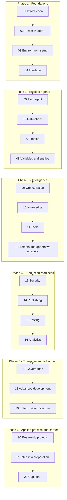

# Course Roadmap — Microsoft Copilot Studio Professional Course

> [!NOTE]
> **Build status (18 November 2026):** Steps 1–4 of the build plan are complete. That covers the repository structure, this roadmap, the glossary, the architecture reference, and **Module 01 in full**. Modules 02–22 have published **syllabus READMEs** and are developed in Steps 5–11. Progress is tracked in [LEARNING-PROGRESS.md](LEARNING-PROGRESS.md).

## 1. Course at a glance

| Item | Detail |
|---|---|
| **Audience** | Complete beginners through professional makers and solution architects |
| **Scope** | Microsoft Copilot Studio only. Power Platform concepts appear only where needed to understand Copilot Studio. |
| **Format** | 22 self-paced modules, each with 8 files (lessons, lab, examples, assessment, answers, interview questions, common mistakes) |
| **Estimated effort** | About 142 hours, including labs, projects, and the capstone |
| **Assessment** | 24 items per module (10 MCQ, 5 true/false, 5 short answer, 2 practical, 1 scenario, 1 troubleshooting) |
| **Grading** | 0–59% Beginner · 60–74% Intermediate · 75–89% Advanced · 90–100% Professional Ready |
| **Accuracy policy** | Every product claim is verified against current Microsoft Learn documentation, and features are labeled 🟢 GA · 🧪 Preview · ⚠️ Deprecated · ⛔ Retired · 💳 Licensing/Region |

## 2. How the course handles the 2026 harness model

Copilot Studio runs what you build on one of three **harnesses** (see [Module 01, Lesson 2](01-Introduction-to-Copilot-Studio/CONCEPTS.md#lesson-2-harnesses-and-the-new-vs-classic-experience)):

- **Standard harness** (🟢 GA, classic experience): topics, trigger phrases, nodes, variables, entities, generative and classic orchestration.
- **Microsoft Copilot harness** (🧪 production-ready preview, the default new experience): skills, memory, workflows, files, connected agents, usage-based billing from build time.
- **Customer Conversation harness** (🧪 Preview): customer voice and chat with escalation to human representatives.

Conversation-design fundamentals (Modules 07–08) exist only on the standard harness, so the core build track teaches the **standard harness first**. Modules that span both harnesses compare them side by side.

| Module(s) | Harness focus |
|---|---|
| 01 | All three (concepts and history) |
| 02 | Harness-independent (Power Platform foundations) |
| 03–04 | Both experiences: setup, licensing implications, full interface tour |
| 05 | Standard harness lab, with a Microsoft Copilot harness comparison |
| 06 | Both |
| 07–08 | Standard harness only |
| 09 | Standard harness generative vs. classic orchestration, plus the Microsoft Copilot harness reasoning runtime |
| 10, 11, 13–17 | Both, with per-harness differences |
| 12 | Standard harness prompts and generative answers; Microsoft Copilot harness skills as the equivalent |
| 18 | Multi-agent, skills, memory, triggers, agent accounts, handoff |
| 19 | Harness-selection strategy and enterprise architecture |
| 20–22 | Each project states and justifies its harness |

## 3. Learning path

## 4. Phase-by-phase plan

**Status legend:** ✅ Complete · 📝 Syllabus published (full lessons pending) · 🔜 Planned

### Phase 1 — Foundations (16 h)

| # | Module | Level | Hours | Prerequisites | Lab | Status |
|---|---|---|---|---|---|---|
| 01 | [Introduction to Microsoft Copilot Studio](01-Introduction-to-Copilot-Studio/README.md) | Beginner | 5 | None | Understand and explore Copilot Studio | ✅ |
| 02 | [Power Platform Fundamentals](02-Power-Platform-Fundamentals/README.md) | Beginner | 4 | 01 | Map the Power Platform building blocks Copilot Studio uses | 📝 |
| 03 | [Environment Setup](03-Environment-and-Setup/README.md) | Beginner | 3 | 02 | Prepare a development environment | 📝 |
| 04 | [Complete Copilot Studio Interface](04-Copilot-Studio-Interface/README.md) | Beginner | 4 | 03 | Guided tour of every section in the new and classic experiences | 📝 |

**Milestone 1 — Foundations:** you can explain the platform, choose a harness, and navigate both experiences.

### Phase 2 — Building agents (21 h)

| # | Module | Level | Hours | Prerequisites | Lab | Status |
|---|---|---|---|---|---|---|
| 05 | [Creating Your First Agent](05-Creating-Your-First-Agent/README.md) | Beginner | 4 | 04 | Create a complete FAQ assistant | 📝 |
| 06 | [Agent Configuration and Instructions](06-Agent-Configuration-and-Instructions/README.md) | Beginner–Intermediate | 4 | 05 | Create a professional customer-support agent | 📝 |
| 07 | [Topics and Conversation Design](07-Topics-and-Conversation-Design/README.md) | Intermediate | 7 | 06 | Build a complete customer-support conversation | 📝 |
| 08 | [Variables and Entities](08-Variables-and-Entities/README.md) | Intermediate | 6 | 07 | Create an agent that collects customer information | 📝 |

**Milestone 2 — Builder:** you can build, configure, and test a structured conversational agent.

### Phase 3 — Intelligence (23 h)

| # | Module | Level | Hours | Prerequisites | Lab | Status |
|---|---|---|---|---|---|---|
| 09 | [Generative AI and Orchestration](09-Generative-AI-and-Orchestration/README.md) | Intermediate | 6 | 08 | An agent that handles multiple user requests | 📝 |
| 10 | [Knowledge Sources and Grounding](10-Knowledge-Sources-and-Grounding/README.md) | Intermediate | 6 | 09 | Build a company knowledge assistant | 📝 |
| 11 | [Agent Tools and Capabilities](11-Agent-Tools-and-Capabilities/README.md) | Intermediate | 6 | 10 | Configure and test an agent using available tools | 📝 |
| 12 | [Prompts and Generative Answers](12-Prompts-and-Generative-Answers/README.md) | Intermediate | 5 | 11 | Build a document-based question-answering agent | 📝 |

**Milestone 3 — Intelligent agents:** you can ground, orchestrate, and extend agents safely.

### Phase 4 — Production readiness (19 h)

| # | Module | Level | Hours | Prerequisites | Lab | Status |
|---|---|---|---|---|---|---|
| 13 | [Authentication and Security](13-Authentication-and-Security/README.md) | Intermediate–Advanced | 5 | 12 | Configure an appropriately secured agent | 📝 |
| 14 | [Publishing and Channels](14-Publishing-and-Channels/README.md) | Intermediate–Advanced | 5 | 13 | Publish an agent to a supported channel | 📝 |
| 15 | [Testing and Debugging](15-Testing-and-Debugging/README.md) | Advanced | 5 | 14 | Debug a deliberately misconfigured agent | 📝 |
| 16 | [Analytics and Monitoring](16-Analytics-and-Monitoring/README.md) | Advanced | 4 | 15 | Analyze an agent and improve its performance | 📝 |

**Milestone 4 — Production-ready:** you can secure, publish, test, and continuously improve agents.

### Phase 5 — Enterprise and advanced (18 h)

| # | Module | Level | Hours | Prerequisites | Lab | Status |
|---|---|---|---|---|---|---|
| 17 | [Agent Management and Governance](17-Agent-Management-and-Governance/README.md) | Advanced | 5 | 16 | Design a governance plan and review environment-level controls | 📝 |
| 18 | [Advanced Agent Development](18-Advanced-Agent-Development/README.md) | Advanced | 7 | 17 | Build a multi-agent solution with a front-door agent and specialists | 📝 |
| 19 | [Enterprise Copilot Studio Architecture](19-Enterprise-Copilot-Architecture/README.md) | Professional | 6 | 18 | Produce an enterprise architecture blueprint | 📝 |

**Milestone 5 — Architect:** you can design governed, multi-agent enterprise solutions.

### Phase 6 — Applied practice and career (45 h)

| # | Module | Level | Hours | Prerequisites | Lab / deliverable | Status |
|---|---|---|---|---|---|---|
| 20 | [Real-World Projects](20-Real-World-Projects/README.md) | Professional | 20 | 01–19 | Ten end-to-end projects | 📝 |
| 21 | [Interview Preparation](21-Interview-Preparation/README.md) | All levels | 10 | 01–19 | 300+ questions with detailed answers | 📝 |
| 22 | [Final Capstone Project](22-Final-Capstone-Project/README.md) | Professional | 15 | 01–21 | Enterprise-grade capstone agent with scored evaluation | 📝 |

**Milestone 6 — Professional Ready:** a capstone score of 90% or more, plus an average module score of 90% or more.

## 5. Suggested learning tracks

| Track | Modules | Best for |
|---|---|---|
| **Full professional path** | 01 → 22 in order | Anyone aiming for "Professional Ready" |
| **Maker fast track** | 01, 03, 04, 05, 06, 07, 08, 09, 10, 11, 14, 15 | Business makers who need to ship a first agent quickly |
| **Architect track** | 01, 02, 09, 10, 11, 13, 14, 16, 17, 18, 19, 22 | Solution architects and CoE leads |
| **Interview sprint** | 01, 02, 09, 10, 13, 17, 19, 21 | Candidates preparing for Copilot Studio interviews |

## 6. Assessment strategy

- **Per module:** 24 items worth 100 points, with full answers, explanations, why wrong options are wrong, expected practical outcomes, and rubrics.
- **Per lesson:** each lesson in a module's CONCEPTS.md ends with a short knowledge check, so every major topic is assessed.
- **Question bank:** the module assessments provide 22 × 24 = 528 items, and Module 21 adds 300+ interview questions. In Step 12, all items are consolidated into a single question bank (well above the 300-question minimum) and validated.
- **Progress:** learners record scores and levels per module in [LEARNING-PROGRESS.md](LEARNING-PROGRESS.md).

## 7. Course build plan (execution strategy)

| Step | Scope | Status |
|---|---|---|
| 1 | Inspect the workspace | ✅ 18 Nov 2026 |
| 2 | Create the course structure (22 module folders + root files) | ✅ 18 Nov 2026 |
| 3 | Generate this roadmap, the [glossary](GLOSSARY.md), the [architecture reference](COPILOT-STUDIO-ARCHITECTURE.md), and module syllabi | ✅ 18 Nov 2026 |
| 4 | Develop Module 01 completely | ✅ 18 Nov 2026 |
| 5 | Develop Modules 02–05 | 🔜 |
| 6 | Develop Modules 06–10 | 🔜 |
| 7 | Develop Modules 11–15 | 🔜 |
| 8 | Develop Modules 16–19 | 🔜 |
| 9 | Develop real-world projects (Module 20) | 🔜 |
| 10 | Develop interview preparation (Module 21) | 🔜 |
| 11 | Develop the capstone project (Module 22) | 🔜 |
| 12 | Generate and validate all assessments and the consolidated question bank | 🔜 |
| 13 | Complete quality review (accuracy, links, Mermaid, status labels) | 🔜 |

**Rules for every step:** work module by module, complete all 8 files before moving on, don't create empty placeholders, re-verify facts against Microsoft Learn ([What's new](https://learn.microsoft.com/en-us/microsoft-copilot-studio/whats-new)), and update this roadmap and [LEARNING-PROGRESS.md](LEARNING-PROGRESS.md).

## 8. Maintenance policy

- Copilot Studio ships changes monthly. Before developing each module, re-check [What's new](https://learn.microsoft.com/en-us/microsoft-copilot-studio/whats-new) and the module's key articles.
- When a feature changes status (for example, from Preview to GA), update the status label everywhere it appears. The [glossary](GLOSSARY.md) is the first place to update.
- Every file ends with a *Last verified* date. Re-verify any file older than six months before teaching from it.

## 9. Change log

| Date | Change |
|---|---|
| 18 Nov 2026 | Course created: structure, roadmap, glossary, architecture reference, learning-progress tracker, Module 01 complete, syllabus READMEs for Modules 02–22. Course design updated for the 2026 harness model (Microsoft Copilot, Customer Conversation, standard). |

## References

- [Overview – Microsoft Copilot Studio](https://learn.microsoft.com/en-us/microsoft-copilot-studio/fundamentals-what-is-copilot-studio)
- [Harnesses in Copilot Studio](https://learn.microsoft.com/en-us/microsoft-copilot-studio/harnesses-overview)
- [FAQ for agents powered by the Microsoft Copilot harness](https://learn.microsoft.com/en-us/microsoft-copilot-studio/agents-experience/faqs-copilot-harness)
- [What's new in Copilot Studio](https://learn.microsoft.com/en-us/microsoft-copilot-studio/whats-new)

_Last verified against Microsoft Learn: 18 November 2026._
